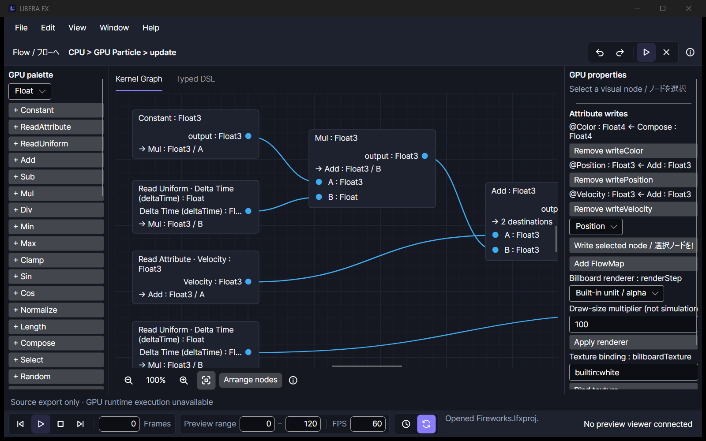

  

<h1 align="center">LIBERA FX</h1>

<strong>Author effects in graphs. Play them in-engine.</strong>

<h3 align="center">Hello, new beginning.</h3>

  

  Real-time VFX, reimagined from the ground up—a lightweight, node-driven studio built for clarity, speed, and freedom.

<h3 align="center">Hello, total control.</h3>

  <a href="docs/images/gpu-kernel-update.png">
     GPU Particle > update, showing connected math nodes, GPU palette, and attribute writes">
  </a>

  From Signals and curves down to visual GPU kernel graphs and attribute writes—control every parameter, every frame, and every particle.

<h3 align="center">Hello, pure creativity.</h3>

  

  From CPU and GPU particles to reusable groups, turn complex visual ideas into clean node graphs.

<h3 align="center">Hello, your new buddy.</h3>

  

  AI-native with built-in <strong>MCP</strong> and in-editor <strong>AI Chat</strong>—ready to inspect graphs, propose edits, and build alongside you.

<h3 align="center">Unity · Unreal Engine · Godot</h3>

  Preview update: GPU 2D smoke and dye, nested Spawnables with CPU particles, and direct engine rendering. 
  Upgrade guide: <a href="docs/site/preview-update.md">English</a> / <a href="docs/site/ja/preview-update.md">日本語</a>

  Production workflow (Unity / Unreal / Godot): <a href="docs/site/production-workflow.md">English</a> / <a href="docs/site/ja/production-workflow.md">日本語</a> 
  Batch converter: <a href="docs/site/batch-conversion.md">English</a> / <a href="docs/site/ja/batch-conversion.md">日本語</a>

  <a href="https://github.com/Libra-Works/LibraFX/releases">Downloads</a> ·
  Documentation:
  <a href="https://libra-works.github.io/LibraFX/" lang="en">English</a> /
  <a href="https://libra-works.github.io/LibraFX/ja/" lang="ja">日本語</a> ·
  <a href="LICENSE">MIT License</a>

