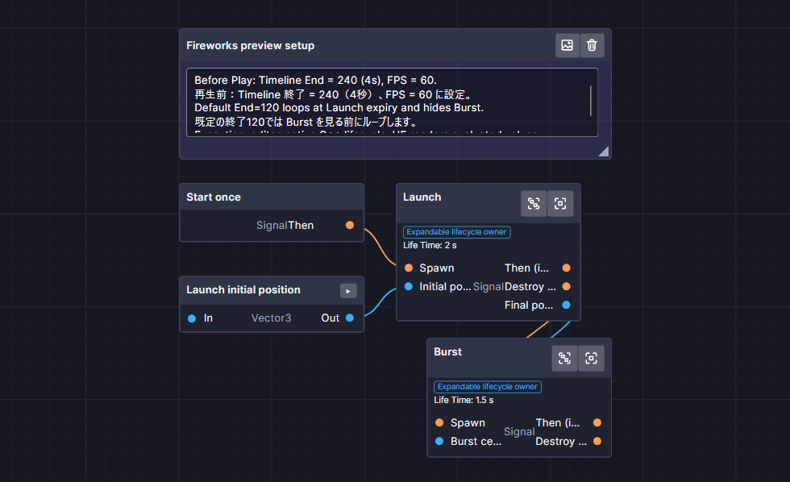

  

<h1 align="center">LIBERA FX</h1>

<strong>グラフでつくる。ゲームの中で動かす。</strong>

Unity · Unreal Engine · Godot

  <a href="docs/getting-started.md">入門</a> ·
  <a href="docs/sdk-distribution.md">SDKの導入</a> ·
  <a href="https://github.com/Libra-Works/LibraFX/actions/workflows/build.yml">ビルド</a>

LIBERA FXは、ゲーム向けのリアルタイムエフェクトをノードグラフで作るツールです。
値の計算、発生や停止を伝えるSignal、エフェクトの寿命をグラフで組み合わせます。
グラフをコンパイルし、接続先のエンジンで再生・描画します。

*同梱の花火サンプル。LibraDarkで表示した実際のグラフ編集画面です。*

## はじめに

1. [入門](docs/getting-started.md)に沿って、同梱の花火サンプルを開きます。
2. [小さな実例](docs/small-example.md)で、Signalからエフェクトが生まれ、終了するまでを確認します。
3. [SDKの導入手順](docs/sdk-distribution.md)から利用するエンジンを選び、コンパイル済みのエフェクトを再生します。

エディターには、分岐できる編集履歴、再利用できるグラフグループ、保存済みグラフの左右比較があります。
ファイル同士の比較にGitは不要です。[ドキュメント一覧](docs/README.md)に詳しい使い方があります。

## ビルドとSDK

エディターは .NET 10／Avalonia、共通ランタイムは C++ です。
[Build LIBERA FX and SDKs](https://github.com/Libra-Works/LibraFX/actions/workflows/build.yml)でビルドを確認できます。
ダウンロード用成果物は、リポジトリにアクセスできる状態で **Run workflow** を実行すると保存されます。

| 成果物 | 内容 |
| --- | --- |
| **LibraFX** | エディターとコンバーター。Windows x64、macOS Apple Silicon（署名なし `.app`）、Linux x64向け。 |
| **LibraSDK** | エンジンに依存しないC++ランタイムのソースと公開ヘッダー。 |
| **LibraForUnity** | [Unity用SDK](Runtime/Integrations/Unity/USAGE.txt)とWindows x64向けネイティブDLL。 |
| **LibraForUnreal** | [Unreal Engine用SDK](Runtime/Integrations/Unreal/USAGE.txt)とソースプラグインのインストーラー。 |
| **LibraForGodot** | [Godot用SDK](Runtime/Integrations/Godot/USAGE.txt)とGodot 4.7向けWindows x64 GDExtension。 |

ビルド成果物には `年.月.ビルド番号` が付きます。CIでのビルドと、各エンジン・OSでの起動や描画の確認は別です。
対応範囲と実機確認状況は[SDKの導入と配布](docs/sdk-distribution.md)を参照してください。
