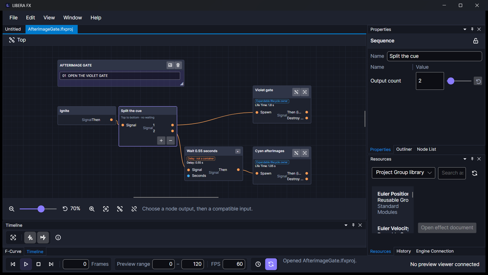
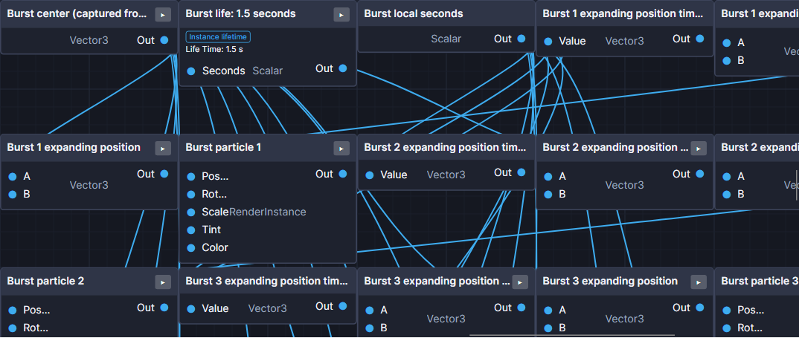
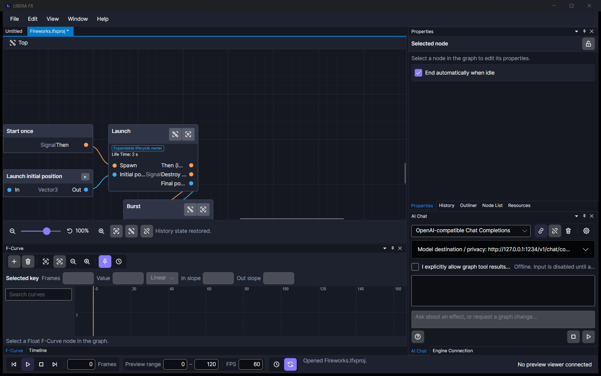

  

<h1 align="center">LIBERA FX</h1>

<strong>Author effects in graphs. Play them in-engine.</strong>

### Hello, new beginning.

  

Real-time VFX, reimagined from the ground up—a lightweight, node-driven studio built for clarity, speed, and freedom.

### Hello, total control.

  <a href="docs/images/gpu-kernel-update.png">
     GPU Particle > update, showing connected math nodes, GPU palette, and attribute writes">
  </a>

From Signals and curves down to visual GPU kernel graphs and attribute writes—control every parameter, every frame, and every particle.

### Hello, pure creativity.

  

From CPU and GPU particles to reusable groups, turn complex visual ideas into clean node graphs.

### Hello, your new buddy.

  

AI-native with built-in **MCP** and in-editor **AI Chat**—ready to inspect graphs, propose edits, and build alongside you.

<h3 align="center">Unity · Unreal Engine · Godot</h3>

  <a href="https://github.com/Libra-Works/LibraFX/releases">Downloads</a> ·
  Documentation:
  <a href="https://libra-works.github.io/LibraFX/" lang="en">English</a> /
  <a href="https://libra-works.github.io/LibraFX/ja/" lang="ja">日本語</a> ·
  <a href="LICENSE">MIT License</a>

