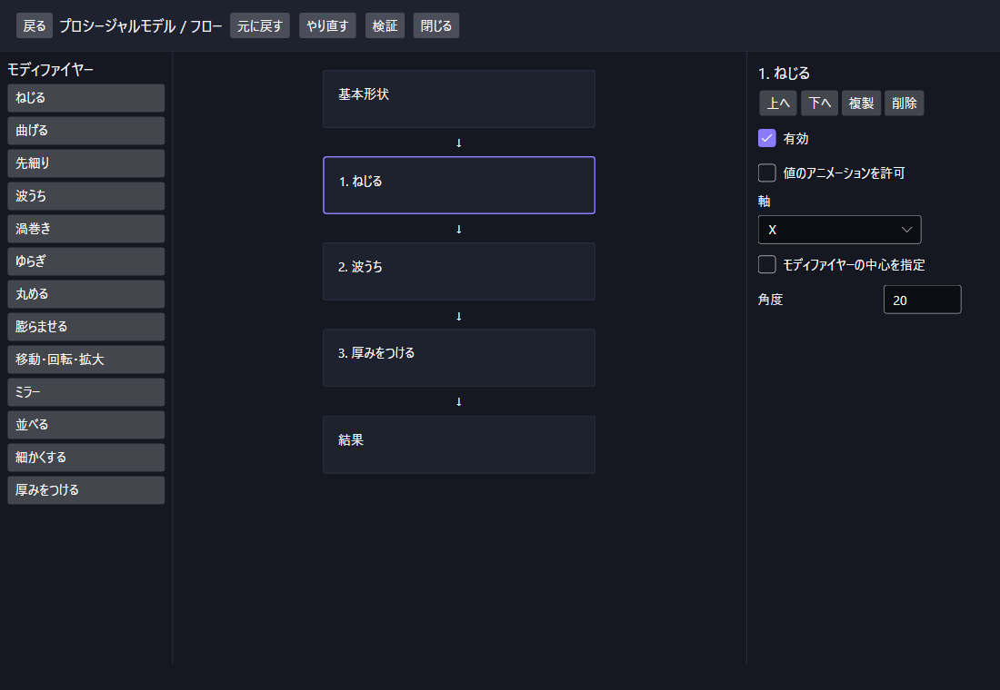
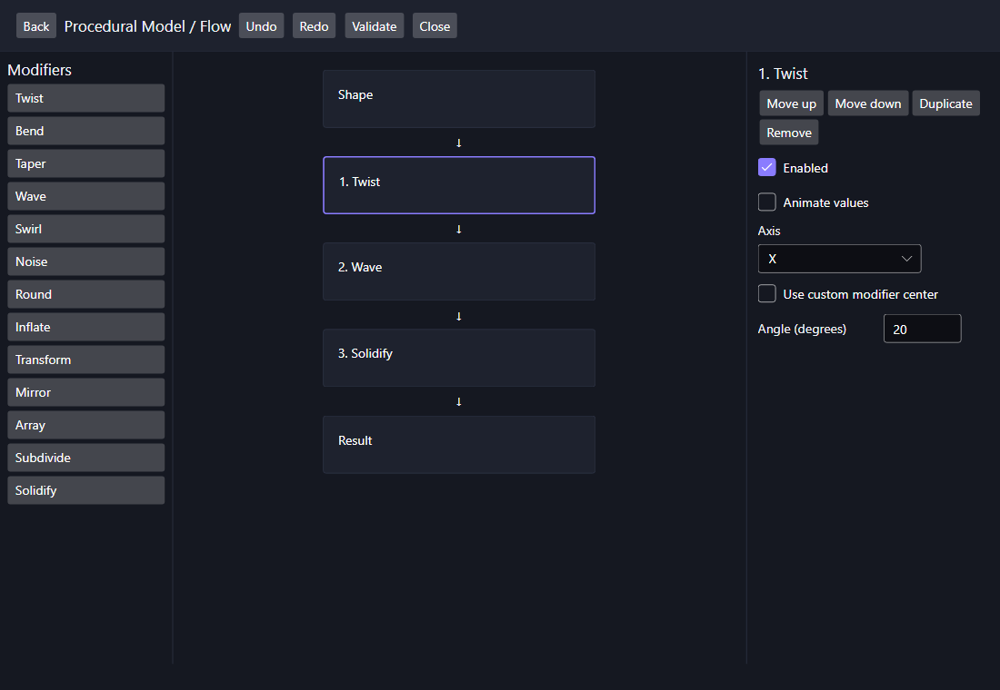

# Procedural resources / プロシージャルリソース

## 日本語

ノード一覧の「プロシージャル」から、プロシージャルモデル・テクスチャー・マテリアルを追加します。ノードをダブルクリックすると、Particle と同様にメイン画面内の Flow 編集へ切り替わります。左の一覧で処理を追加し、中央のカードを選んで右側の設定を編集します。モディファイヤーは上から順に適用されます。並べ替え・複製・削除と Undo/Redo に対応しています。

モデルの出力を既存の `Model Draw` の `proceduralModel` に接続します。テクスチャーはマテリアルの `texture0` ～ `texture3` に接続し、マテリアルの Texture Sample 処理で参照します。マテリアルの出力は同じ Draw の `proceduralMaterial` に接続します。メッシュや画像を各エンジンへインポートする必要はありません。

モデルの最初のカードで形状・分割数・サイズ・ピボットを変更できます。ピボットは変形前の形状から決まり、アニメーション中も勝手に中心へ移動しません。頂点を指定する場合は、変形前の形状に存在する頂点番号を使います。

**静的な生成物は、エフェクトをまたいで共有します。** ノード ID や編集用の名前を除き、生成設定と参照テクスチャーの設定全体が一致するものを照合します。ハッシュが衝突しても、設定全体の比較で区別します。たとえば、同じ設定で作った丸いグローは、それぞれのエフェクトで別々に GPU テクスチャーを作りません。テクスチャーはリニアの RGBA16F で、画像ファイルの圧縮は介しません。Time・移動するノイズ・外部からの数値接続などがある生成物は、各インスタンスの時刻や値を守るため個別に管理します。

共有物は最後の利用者が解放すると破棄されます。参照する生成物も必要な間は保持します。共有キャッシュの登録数は 256 件までです。静的な生成物は値が変わらなければ再ディスパッチせず、通常のテクスチャー再生で CPU への読み戻しは行いません。

`Assets/Samples/ProceduralSlash.lfxproj`、`ProceduralShockwave.lfxproj`、`ProceduralBeam.lfxproj` は外部アセット不要のサンプルです。見た目の最終確認には各エンジンのプレビューを使います。

上限はモデル 16 モディファイヤー、静的モデル 65,536 頂点・131,072 三角形、アニメーションモデル 16,384 頂点・32,768 三角形です。テクスチャーは標準 256²、最大 1024²、32 処理、ノイズ 8 オクターブ、マテリアルのテクスチャー参照は 4 つまでです。上限超過はエラーになり、形状の切り捨てやアニメーションの自動停止では回避しません。初期のマテリアルは Unlit、Alpha/Additive、両面/片面に対応します。

## English

Add a Procedural Model, Texture or Material from the Procedural palette. Double-click a producer to enter its Flow workspace in the main window. Add operations from the left palette, select a central card, and edit its properties in the right inspector. Model modifiers execute from top to bottom. Reorder, duplicate, remove and Undo/Redo are supported.

Connect the model to the existing Model Draw's `proceduralModel` input. Connect textures to a material's `texture0`–`texture3` inputs and sample them with Texture Sample operations. Connect the material to the draw's `proceduralMaterial` input. No imported engine mesh or image is required.

The source card controls the shape, tessellation, size and pivot. Pivots resolve against the undeformed source and remain stable during animation. Vertex anchors reference the original source topology.

Identical static resources share their retained mesh or GPU output across effects. Keys omit authoring IDs and names, include effective settings and dependency identities, and compare complete settings after hashing. Static round glows therefore share a linear RGBA16F texture without image-file compression. Time-dependent operations and connected numeric inputs retain independent instance state. Static unchanged outputs do not dispatch again; normal animated texture playback performs no CPU readback.

The cache holds at most 256 weak entries. Active consumers retain leases, including dependency leases. The last consumer releases the resource; idle cache entries do not retain GPU allocations.

The three `Assets/Samples/Procedural*.lfxproj` projects demonstrate a slash, shockwave and beam. Use the engine preview for final appearance. Model limits are 16 modifiers, 65,536 vertices / 131,072 triangles for static output and 16,384 vertices / 32,768 triangles for animated output. Pixel graphs allow 32 operations, 8 noise octaves and 4 sampled textures. Texture resolution defaults to 256² and is bounded at 1024². Over-budget configurations report errors. Initial materials support unlit Alpha/Additive rendering and single/double-sided geometry.

## Node definition metadata

Node parameter definitions accept `"hidden": true`. Such parameters remain persisted and available to compilation and tooling, while generic inline editors, inspectors and group-parameter publishing exclude them. IDs remain stable storage keys; display names remain readable labels.

Procedural producers use the bounded `proceduralState` parameter type for their internal Flow data (maximum 64 KiB of recipe text). Earlier procedural snapshots using the `string` type remain readable. Numeric stage blocks are hidden parameters with stable input IDs and localized, readable port labels; the Flow inspector exposes their meaningful individual controls.

## Validation status

Local checks passed on Windows for portable geometry and cache identity/lifetime; managed authoring, history, persistence and Flow editing; Unity 7000.0.0a16 with D3D11; Godot 4.7.2 with Vulkan; and Unreal 5.7 with D3D11. Engine checks captured generated models, animated frames and disappearance after Stop. Unity also verified actual GPU output identity, static dispatch suppression, independent animation and dependency lifetime. Exported-player/cook acceptance is not established by these editor-host checks.

UE 5.8 and UE 5.9 remain intended compatibility targets. Further checks for those versions were stopped at the user's request; they are not certified by the 5.7 result.
