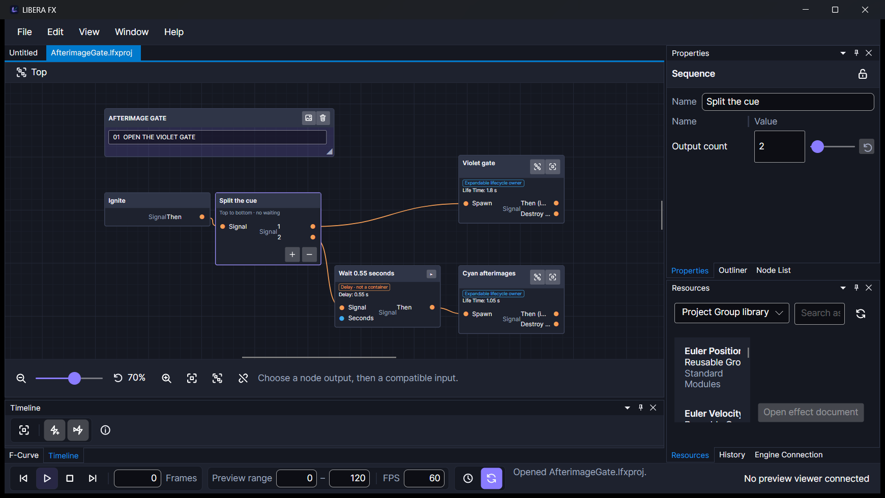

# Read Afterimage Gate

Open `Assets/Samples/AfterimageGate.lfxproj` to follow a violet ring and later cyan
afterimages. Learn **Sequence, Delay, Spawnable Group, Time and Life Time**.
Try [the fountain](first-fountain.md) first if you are new to particles.

The graph can be read without an engine. Its supplied model references target Unreal;
the rendering steps below use Unreal's dedicated preview.

## 1. Follow the two Signals

1. Open the sample and use **File → Save As** to keep your own copy.
2. Find **Ignite**, then follow its Signal into **Sequence**.
3. One branch creates the violet ring. The other passes through **Delay**, set to
   `0.55` seconds, before creating the cyan afterimages.
4. Open each Spawnable Group. **Time** starts when that instance is created;
   **Life Time** sets its emission/lifetime deadline.

This image shows the editor graph, not engine rendering.

## 2. Compare the timing

Change only Delay, then replay the same range. The second cue moves while the first
remains unchanged. Undo to compare. Use `Ctrl+P` to find a node if you lose your place.

## 3. Preview in Unreal

Install the [Unreal SDK](production-workflow.md#unreal). Open
**Window → LIBERA FX Preview → Connect to Libra**. Set the timeline to **60 FPS**,
**End = 144**. Play or scrub; around frames **54–63**, both parts can be seen together.
Frame the ring face-on.

The live preview uses Unreal's stock Sphere and an explicit preview material.
Offline `.lfxb` playback needs engine asset bindings; the transient preview material
is not an exported Unreal asset.

Continue with [Graph fundamentals](authoring.md) or [Connect and deliver](production-workflow.md).
