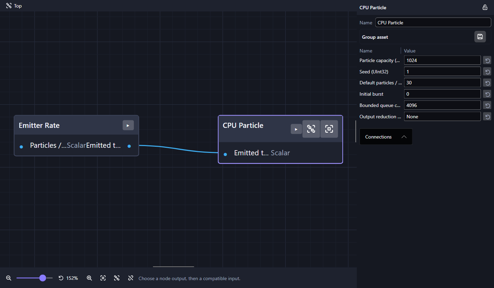
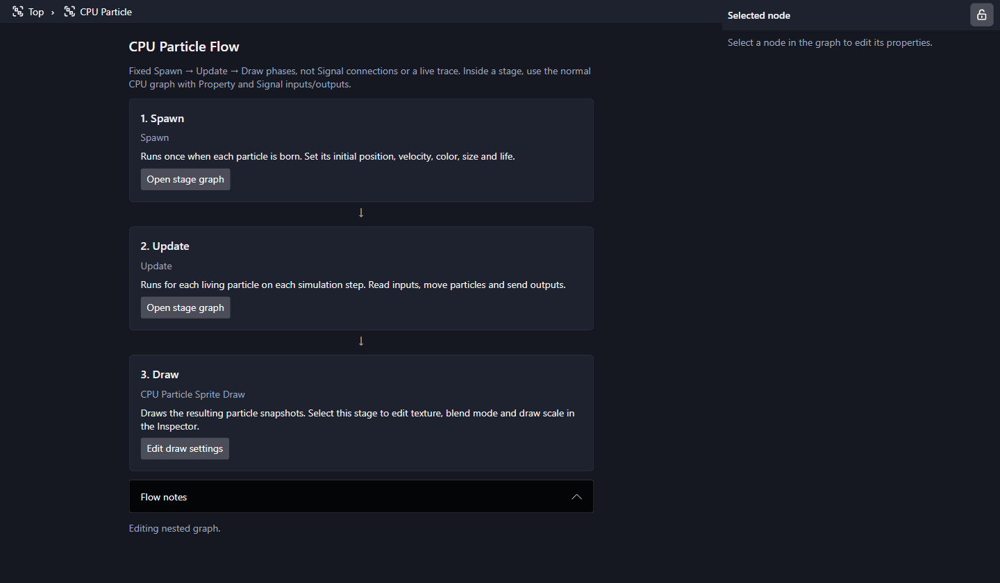
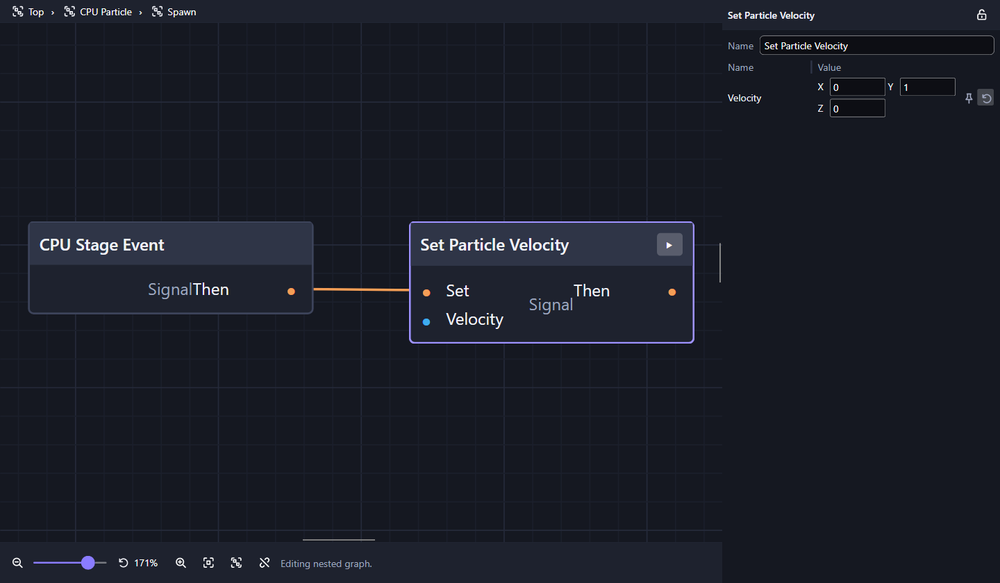
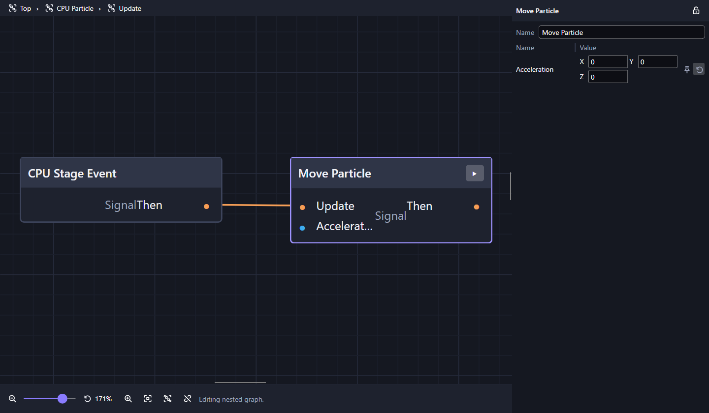
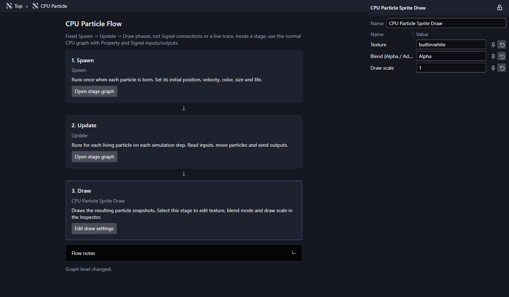

# CPU particles and emitters

> Requires the matching updated editor, converter, native library and engine adapter sources.
> The earlier 2026.11.8 SDK does **not** include this feature. Use matching updated
> packages from [Preview releases](https://github.com/Libra-Works/LibraFX/releases).
> Build and regression results do not establish engine playback, UI usability or rendered pixels.

## Follow the five editor views

These are real editor captures of an isolated example, not engine-rendered
particles. Open an image at full size to read the pins and Inspector fields.
The Flow overview below is newer source than the published 2026.11.22 Preview;
that Preview still shows the three structural nodes.

### 1. Parent graph: connect emission

Connect **Emitter Rate → Emitted total** to **CPU Particle → Emitted total**.
The selected CPU Particle Inspector sets capacity, seed, initial burst and queue
capacity. With this connection, the emitter's rate replaces the container's
default rate; the two rates are not added.

[](images/editor/cpu-particles-root-en.png)

### 2. Inside CPU Particle: choose the editing scope

Open CPU Particle to find the **Spawn → Update → Draw** Flow cards, matching the
GPU overview's stage-oriented presentation. Use **Open stage graph** on Spawn
or Update; use **Edit draw settings** on Draw for the existing Inspector.
This is a fixed simulation-phase order, not Signal connections, a live trace,
or support for arbitrary extra passes. Property and Signal wiring remains free
inside the ordinary CPU stage graphs. **Flow notes** retains existing comments
and lets you add/edit notes through normal undo history.

[](images/editor/cpu-particles-stages-en.png)

### 3. Spawn: set initial values once

The initial **CPU Stage Event → Set Particle Velocity** chain gives each newborn
particle velocity `(0,1,0)`, visible in the Inspector. To add initial position,
color or life, chain their setters along the orange Signal wire. Merely placing
an unconnected setter does not execute it.

[](images/editor/cpu-particles-spawn-en.png)

### 4. Update: move each living particle

**CPU Stage Event → Move Particle** runs for the current particle at each
simulation step. The Inspector controls acceleration and drag. The screenshot
uses the defaults; for downward acceleration, change its acceleration rather
than repeatedly changing the initial velocity in Spawn. Breadcrumbs at the top
show that you are editing the Update child graph.

[](images/editor/cpu-particles-update-en.png)

### 5. Sprite Draw: choose appearance for the entire pool

Return to Flow and choose **Edit draw settings** on **Draw**. The Inspector shows
the texture, Alpha/Additive blend mode and draw scale. `builtin:white` selects
the built-in white texture explicitly; it is not an unresolved asset fallback.
This screen configures rendering but does not display engine playback.

[](images/editor/cpu-particles-draw-en.png)

### Does ordinary Draw create more MeshComponents?

The published **2026.11.22 Preview** uses Unreal MeshComponents for ordinary
Draw and one InstancedStaticMeshComponent per CPU particle system, not per
particle. The renderer migration in newer source removes those draw components:
the effect host owns native rendering data and compatible batches. Unity uses
direct drawing, Unreal native primitives/proxies, and Godot RenderingServer
instances. The effect-level playback Component/Node remains.

Removing scene components does not remove mesh/material resources or guarantee
one draw call. Different materials, shader parameters and transparent ordering
can require separate submissions. Particle data, CPU work, memory, overdraw and
transfer costs still scale with the content. See the
[engine rendering boundary](engine-integration.md#rendering) before comparing
the released Preview with a newer source build.

## Authoring a moving Sprite cloud

Add **CPU Particle** from **CPU Particles**, open it, then open its **Spawn** or
**Update** child graph. These are ordinary CPU graphs, not GPU-language kernels.
They retain normal node UUIDs, connections, parameters, graph history, copy/paste
and document persistence. Navigation does not itself add an undo step.
Flow projects the existing stage identities without migrating the graph format:
old projects, nested edits, boundary ports and undo branches keep their data.

The initial Spawn graph sets velocity to `(0,1,0)`. The initial Update graph
connects **CPU Stage Event → Move Particle**. Each particle starts at the origin,
white, size `(1,1)`, age zero and life two seconds. Change initial attributes in
Spawn with Signal setters. In Update, chain setters or Move Particle from the
stage event; Move uses semi-implicit Euler:

```
velocity += acceleration * stepDelta
position += velocity * stepDelta
```

Attribute readers sample the stage's input state; they are not implicit live
memory reads after each setter. **Particle Step Delta** exposes the simulation
substep (zero at birth); the ordinary Frame Delta node retains the host game-frame
delta. Spawn executes once, and Update executes once per
positive simulation step (also once with delta zero at birth). A particle whose
age reaches its life is removed before that step's Update.

The sibling **CPU Particle Sprite Draw** renders the pool as a batch, not one
engine actor/component per particle. Select a texture explicitly (`builtin:white`
is an explicit built-in resource), Alpha/Additive and positive draw scale.
Position and XY size are effect-local; draw scale affects both. In the migrated
source, Unity directly submits a reusable combined mesh per emitter, Unreal uses
native instanced primitives, and Godot bulk-uploads MultiMesh data through
RenderingServer RIDs. There is no per-particle scene object. Per-particle RGBA
and XY size are retained; there is no per-particle transparent sorting. These
renderer changes do not update previously downloaded 2026.11.22 SDKs.

Unreal requires the instanced-RGBA Sprite material documented in its adapter
`USAGE.txt`; that material is **not supplied** by this implementation. A missing
or incompatible material fails visibly instead of rendering a placeholder.

## Emission and deterministic shapes

Set capacity, system UInt32 seed, default rate and initial burst on CPU Particle.
If **Emitted total** is connected, its cumulative count replaces the default rate
(initial burst still applies).

* **Emitter Rate** accumulates particles/second, carrying fractional counts.
* **Emitter Burst** accepts ordinary Signals. Each arrival adds its fixed count.
  Add Rate and Burst cumulative outputs to combine them.
* **Emitter Box Position** samples half extents; **Sphere Position** samples the
  sphere volume; **Circle Position** samples the XY circumference. Connect a
  shape to Set Particle Position in Spawn. A constant position is a point emitter.

Shape sampling uses system seed plus stable particle ID, never a global RNG.
Particle ID and Seed outputs also connect to the deterministic Random family
SampleIndex/Seed inputs. IDs are monotonic nonzero UInt32 values within an effect
playback and are never reused when a pool slot is recycled. Exhaustion is an error.
Results are deterministic for the same graph, seed and simulation-step sequence;
arbitrary frame partitions are not promised to produce identical trajectories.

## Ordinary Property and Signal boundaries

Inside either stage, add named Particle Input/Output Float, Vector3 or Vector4
nodes. These become container pins. Other numeric types can use explicit ordinary
CPU conversions; Matrix/Int32/Color/Vector2 boundary specializations are not
provided yet. CPU arithmetic, comparisons, Signal capture and ordinary supported
custom nodes remain VM nodes with per-particle state.

Input Properties are copied once per system step and shared consistently by all
particles in that step. Spawn inputs are capture-at-birth; Update inputs are live.
Put **Particle Input Signal** in **Update**. Each outer arrival is a bounded FIFO
message broadcast to all particles processed by the next step (including births
in that step). Spawn is not an ongoing external event scope.

Output Properties and Signals enqueue identity-bearing messages:

```
systemId, nodeId, particleId, time, kind, width, values[4]
```

They survive death in the same step. External code reads them using
`SpawnableHost::popCpuParticleEvent`, the matching C ABI, or the adapters' exposed
event-drain API. **Consumers must drain this bounded queue**; capacity exhaustion
returns an error, never silently drops messages. No engine SDK callback runs on
the simulation worker.

Connecting many particles to a single outer Property is rejected unless the
container explicitly selects `outputReduction = LastById`. This chooses the
highest particle ID, not arbitrary slot/evaluation order. Such reductions and
outer Signal routes are delivered on the following simulation step. Read the
scoped event API when every individual value/identity matters. Feedback is
therefore queued rather than recursively re-entering the particle VM.

## Limits, ownership and compatibility

* Root and ordinary Graph Group CPU systems are supported. CPU inside Spawnable
  Group, nested CPU/GPU containers inside stages, stage Draw nodes and deferred
  lifecycle nodes (`Delay`, `LifeTime`, etc.) fail compilation explicitly.
* Sprite billboard is the renderer implemented here. Mesh Draw, Cone shape,
  collision, trails and particle-specific external targeted Signal delivery are
  not implemented. Incoming graph Signals are broadcast, not targeted by ID.
* A direct outer Signal connection preserves the input you wired, including
  named inputs such as Reset. The compiler inserts a relay in the exported
  program; you do not need to add one to the graph.
* Particle capacity and all queue capacities are fixed by the author. Full
  particle pools, excessive requested emission, memory limits or queue exhaustion
  fail visibly; updates before a failure are not transactionally rolled back.
  Restart the effect after correcting the resource/graph configuration.
* The whole-effect host owns contiguous work/default slabs and particle slots.
  CPU particle stepping does not allocate per particle/node/frame after creation.
  This is not a claim that unrelated existing Spawnable host paths never allocate.
* Time is monotonic. Seeking backwards requires recreating playback; no silent
  rewind/reset. Natural end stops emission and drains surviving particles;
  Stop/Force clears particles and queued CPU notifications.
* CPU effects use the existing `LFXP` envelope **format 4 / package 12**, adding a
  little-endian numeric CPU payload version 1. Non-CPU effects retain format 3 /
  package 11. Updated readers retain legacy package reads; old readers reject
  CPU packages rather than silently discarding them.
* Render metadata adds `cpuParticleVersion: 1` and `cpuParticles`. Native snapshot
  ABI is 80 bytes; scoped event ABI is 88 bytes. Existing stable node IDs and
  existing value ABI are unchanged.

The standalone converter exports CPU systems without editor startup. Its existing
GPU rejection is retained. Focused authored regressions cover graph/package
contracts and native pools. Compiler-produced fixtures additionally exercise
native execution; these checks do not replace engine rendering acceptance.
