[Home](index.md) · [Graph authoring](authoring.md) · [Built-in nodes](node-reference.md)

# Editor Window and Panel Reference

New to the editor? Follow the [workspace tour](workspace-tour.md) first. Use this page to find a panel by task or menu name.

See [editor terms](glossary.md#editor) for dock, inspector, outliner, and MCP.

Most editor tools are dockable panels rather than separate windows. Open them from
**Window** or **View**. Panels that read the graph normally follow the active
document tab. Menu names use the English UI. Captions identify localized captures. Screenshots show
the editor with bundled sample data, not engine rendering.

[Workspace and editing](#workspace-and-editing) · [Animation](#animation) ·
[Engine connection and diagnostics](#engine-connection-and-diagnostics) ·
[First launch and settings](#first-launch-and-settings)

On this page

* TOC
{:toc}

## Authoring workspace

| Screen | Where to find it | How to use it |
| --- | --- | --- |
| Main window and document tabs | **File → New / Open** | Open multiple graphs, switch tabs, save the current document, and use **Save As** for an experimental copy. Docking a tool elsewhere does not change the document. |
| Graph canvas | Open a document | Place nodes, connect compatible pins, and enter a Group to see its child graph. Use the breadcrumb to return to the parent. See [Graph authoring](authoring.md). |
| Reroute | Right-click a connection → **Add reroute** | Insert a routing point without changing the connection semantics. Signal outputs still allow only one destination. Undo restores the original connection. |
| Search anything | **Edit → Search anything** or `Ctrl+P` by default | Search across commands, nodes, and assets. Use the arrow keys to select a result and Enter to run or open it. |
| Outliner | **Window → Outliner** | Browse graph nodes and select one without locating it manually on the canvas. |
| Node List | **Window → Node List** | Search and drag nodes onto the graph. The catalog includes built-ins and definitions from the active project, not every known project definition. |
| Properties and inspectors 1–4 | **Window → Inspectors** | Edit the selected node's values, options, and connections. Use the lock beside the node name to lock or unlock its parameters. Open another slot to keep a second inspector available. |
| F-Curve | **Window → F-Curve** | Edit numeric animation keys and interpolation. Choose the channel or curve first, edit its keys, and use the shared playhead to inspect timing. |
| Timeline | **Window → Timeline** | Set playback range, scrub or step, and author timed Signal keys. Preview playback and the F-Curve pane share the playhead. A preview loop does not define runtime lifetime. |
| Playback controls | Timeline and workspace transport | Play, pause, seek, or step. Use the engine connection status to distinguish moving the playhead from successfully displaying a frame in an engine. |
| Color editor | Open a color control in the inspector | Edit color channels and alpha. Editable color curves, where exposed, are opened from the corresponding curve control. |
| GPU workspace | Double-click a GPU Particle node | Edit Spawn and Update kernels or billboard settings. See [GPU Particle Authoring](gpu-particles.md) for the separate workflow. |
| Procedural workspace | Double-click a Procedural Model, Texture or Material | Edit the producer's ordered Flow in the main window. Connect its output to Model Draw; see [Procedural resources](procedural-resources.md). |
| Effect settings | **Effect settings** button on the root graph toolbar | Open the flyout and change **End automatically when idle**. The setting is available from the root graph, not nested graphs. |
| Sprite Animation | **Window → Sprite Animation** | Author sprite animation and composition data using the atlas, cells, and timeline. Previewing a composition in this pane is different from drawing a compiled package in an engine. |
| Graph Problems | **Window → Graph problems** | Review graph diagnostics while editing. Resolve missing or incompatible definitions and connections before retrying compilation. |
| History | **Window → History** | Browse the edit history as a branching tree, select a state to navigate, and pin useful states. Editing after moving back creates a branch; this does not create a Git commit. |

Select a connection by clicking its wire; Ctrl-click toggles individual wires and
nodes. Drag a selection box across nodes or wires to select them; hold Ctrl to
extend the selection. Delete removes the selected nodes and wires in one undoable
edit. Right-click a selected wire and choose **Add reroute** to insert a routing
point on each selected wire. During a drag, affected wires are drawn above the
nodes, including outside an expanded child canvas; settled wires stay below nodes.

The breadcrumb bar shows the document and its graph or workspace path. Use
**Back** and **Forward** to revisit graph, GPU and procedural locations, or click
a segment to return to it. Navigation does not add an edit to History.

For MCP, `libera_graph_read` lists node IDs and connection port IDs.
`libera_graph_insert_reroute` inserts a point on the specified connection;
`libera_graph_remove_reroute` removes a connected point and reconnects its source
and destinations. Both edits can be undone. Use the exact IDs returned by the graph.

## Projects, assets, and shared groups

| Screen | Where to find it | How to use it |
| --- | --- | --- |
| Local projects | **Window → Local projects** | Find local effect project files and open them as documents. Use Settings for team/project profiles, which control node and group directories. |
| Content / engine assets | **View → Content** | Browse assets for the selected source or project. Where supported, drag a typed asset onto a compatible graph target or assign it through the inspector. A matching filename does not establish a binding. |
| Resources | **Window → Resources** | Inspect the active effect's resources and their engine references; use the resource action appropriate to the selected item. |
| Asset References | From an asset or resource's reference action | Inspect use sites before replacing a binding. Separate reported references from assets that merely look similar across sources. |
| Resource Identity | From resource or binding details | Inspect the binding's source and engine identifier. Preserve portable identity rather than substituting a machine-specific file path. |
| Configure Group Items | From a Group's inspector | Select the parameters or ports that should appear at the group boundary. Instances can edit exposed values without editing a locked shared asset. |
| Group Updates | When linked Group assets have available updates | Review versions and explicitly decide whether to update the selected instances or retain their saved revisions. |
| Revision history and graph diff | **Edit → Revision history and graph diff**, or from the resource version control action | Inspect Git-backed revisions and compare graph changes. This is separate from the editor's undo history. |
| Compare graph files | **Edit → Compare Graph Files** | Select saved graph files and inspect the comparison. Opening a diff does not merge or modify either file. |

## Engine connection, diagnostics, and assistance

| Screen | Where to find it | How to use it |
| --- | --- | --- |
| Engine Connection | **Window → Engine Connection** | Check preview transport and client status. The runtime debugger area can start or disconnect a supported CPU debug session, toggle breakpoints, and pause, step, resume, or locate the current node. Keep debug invitations private. |
| Preview connections | **View → Preview connections** | Manage authorized preview connections and inspect connected clients. A connected client or accepted transfer is not proof of rendering. Preview invitations are separate from debugger invitations. |
| Native preview profiler | **View → Native preview profiler** | Inspect timing samples and cost/history charts from the native preview. These timings do not benchmark other engines or target platforms. |
| Live Game Instances | **View → Live Game Instances** | Work with a connected, opted-in game session. Check the target instance and connection state before sending changes; this is separate from ordinary asset export. |
| Log | **View → Log** | Read recent editor messages when graph compilation, resource binding, or preview does not behave as expected. Check for private paths before sharing logs. |
| Crash Reports | **View → Crash Reports** | Review locally available crash information before choosing what to copy or share. |
| MCP | **View → MCP** | Inspect the local editor tool connection and setup information. Keep connection credentials private; external clients can use the bundled operator guide. |
| AI Chat | **View → AI Chat** | Configure a supported chat connection, review graph context or attached references, and inspect any proposed edit before approving it. Sending a prompt and approving a graph edit are distinct actions. |

## Settings, layouts, and dialogs

| Screen | Where to find it | How to use it |
| --- | --- | --- |
| Settings → Appearance | **Edit → Settings** | Set the editor language and node-name language independently, then choose the theme and accent. These settings do not rename nodes saved in a project. |
| Settings → Shortcuts | **Edit → Settings** | Inspect or change command bindings and graph/curve navigation controls. The shortcuts in these docs refer to defaults. |
| Settings → Servers | **Edit → Settings** | View or change the editor's MCP and preview ports. Update the corresponding client connection when needed. |
| Settings → Projects | **Edit → Settings** | Choose a profile and supply its node directory and group asset directory. Switching profiles changes future discovery, not the contents of open graphs. |
| Settings → Inspectors / Extensions | **Edit → Settings** | Manage extensions, inspector providers, default inspectors, and plugin commands. Review the trust prompt before enabling third-party code. |
| Window layouts | **Window → Window layouts** | Save, select, or manage docking presets, or restore the default layout from the layout menu. Layout changes do not edit the effect graph. |
| Startup setup | During initial setup | Choose the initial editor settings when prompted. These can be reviewed later in Settings. The splash screen only indicates startup. |
| Unsaved changes | Closing a modified document or workspace | Choose whether to save changes, discard them, or cancel the close. File open/save/export dialogs select the destination or source; the editor's VFX export creates an `.lfxp` package. |
| Getting started / About | **Help** menu | Open built-in help or check application details. See [Engine integration](engine-integration.md) for installing the current release SDK. |

Specialized confirmation dialogs appear inside these workflows, for example when
trusting an inspector provider, managing resource or sprite data, reviewing a
chat action, or copying diagnostic details. Review the selected target and action
before accepting. Operating-system file pickers vary by platform.

## Workspace and editing

### Main window and graph

1. **Document tabs:** select `Fireworks.lfxproj` to edit the sample rather than the adjacent untitled graph. For your own experiment, use **File → Save As** before editing the sample.
2. **Graph canvas:** read Signal edges in execution order. In Fireworks, **Start once** initiates **Launch**. The child-graph button opens the nested graph at full size; **Top** in the breadcrumb returns to the root. The zoom and framing controls only change what you see.
3. **Tool tabs:** use the right-side tabs to switch between Properties, History, Outliner, Node List, and Resources without leaving the active document. Docking and resizing the panels do not change the graph.
4. **Transport:** the bottom bar shows the current frame, preview range, FPS, loop state, and whether a preview viewer is connected. It is not a runtime lifetime editor.

### Outliner, Node List, and Properties

| Find an existing node | Add a node |
| --- | --- |
| 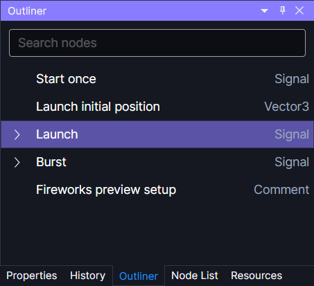 | 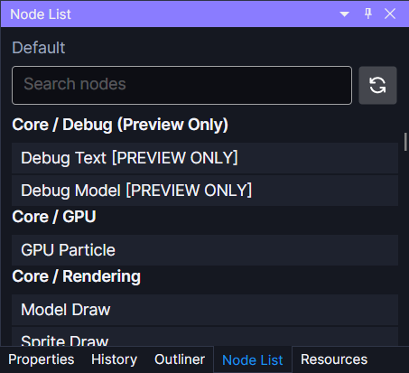 |

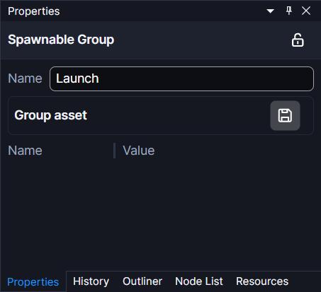

Use **Outliner** to select a node already in the active graph. Switch to
**Properties** to inspect that node. With nothing selected, the inspector shows
the graph-level options instead; a different selection can expose a different
set of fields. Use the lock control if you want to keep an inspector on one
selection while examining another with a separate inspector slot.

Use **Node List** to look up a type and drag it onto the canvas. Finding a type
doesn't establish whether it can connect to a particular pin. Check the pin type
and whether it carries a value or a Signal before wiring it. See the
[built-in node reference](node-reference.md) for the base pin definitions.
Node List, the canvas node-add search and Search anything accept the original
English node and category names as well as translated names. User-named nodes
and assets keep their own names.

### Search anything

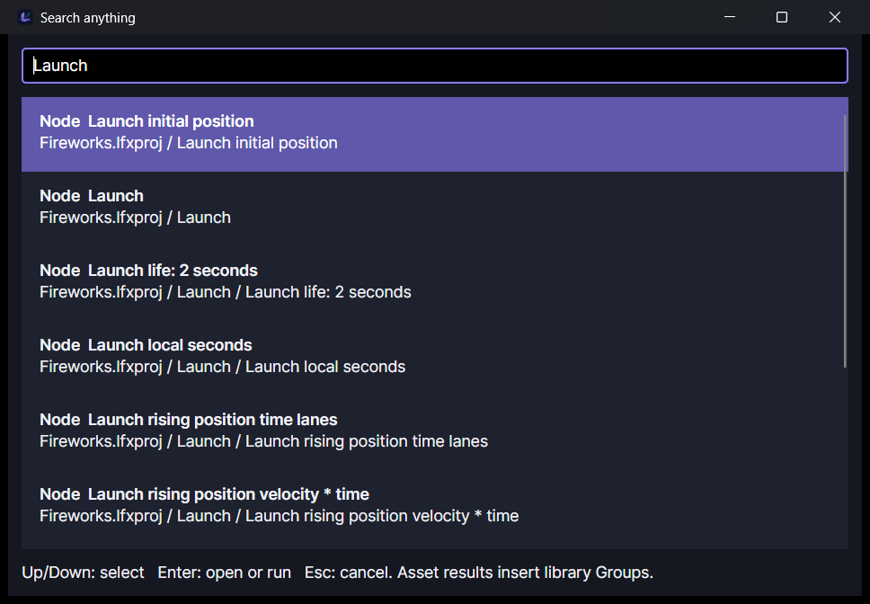

Open **Edit → Search anything** or press `Ctrl+P`. For example, type `Launch`
in Fireworks and choose a **Node** result to navigate to it. Read the result's
type before pressing Enter: a graph result opens a graph, a panel result opens a
tool, and a Group library result can insert an instance. Use Escape to close
without running anything. Built-in result categories and panel names also accept
their English names, independent of the interface language.

### History

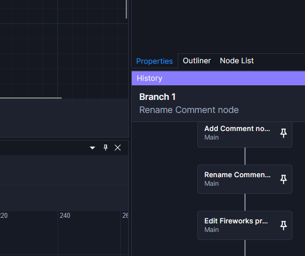

**History** shows edits as connected nodes in a branching tree. The highlighted
path marks the current state; select an earlier node to navigate there. Pin
states you want to find again.
If you edit after going back, the new edit belongs to a branch instead of
overwriting the original trail. Use revision history or graph comparison for
saved files rather than for these in-editor states.

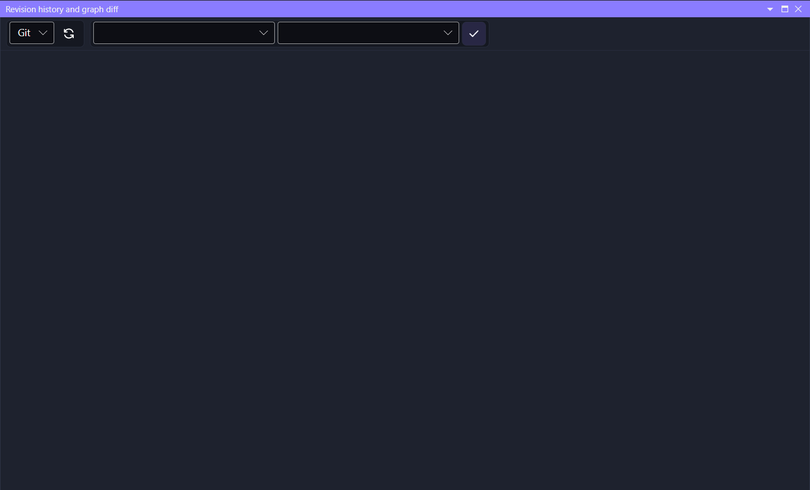

For a Git-tracked project, refresh the revision list, choose two saved
revisions, and run the comparison. If a bundled sample has no revisions
listed, use **Compare Graph Files** with two saved copies instead. Neither
view replaces the in-editor undo history or merges changes.

## Animation

### Timeline and transport

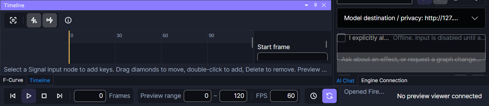

For Fireworks, set the preview range to **0–240** at **60 FPS** for a four-second
preview. The initial **0–120** range loops around the point where Launch expires
and can hide the Burst. Scrub or step the playhead to inspect timing, then connect
a supported engine viewer to see the rendered result. Use the timeline toolbar's
**Zoom Out** / **Zoom In** buttons to adjust the visible time span and the clock
toggle to switch ruler labels between frames and seconds.

To author a timed Signal, select a compatible Signal input node and use one of
the two add-key actions in the Timeline. **Preview Signal** is for editor preview;
**Runtime Signal** is authored for supported runtime package export. Drag a key
diamond to retime it; select it before editing its time or deleting it. Neither
kind of key is a substitute for a **Life Time** node.

Continuous preview playback is no longer capped at 120 seconds, and long
forward or backward timeline seeks catch up incrementally across frames within a
per-frame step and time budget so the editor and engine viewports stay
responsive. While catching up, the preview status shows seeking progress;
issuing a new seek, pressing Stop, or editing the graph cancels the previous
catch-up immediately. Manually sent Editor Send signals and external engine
inputs cannot be replayed on arbitrary backward seeks.

### F-Curve

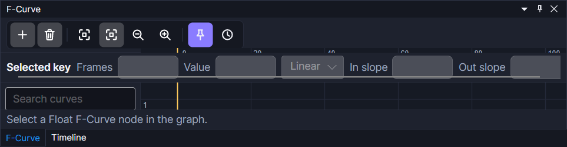

Select a **Float F-Curve** node to show its curve. Add or select a key, then edit
its time, value, and interpolation in **Selected key**. Slope fields apply where
the interpolation supports tangents. Use **Frame all** if the keys are outside
the visible range. This pane shares the preview playhead with the Timeline, but
its keys produce values rather than triggering Signals.

### Sprite Animation

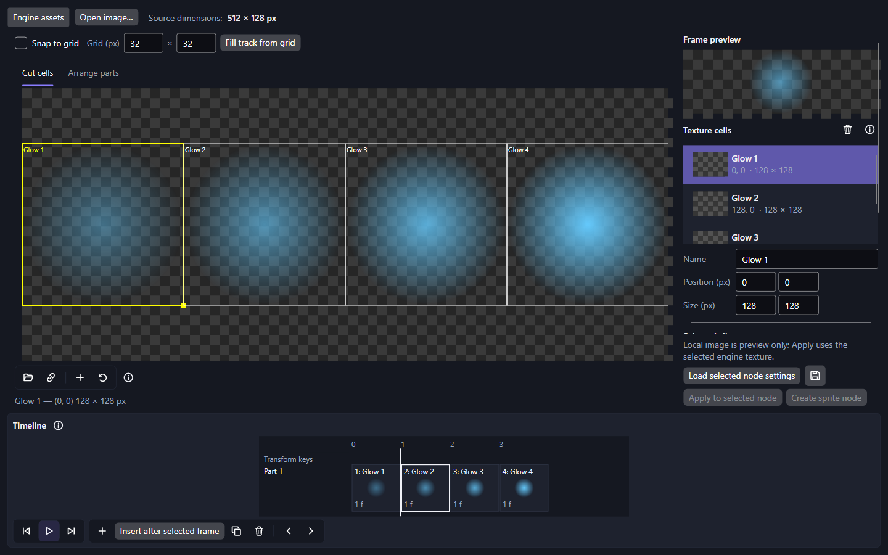

The image shows the released 2026.11.72 editor using a local preview atlas, without engine rendering. For loading, editing and applying the animation, follow [Animate particle textures](sprite-animation.md).

1. Open a local source image or pick a supported texture from a connected editor. **Source dimensions** must be known to edit exact pixel rectangles.
2. In **Cut cells**, draw or add a rectangle and refine its pixel position and size. For an evenly spaced atlas, enter its grid dimensions, enable snap if useful, and use **Fill track from grid**.
3. Use the bottom **Timeline** to insert, reorder, and preview frames. Use **Arrange parts** if you need to layer parts and key their transforms separately. The **Frame preview** lets you review the result before applying it to the selected CPU Particle, GPU Particle or Sprite Draw.

### Content and asset references

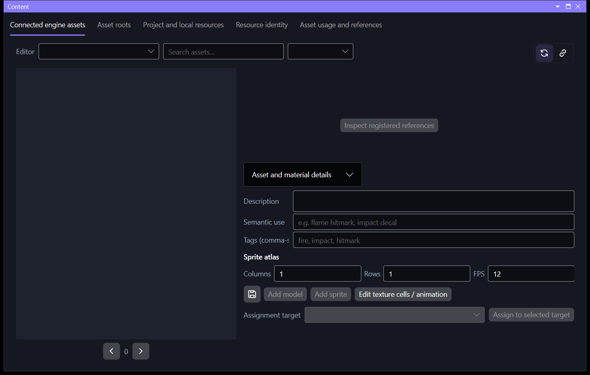

In **Connected engine assets**, select an editor and search its catalog. An
empty disconnected list, as shown above, doesn't mean the effect has no local
resources. Use **Project and local resources** for those and **Asset roots**
to review the sources that are available. When replacing an asset, inspect
**Resource identity** for its binding and **Asset usage and references** for
use sites. A filename match alone is not evidence that two engine bindings
refer to the same asset.

## Engine connection and diagnostics

### Engine Connection

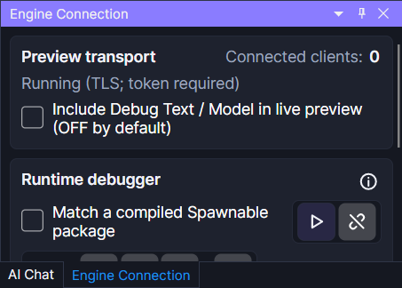

Start with **Preview transport**. In the screenshot the local server is running,
but **Connected clients: 0** means no external viewer is connected. After
connecting, check the target and transfer status before diagnosing an invisible
effect as a graph problem. See [Engine integration](engine-integration.md) for
engine setup.

The **Runtime debugger** is separate and requires a supported CPU debug session.
Use **Match a compiled Spawnable package** when you need the debug session to
match that export. Only share invites with the intended client; never include
them in a public screenshot.

### Native preview profiler

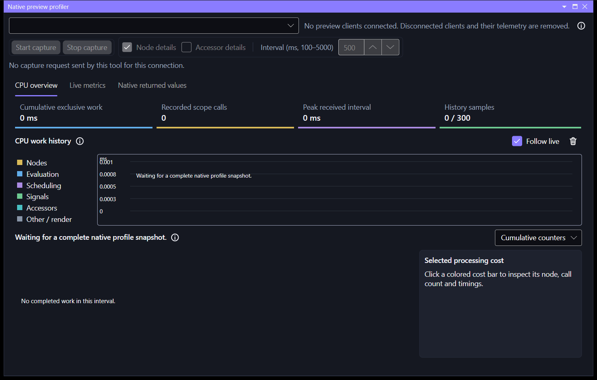

Select a supported preview client and start capture. **CPU overview** summarizes
the reported work; click a cost bar to see its scope, call count, and timings
once samples arrive. **Live metrics** and **Native returned values** show
different data from timing. An empty chart or a zero before the first snapshot
isn't a measurement of the effect's cost.

### Live Game Instances

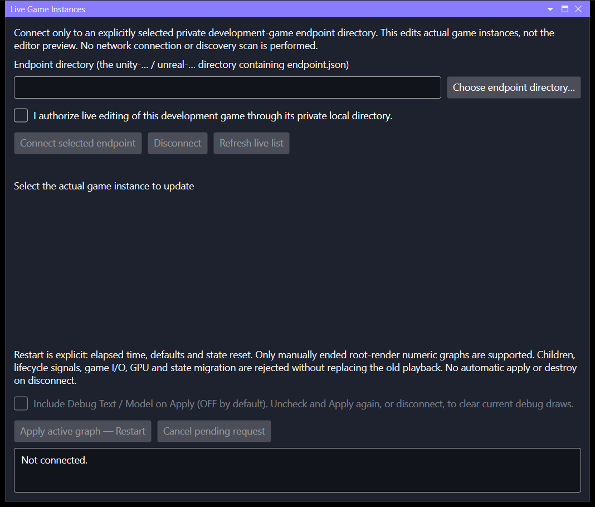

This tool changes an actual development game instance, not the editor preview.
Select the private endpoint directory, authorize this session explicitly, and
select the instance to update. **Apply active graph — Restart** restarts
supported playback and resets its elapsed time and state; it does not migrate
the instance. The panel lists the supported graph restrictions before applying.

### Log, AI Chat, and crash reports

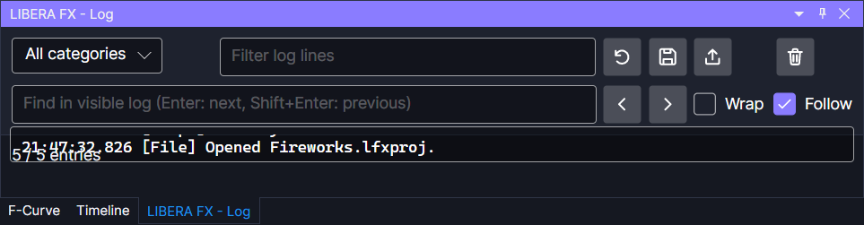

Start with the category and text filters to narrow down a problem. **Find in
visible log** navigates within the filtered results. Disable **Follow** if
you want to read older lines without scrolling to each new event. Review
paths and connection details before sharing an export.

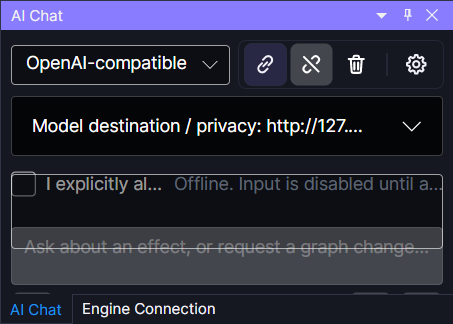

In **AI Chat**, check the adapter and destination before granting permission
to send graph context. Connecting the local tools does not authorize sending
context to a model. Review the proposed graph changes separately before applying
them.

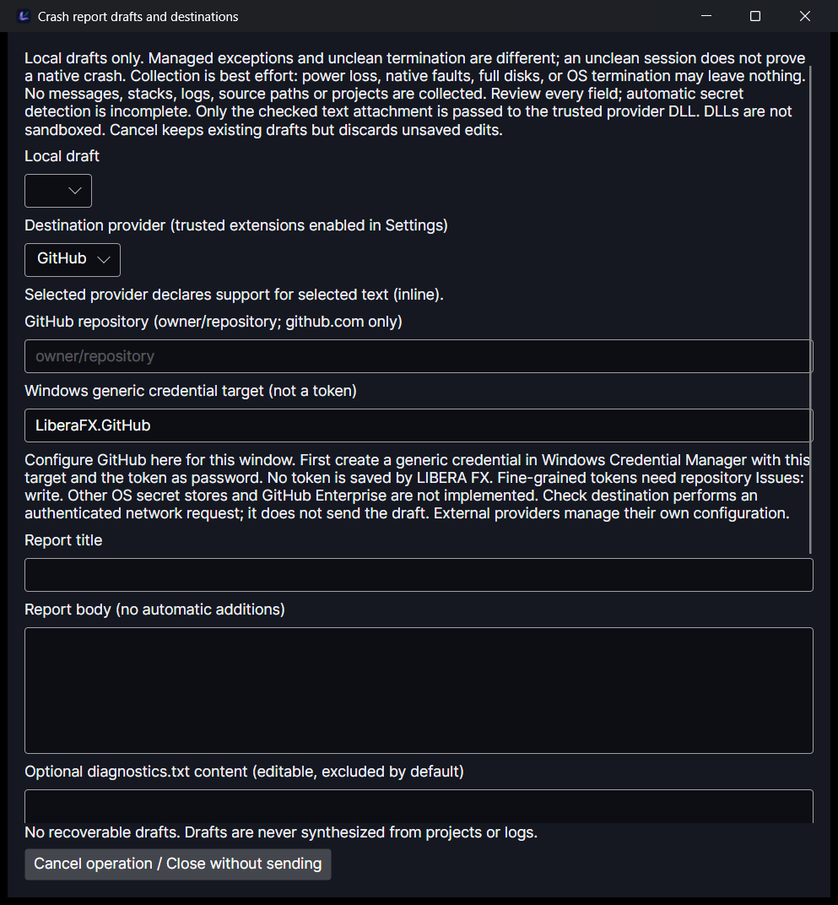

Select a local draft, confirm the destination and visibility, and review the
title, body, and optional diagnostics before sending. **Check destination**
is separate from sending. The screenshot shows no recoverable drafts; this
window does not automatically create a report from project data or logs.

## First launch and settings

### Startup setup

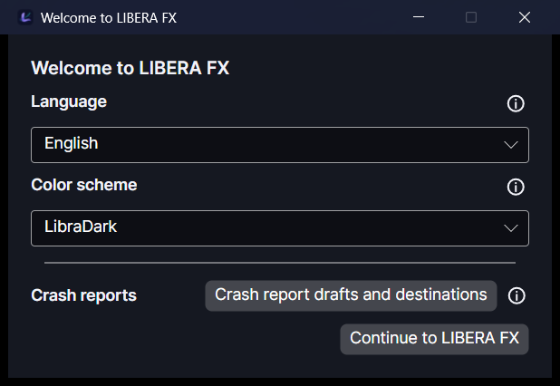

Choose **Language** and **Color scheme**, then select **Continue to LIBERA FX**.
The crash-report button opens draft and destination management; choosing a theme
or continuing startup does not send a report. You can change the appearance
later under **Edit → Settings**.

### Appearance and shortcuts

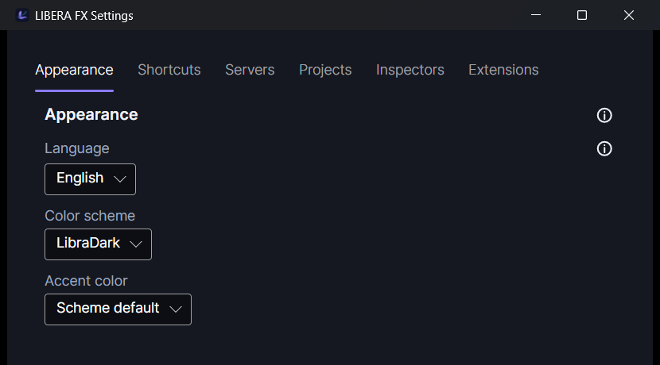

Use **Language** for menus and dialogs and **Node names** for built-in
node labels. If you follow an English tutorial in a localized editor, you can
keep the node labels in English without changing the menus. The color scheme
and accent affect the editor, not project output.
The node-name selector is not shown in this screenshot.

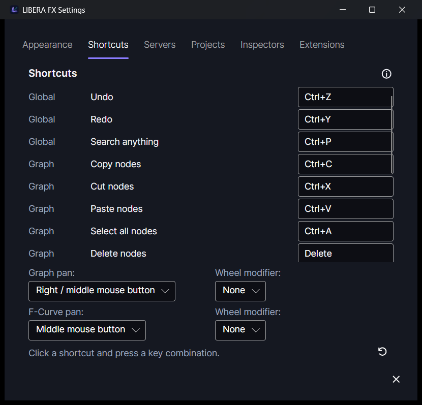

In **Shortcuts**, find the command you use and inspect its binding. Graph and
curve panning and wheel modifiers are separate from command shortcuts. If
navigation differs between two machines, check these settings before assuming
the graph is damaged. Resetting shortcuts changes editor preferences, not the
open document.

### Servers and projects

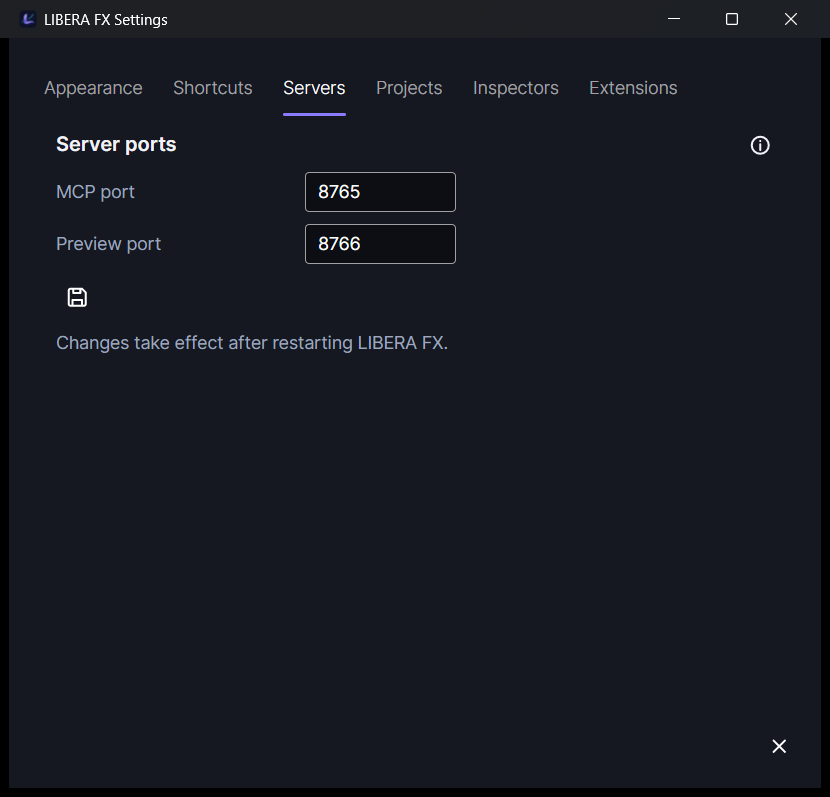

**Servers** shows separate ports for MCP and preview. Use **Save** and read
the status after changing a port. Restart the editor and update the
client configuration to match. A port number is not an access token.

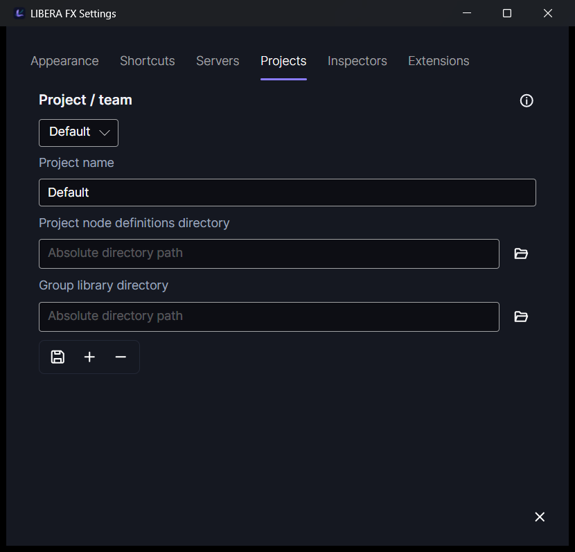

**Projects** controls which additional definitions and reusable Groups appear
in the editor. Choose or create a profile, set its **Project node definitions
directory** and **Group library directory**, and save the profile. Switch back
to **Default** to work without those extra catalogs. Switching profiles doesn't
rewrite nodes or Group revisions already saved in an open graph.

### Inspectors and extensions

| Inspectors | Extensions |
| --- | --- |
| 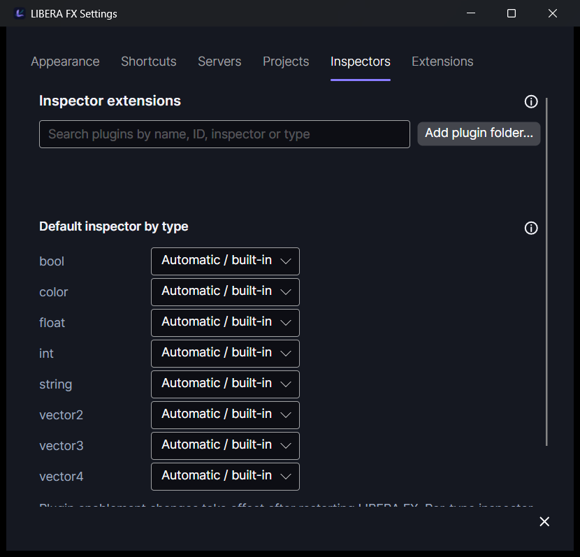 | 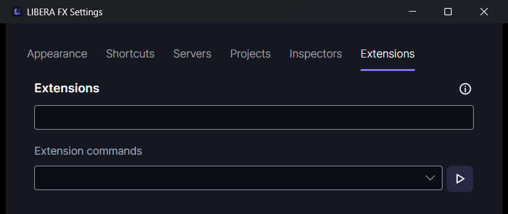 |

Use **Inspectors** to see registered inspector providers and select defaults by
type. Choose **Automatic / built-in** to go back to the default picker. The
**Extensions** tab lists registered extension commands separately from
inspectors. Only enable code you trust; a plugin is not an isolated graph file.
Local directories are hidden in these screenshots.
