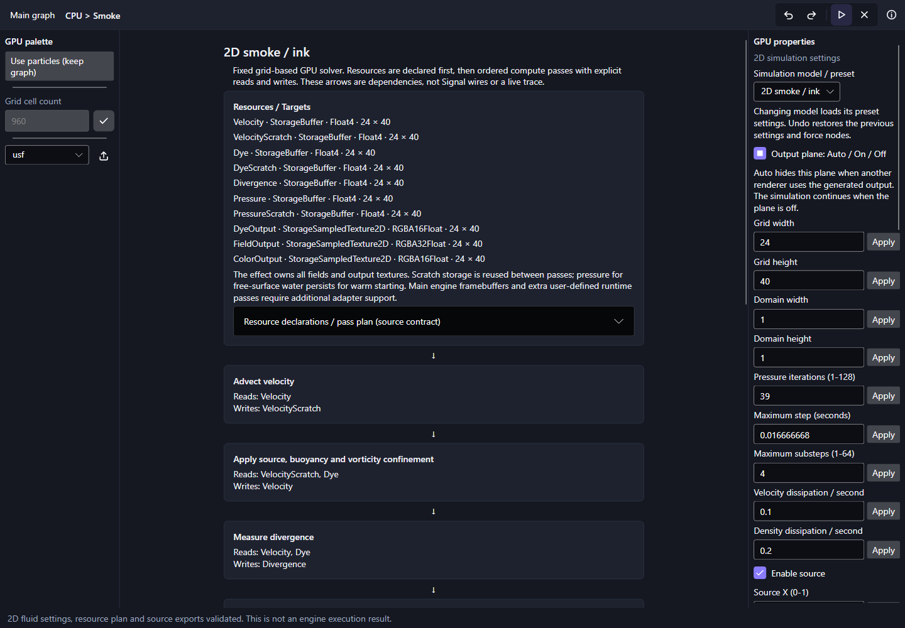
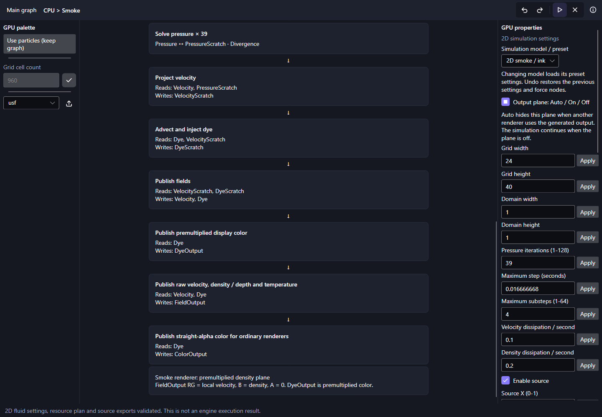

# 2D smoke and ink

> **Requires the Preview update after 2026.11.22.**
> See the [update and upgrade guide](preview-update.md); old archives are unchanged.
> Use a matching updated editor and engine SDK. The first solver
> targets **2D GPU smoke / dye**, not liquid surfaces, combustion or 3D volumes.

## Open the resource-first Flow

Add **GPU Particle**, open its workspace, then choose **Use 2D smoke / ink**.
The same container now runs a grid solver instead of its particle kernels.
The particle graph, drafts and bindings remain saved. **Use particles (keep
graph)** restores that graph; Undo can restore the fluid settings.

The **Resources / Targets** card is first. It declares effect-owned velocity,
dye, divergence and pressure fields, their ping-pong scratch storage, and the
sampled **DyeOutput** texture. A storage field is not itself a graphics render
target. This does **not** expose or overwrite the engine's main framebuffer.

The following cards show a fixed resource-dependent solver, not Signal
connections or a live execution trace:

1. Advect velocity with semi-Lagrangian bilinear sampling.
2. Apply the source acceleration and density-based artistic buoyancy.
3. Measure velocity divergence and clear the pressure field.
4. Solve projection pressure with the selected Jacobi iteration count.
5. Subtract the pressure gradient from velocity.
6. Advect dye using the projected velocity and inject the enabled source.
7. Publish the new fields and write the sampled density texture.

Reads and writes use distinct resources. Pressure ping-pong follows the actual
last iteration, including odd iteration counts. Engine adapters handle GPU
ordering, resource transitions and lifetime; authors do not wire API barriers.
The displayed pressure is a projection field, not pressure in physical units.

## Settings and units

Edit a value and choose **Apply**. Each accepted change is undoable; invalid
settings do not partially change the graph.

| Setting | Meaning |
| --- | --- |
| Grid width / height | 8–1024 cells per axis. The axes may differ. More cells increase memory and every compute pass's cost. |
| Domain width / height | Positive effect-local XY dimensions, independent of resolution. Boundaries are closed, with zero normal velocity. |
| Pressure iterations | 1–128 iterations. More iterations cost more; a coarse grid / low iteration count is an approximation, not an exact incompressibility guarantee. |
| Maximum step / substeps | Bound the timestep and GPU work. Zero elapsed time does not inject or advance. Excess long-frame time is discarded rather than accumulated into unlimited catch-up work. |
| Velocity / density dissipation | Nonnegative exponential decay rates per simulated second. |
| Source X / Y | Normalized coordinates, 0–1, within the local XY domain. Positive Y and positive buoyancy point upward. |
| Source radius | Effect-local distance, not a cell count or normalized UV radius. |
| Source acceleration / density | Acceleration and dye density injected per simulated second using a smooth circular source. |
| Enable source | Disables both source acceleration and dye injection. Existing dye can still move, fade and contribute buoyancy. This is not Pause. |
| Source RGBA | RGB dye color; opacity scales density injection. |
| Draw scale | Scales the output plane, not the physical simulation domain or timestep. |

Seven Float4 field buffers and one RGBA16Float output texture use
**120 bytes per grid cell**, before driver and draw overhead. At 128×128 that is
about 1.88 MiB; at 1024×1024 it is 120 MiB per fluid system. A large grid with
many pressure iterations can be expensive despite having no per-cell scene
objects.

## Playback and export

Export the whole effect as **`.lfxb`** and import it through the matching engine
SDK. Use the editor's whole-effect export: the standalone CPU-only converter
explicitly rejects GPU scopes, including fluids. The effect-level playback Component/Node remains the public entry point.
Fluid resources belong to the effect instance; different systems must not share
mutable simulation storage.

A connected **Draw Matrix** is a world-space override; without one, the plane
follows the effect owner. **OwnerMatrix** is an explicit host-supplied Game I/O
input, not an automatic copy of the owner's transform. Do not apply the owner
transform again to a connected matrix.

For continuous GPU-only scopes, turn off **End automatically when idle**. A scope
with no CPU work can otherwise finish immediately. A fluid inside a Spawnable
also needs an actual Spawn Signal for that group; editing its template does not instantiate it.
Use **Life Time** for an authored deadline, or stop continuous playback from
the host. Fluid mode does not silently change the graph's lifetime settings.

*Actual Unity / D3D11 framebuffer captures from a 24×40 acceptance fixture:
initial density on the left, later buoyant motion on the right. These are
engine results, not an editor preview or a promised production quality preset.*

The explicit **`builtin:fluid-alpha`** renderer draws a local XY plane using a
premultiplied-alpha density texture: alpha is `1 - exp(-density)`. It is not a
silent replacement for an unresolved engine material. Arbitrary engine-material
binding and global transparent interleaving are not promised by this milestone.

Fluid scopes use **GPU executable-payload version 2** inside the existing effect
envelope; particle-only scopes retain version 1. Old SDKs must reject the new
payload rather than drop the simulation. The CPU bytecode and particle register
packet ABI do not change.

GPU source export can write settings JSON or HLSL / USF / Unity compute source
with fluid resource/pass metadata. **Validate / compile** validates settings and
source generation; it does not execute an engine. The legacy particle-source
preview transport cannot carry fluid resources: use whole-effect package
playback, not a particle LGPK delivery.

## Current boundaries

The source implementation has been exercised in Unity 7000-series / D3D11,
Unreal 5.7 / D3D11 (SM5), and Godot 4.7.2 / Forward+ Vulkan on Windows.
The checks include actual pixels,
finite GPU fields, odd/even pressure iterations, closed boundaries,
source-off decay, independent effects, mixed particle scopes and scoped
retirement. Numerical readbacks are test-only; normal playback keeps fields
on the GPU. This is not acceptance of every graphics API, console SDK or
exported player build.

Compiler-produced packages also cover Stop/restart, odd-sized grids, and
Draw Matrix / OwnerMatrix inputs without double-applying the owner transform.
The Unreal plugin additionally passes Clang compilation and MSVC linking.

This is a fixed closed-domain, collocated-grid smoke / ink solver. “Ink” means
transported dye, **not** a water surface or a particle-based liquid solver.
There are no authored obstacles, temperature / combustion, arbitrary compute
passes, cross-container field wiring, 3D textures, or direct main-target writes.
Godot needs a RenderingDevice-capable renderer; Compatibility is not a GPU
compute fallback.

The common resource vocabulary is the first concrete part of
[the resource-led Flow proposal](https://github.com/Libra-Works/LibraFX/issues/68),
not completion of every general-purpose resource feature proposed there.
3D work starts only after the 2D path is verified.
