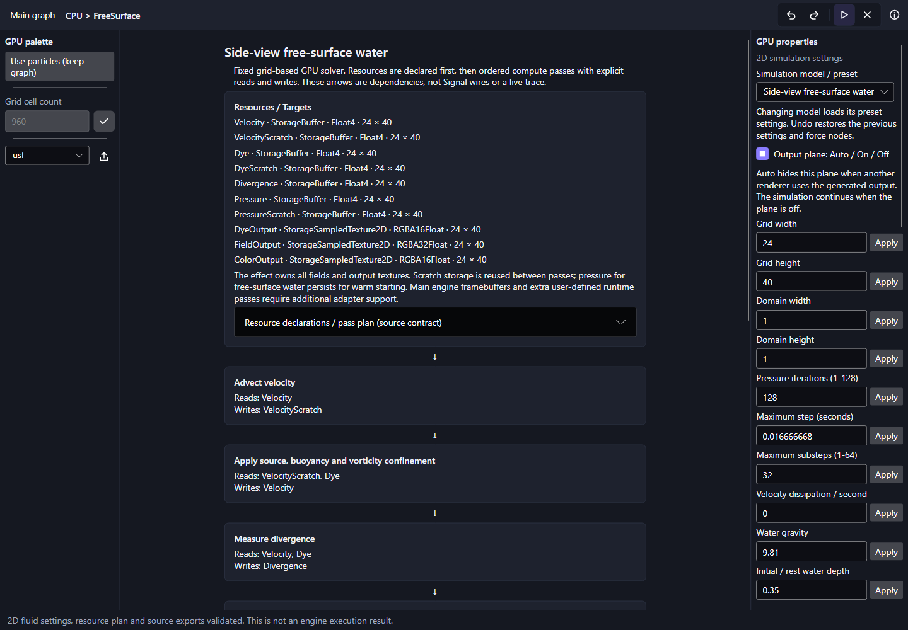
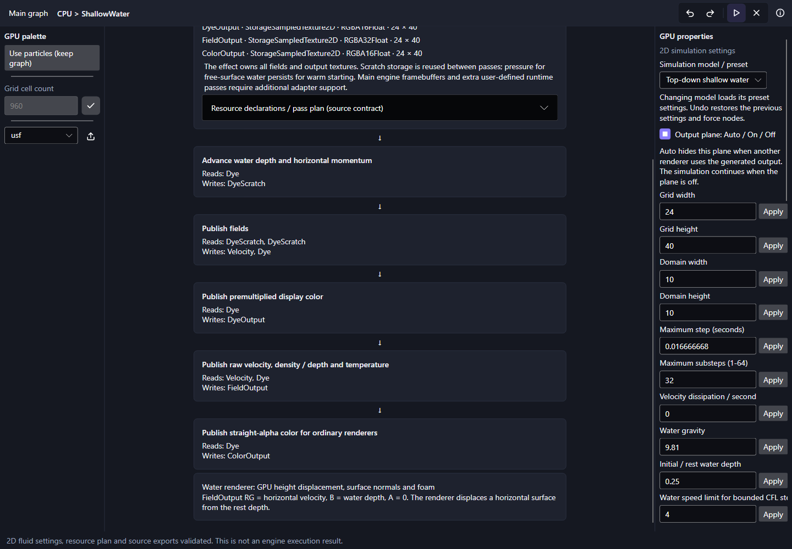
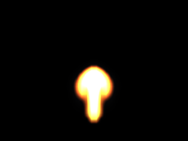
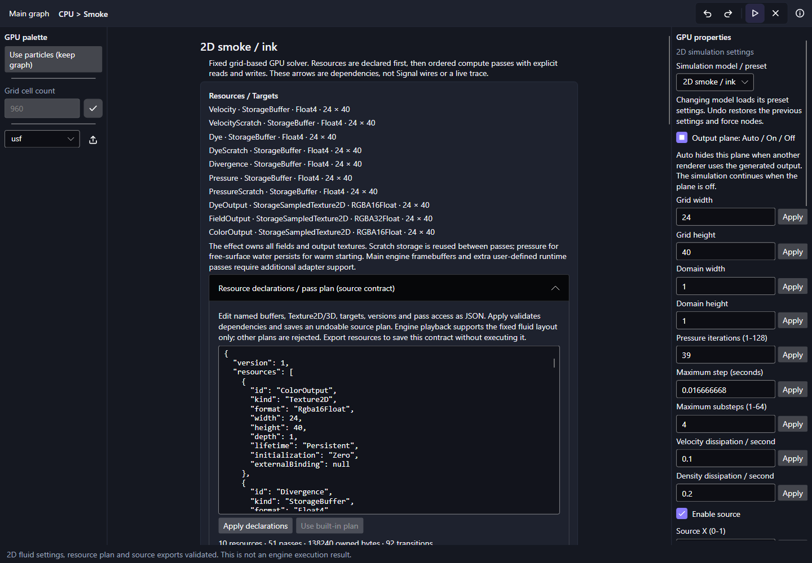

# 2D fluids: smoke, water and fire

Use matching development editor and engine SDK sources. Existing published archives are unchanged; see [updates](preview-update.md). The four fluid models, cell forces and ordinary-draw consumers have Windows GPU acceptance on the engine/backends listed below. Published archives have not been rebuilt with these changes.

## Make a water or fire effect

1. Add **GPU Particle**, open its workspace and click **Use 2D smoke / ink**.
2. Select **Simulation model / preset**. Changing model loads that preset's settings and clears its previous force nodes; Undo restores them.
3. Adjust the grid, domain, source and model settings. Start with a small grid. Source coordinates are normalized; radius and depth use simulation-domain distance units.
4. Leave **Output plane: Auto / On / Off** at Auto to use the dedicated renderer. For a continuous root effect, disable **End automatically when idle**. A Spawnable template needs a Spawn Signal and an appropriate **Life Time**.
5. Export the entire effect as `.lfxb` and play it through the matching engine SDK. The standalone CPU converter rejects GPU programs. Validate / compile and source export do not execute the GPU.


These are actual development-editor captures in English with LibraDark, not engine playback images.

| Model | Simulation | Dedicated renderer |
| --- | --- | --- |
| 2D smoke / ink | Collocated velocity projection and transported dye | Premultiplied density plane |
| Side-view free-surface water | Staggered MAC face velocities, air pressure boundary and conservative water-fraction transport in a closed rectangular domain | Water tint, Fresnel response, surface-edge foam and highlights |
| Top-down shallow water | Flat-bed, first-order HLL shallow-water depth and horizontal momentum | Horizontal GPU-displaced grid, height-derived normals, Fresnel and foam |
| Fuel / temperature combustion | Fuel injection, ignition-gated reaction, heat release, cooling and smoke transport | Temperature emission and smoke opacity |

Free-surface water is a grid simulation: splashes are transported water fractions. It does not create detached droplet geometry or a particle liquid solver. Shallow water represents one depth per horizontal cell; it cannot represent overturning waves. There are no authored solid obstacles or terrain bathymetry yet. Fire emission is visualization, distinct from fuel consumption and temperature evolution.

## Editor and engine examples




The engine images below are synthetic 24×40 acceptance samples, captured in Unity 7000.0.0a16, D3D11 with Built-in RP fallback after 120 fixed updates. The source-enabled free-surface variant adds water above the initial pool; shallow water receives a depth source. These small-grid images demonstrate the rendering foundation, not a production water scene.




Earlier smoke acceptance also captured a clear initial state followed by rising dye:


## Resources and stepping

Resources appear before the passes. Seven Float4 buffers hold velocity, scratch velocity, simulation state, scratch state, divergence and pressure ping-pong. Three output textures make the same result available to drawing and sampling:

| Output | Format | Channels / alpha |
| --- | --- | --- |
| `DyeOutput` | RGBA16Float | Premultiplied display RGB and opacity |
| `ColorOutput` | RGBA16Float | Straight display RGB and opacity, for ordinary Sprite / Flexible Plane inputs |
| `FieldOutput` | RGBA32Float | RG = cell-centered local velocity; B = smoke density, water fraction or shallow-water depth; A = combustion temperature, otherwise zero |
| `VelocityOutput` | View of `FieldOutput` | Raw RG velocity; no extra allocation |
| `DensityOutput` | View of `FieldOutput` | B density/depth and A temperature; no extra allocation |

Owned storage is **144 bytes per cell**, before meshes, particle consumers and driver overhead: 2.25 MiB at 128×128 or 144 MiB at 1024×1024. Independent effect/scope instances own independent storage. Stopping a producer invalidates borrowed output textures; queued GPU work retains its required resources until retirement.

Internally, free-surface state stores water fraction in W; shallow-water XYZ stores depth and two momenta, with W recording a numerical depth-clamp guard; combustion XYZW stores fuel, temperature, smoke and reaction rate. These internal layouts are not the display texture layout.

Maximum step and substep count bound work. Water also uses a two-dimensional CFL bound based on grid spacing and the configured speed limit; shallow water includes gravity-wave speed. Excess frame time is discarded and reported, rather than accumulated into unlimited catch-up work. Shallow depth has a safety limit of sixteen times rest depth. These safeguards do not make arbitrary settings accurate. Zero elapsed time does not inject material or run simulation steps.

Pressure iterations apply to smoke, free surface and combustion. Free surface warm-starts pressure; shallow water evolves depth/momentum without pressure projection. Vorticity confinement is a separate velocity-neighborhood force, applied before divergence and projection; zero disables it.

## Edit resource declarations

Expand **Resource declarations / pass plan (source contract)** in Resources / Targets. Its JSON declares named particle/general buffers, Texture2D/3D resources, render targets, dimensions, format, lifetime, initialization and external binding names. Each pass binds explicit resource versions and access. **Apply declarations** validates the portable dependency graph and saves one undoable edit; **Use built-in plan** removes the override. Project/history storage and MCP retain the declarations. The `resources` export writes their source contract and compilation metadata.



This editor describes allocations and dependencies; it does not provide arbitrary engine kernels or an engine main target. An unchanged built-in fluid plan remains playable. Other authored layouts/operations are rejected for effect playback with `ResourcePlanRuntimeUnsupported`; reset to the built-in plan to play the fluid again. Declaring an external target does not establish its availability, write permission or ownership on a host. Texture3D execution remains separate work.

## Connect outputs to drawing

In the fluid workspace's draw-consumer section, select a target in the **same execution scope**, its texture input and an output, then bind it. Ordinary **SpriteDraw** and **FlexiblePlaneDraw** main textures use `ColorOutput`. Material texture parameters can receive straight color, premultiplied dye or raw fields; the bound material must interpret that format explicitly. Sprite animation/composition main textures are not generated-texture targets.

A draw consuming display color suppresses the automatic producer plane unless explicitly overridden. Raw sampling alone leaves the dedicated renderer enabled. Calculation and visibility are independent: turning the plane off does not stop field updates. Material bindings remain project scoped; Unreal normal draws require the documented Sprite / Flexible Plane materials. Unresolved materials are errors.

## Drive another GPU particle system

Add a Flow Map resource to a GPU particle container in the same scope. Select its generated producer and `VelocityOutput` or `DensityOutput`. The editor selects matching **raw velocity / density** encoding and **generated-plane** coordinates. Static flow maps keep their previous signed-normalized decoding and world bounds.

`sampleFlowMap("field", @Position)` maps the particle position into the producer plane and clamps outside the domain. Raw velocity is transformed into the particle simulation space; density sampling returns density/depth and temperature. For example:

```text
@Velocity = sampleFlowMap("velocity", @Position);
@Alive = greaterthan(sampleFlowMap("density", @Position).x, .01);
```

Use the density result with random candidate positions, comparisons and existing math to author spawn masks or probabilities. This is explicit GPU sampling, not automatic density-weighted emission. Producers execute before consumers. Parent/child resource sharing and implicit same-frame cycles are unsupported. A connected Draw Matrix is a world-space override; generated-plane sampling requires invertible producer and consumer transforms.

## Build cell forces

The cell-force editor supports up to eight ordered nodes. Add **Cell position**, **Simulation time**, **Noise** or **Curl Noise**, a **Density / water depth** or **Temperature** field, and math/mask nodes. Select **Input A** and **Input B** from earlier nodes. For noise they mean position and time; disconnected noise inputs use the cell position and simulation time.

Example: Cell position + Simulation time → Curl Noise; Curl Noise × Density → force. Add, Multiply, Sine and Smoothstep mask evaluate on each cell. Noise parameters include frequency, seed, octaves, roughness and animation speed. Smoothstep uses X/Y as its lower/upper thresholds. Unconsumed final math/noise/acceleration results are summed as force; position/time/field source nodes alone do not apply force. Removing a node disconnects its consumers. Forward references and cycles are rejected.

Forces execute before pressure projection for smoke, free surface and combustion, and as momentum acceleration for shallow water. Vorticity confinement remains a distinct neighbor-field operation. Settings, node identities, connections and output bindings support save/load and Undo/Redo.

## Compatibility and verification

Particle-only executable payloads retain version 1; ordinary fluid payloads use version 2; generated resource/draw references and explicit automatic-plane selection require version 3. Existing CPU bytecode and particle storage layouts remain unchanged. The fluid shader uniform block is 512 bytes; use the matching regenerated SDK shaders. Old SDKs reject unsupported payloads instead of dropping work.

Real GPU checks passed on Windows with Radeon RX 6700 XT: Unity 7000.0.0a16 D3D11 with Built-in RP fallback; Unreal 5.7 D3D11 SM5; and Godot 4.7.2 Vulkan Mobile / Forward+. They cover water mass/rest, finite fields, hot/cold fuel, dedicated rendering, ordinary generated-texture consumers, Stop and fresh replay. Unreal passed a full Clang compile, individual Clang compilation of the final changed files, final MSVC linking and real GPU checks. Godot Compatibility has no compute fallback. Other APIs, consoles and exported players need separate acceptance. UE 5.8 / 5.9 follow-up is tracked separately; it is not established by a UE 5.7 run.

The portable resource plan declares ownership, versions, explicit pass access, dependencies, hazards and allocation lifetimes. General Texture3D simulations, arbitrary runtime compute passes, previous-frame cross-container sharing and writable engine main targets require additional adapter capabilities; their declarations alone do not establish execution support. [Resource-led Flow proposal](https://github.com/Libra-Works/LibraFX/issues/68).

`ColorOutput` uses the engine's ordinary image UV orientation. `DyeOutput` and `FieldOutput` retain solver coordinates with row zero at the lower edge; they are intended for explicit data sampling or materials that handle that orientation. Native ColorOutput publication flips rows on Unreal/Godot so ordinary draws need no special shader UV code.

Unreal’s dedicated fluid surface currently draws after Tonemap through a view extension. It has no scene-depth occlusion or global transparent-object sorting. Unity and Godot use scene meshes. Lighting, refraction and full production-water composition need further renderer work.
