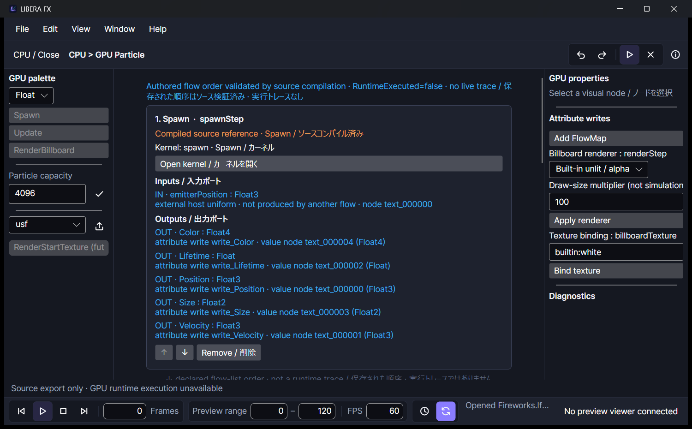

[Home](index.md) · [Editor reference](editor-reference.md) · [Built-in nodes](node-reference.md)

# GPU Particle Authoring

Use **GPU Particle** for large particle fields. Set initial values in **Spawn**, motion in **Update**, and appearance in **RenderBillboard**. Double-click the container to open its workspace.

The outer graph controls effect timing and Signals; GPU kernels calculate particle values. For grid-based smoke, water or fire, use [Fluid2D](fluid-2d.md) in the same workspace. See [GPU terms](glossary.md#gpu) when you need a definition.

On this page

* TOC
{:toc}

## Try the bundled samples

These are editable starting points, not templates requiring an imported image.
Use a LIBERA FX build containing the samples and a matching engine integration
that supports GPU particles and Fluid2D. Connect the engine preview as described
in the [production workflow](production-workflow.md); compiling alone does not
show the result. The expected appearances below are design intentions, not
screenshots or verified engine results.

| Sample in `Assets/Samples` | What it demonstrates |
| --- | --- |
| `GpuCurlTurbulence.lfxproj` | A small blue particle cloud following Curl Noise, with Turbulence changing its speed. Start here. |
| `GpuFluidVelocity.lfxproj` | Particles sampling a Fluid2D smoke solver's velocity output. |
| `GpuCurl100k.lfxproj` | The larger Curl Noise example: capacity 100,000 and 12,500 particles per second. Increase load only after checking your target GPU. |

### Curl and turbulence: follow a moving field

This sample creates a blue cloud drifting along swirling paths. **Curl Noise**
provides the direction, and **Turbulence** varies the speed across space and
time. It does not use a fluid simulation.

1. Use **File → Open** to open `Assets/Samples/GpuCurlTurbulence.lfxproj`,
   then **Save As** to save a working copy. Double-click `GpuCurlTurbulence`.
2. The flow has **Spawn**, **Update** and **RenderBillboard** for the initial
   settings, motion while alive, and appearance. **Particle capacity** is `4096`
   and **Particles per second** is `240`. Blue particles start inside a sphere
   of radius `1.5`. RenderBillboard uses the built-in white image `builtin:white`.
3. Connect the preview, set FPS to `60` and the range to `0–1200`, then play.
   The intended result is a gradually filling, drifting blue cloud. Capacity is
   a limit, not the number of immediately visible particles; allow time for
   emission and the one-second fade-in.
4. Open **Spawn → Open kernel** and select **Kernel Graph**. Find the
   `Constant : Float` written to `Lifetime` in **Attribute writes** and select
   it. Under **GPU properties**, change **Constant components** from `12` to
   `6` and press **Apply properties**. Lifetime is set when a particle is born,
   so restart from the beginning to compare. Similarly, select the
   `Constant : Float2` written to `Size` and change `0.025, 0.025` to
   `0.05, 0.05` to make newly spawned particles larger.
5. Return with **Flow**, then choose **Update → Open kernel**. If the graph is
   crowded, use **Frame all** and pan or zoom. Follow the output of
   `Curl Noise : Float3` to input A of `Mul : Float3`. Select the
   `Constant : Float` connected to that Mul's B, change **Constant components**
   from `1.2` to `0.5`, and press **Apply properties**. The swirling motion
   should become gentler. A separate upward movement is still added, so
   particles will not stop.
6. In the same Update graph, find the `Mul : Float` connected to the output of
   `Turbulence : Float`. Select the `Constant : Float` connected to that Mul's
   A and change `0.65` to `0`, then **Apply properties**. This reduces the
   speed variation from turbulence, and also lowers the overall speed multiplier.
   Use **Compile** to check diagnostics, then restart preview and compare with
   the original values.

The value of a `Constant` appears on the right when selected. Several nodes
share the same name, so use the connections and types above to identify them.

### Fluid2D velocity: carry particles with the solver

1. Open `Assets/Samples/GpuFluidVelocity.lfxproj` and save a separate copy.
   The main graph contains `Fluid2D velocity source` and `Particles following
   fluid` in the same scope. No graph wire is needed: the generated resource
   binding is stored on the particle container.
2. Open `Particles following fluid`. In its flow settings, `fluidVelocity` is a
   FlowMap bound to the fluid node's `VelocityOutput`, using raw velocity and
   generated-plane coordinates. The fluid solver runs before the consumer.
   To rebind it, use **Generated output in this scope**, select the fluid node
   and `VelocityOutput`, then **Use generated output**.
3. Open **Update → Open kernel** and inspect the **Kernel Graph**.
   `Read Attribute · Position` connects to `Flow Map · fluidVelocity`, which
   reads the fluid velocity at the particle's position. Its output is written
   to `Velocity` and also multiplied by `Read Uniform · Delta Time (deltaTime)`
   to advance Position. Spawn places particles near the smoke source, with
   capacity `2048`, `100` per second and a `4`-second lifetime.
4. Connect a compatible engine, set preview to `60` FPS and `0–600`, and play.
   The intended result is yellow particles carried by the smoke velocity.
   The 64 × 64 fluid's output plane is off so the particles are easier to
   see; simulation still runs. Turn **Output plane: Auto / On / Off** on in
   the fluid workspace to compare with the smoke.

To make the particles follow the flow more slowly, change the Update graph.
Drag from an output pin to an input pin to connect nodes.

1. Select `Float3` in the **GPU palette** and add `Mul`. Input `Constant` nodes
   are created automatically. Select the `Constant : Float3` connected to the
   new Mul's B, set **Constant components** to `0.5, 0.5, 0.5`, and press
   **Apply properties**.
2. Connect the output of `Flow Map · fluidVelocity` to input A of the new
   `Mul : Float3`. This replaces the existing connection to A.
3. Connect the new Mul's output to input A of the existing `Mul : Float3`
   that multiplies by time. Its B is connected to
   `Read Uniform · Delta Time (deltaTime)`.
4. Select the new Mul. In **Attribute writes**, select `Velocity` and press
   **Write selected node**. The same multiplier now applies to both the
   velocity output and the calculation that advances Position. Unused
   automatically generated constants do not affect the result.
5. Use **Compile** to check diagnostics, restart preview and compare. The
   yellow particles should follow the fluid more slowly than before.

Outside the producer domain, sampling clamps to its edge. Both transforms
must be invertible; moving the producer and consumer apart changes the sampled
region. Parent/child resource sharing and same-frame cycles are unsupported.
For density sampling and other output details, see
[Fluid2D: Drive another GPU particle system](fluid-2d.md#drive-another-gpu-particle-system).

## Open the particle program

1. In **Node List → Core / GPU**, add **GPU Particle** to the main graph.
2. Double-click **GPU Particle**. The
   breadcrumb changes from the CPU graph to the GPU workspace.
3. Use **Open kernel** on a Spawn or Update card to edit its calculations.
   **Flow** returns to the flow; **Main graph** returns to the main graph.

This image shows an earlier UI and starter program, not the samples above.
Its status message does not describe the current engine integrations.

The center lists the authored execution order, **not** a trace of a running
effect. Read the cards in this order:

| Phase | What to edit |
| --- | --- |
| **Spawn** | Initial particle attributes, such as Position, Velocity, Lifetime, Size, and Color. In the starter program, `emitterPosition` is the emission position supplied by the effect. |
| **Update** | Motion while particles are alive. Read the current position or velocity, calculate the next values, and write them back to the attributes. Multiply a rate per second by the elapsed time, `deltaTime`. |
| **RenderBillboard** | Drawing of the simulated state. Set the texture, material preset, and draw-size multiplier in the renderer properties. A draw-size multiplier changes the rendered size, not the simulated Size attribute. |

### Choose the initial Spawn shape

The **Spawn position shape** selector is on the Spawn flow card. It controls
where each new particle is initially placed; it does not change billboard draw
geometry. Choose **Point**, **Box (volume)**, **Sphere (uniform volume)**, or
**Circle (XY circumference)**. Box uses non-negative half-extents; Sphere and
Circle use a non-negative radius. Sphere distributes particles uniformly inside
its volume; Circle places them on its XY circumference and keeps Z unchanged.

The shape adds a seeded, per-particle offset to the value written to Spawn's
**Position** attribute. If Spawn has no Position write, the offset is centered
on the host-provided `emitterPosition`. Point adds no offset. Existing GPU
documents without a saved shape keep their previous Spawn position behavior
and are shown as Point when opened.
After editing Box half-extents or a Sphere/Circle radius, use **Apply shape
dimensions** on the Spawn card to save the values.

Set **Particle capacity** at program level and apply the change with the
checkmark. Capacity limits the particle storage; it is not an emission rate.

## Use Sprite editor animation and layered parts

Open **Window → Sprite Animation** and author the cells, frame order, individual
durations or layered composition. Select **GPU Particle** in the same graph and
choose **Apply to selected node**. **Load selected node settings** reopens the
authored data. No animation kernel needs to be built by hand.

The updated billboard renderer samples that timeline on the GPU using each
particle's age. Visible parts retain their position/rotation/scale keys and
order inside each particle. The parts share its simulation state; they do not
create more simulated particles or require particle readback. More parts still
mean more vertices and overdraw. Transparent particles are not globally sorted.

In the GPU renderer settings, **Use Sprite editor animation** toggles the
authored data without deleting it; apply the renderer settings to save the change.
The editor's range, loop and FPS settings control playback, and effect time
scaling controls particle age. The source texture binding must match the
authored image dimensions. Frame/key times that collapse at GPU float precision
are rejected explicitly.

This requires GPU executable payload **4**, renderer bindings **2**, and matching
updated native adapters and billboard shaders. The particle buffer layout and
compute-kernel format are unchanged. Older Preview binaries are not updated by
publishing this documentation. See [CPU Sprite animation](cpu-particles.md)
for the authoring workflow and the distinction from a regular-grid Flipbook.

Unity separates GPU simulation updates from camera submission, retaining the last
visible state while time is held. Ordinary camera rendering, Stop and replay were
checked in Windows / Unity 7000.0.0a16 / D3D11 Play Mode. Unity 7 alpha needs
`-enable-builtin-rp-fallback` when testing the bundled shaders.

## Edit a kernel

This earlier UI image illustrates the graph layout, not the current sample.

1. Open a Spawn kernel and select the value driving the **Lifetime** write.
   For a first experiment, change its Float constant, then compile. This
   changes particle lifetime, not the lifetime of the enclosing CPU effect.
2. To add a calculation, select a type in **GPU palette**, add the operation,
   and connect the output to a compatible input. Select a node to inspect its
   settings. If a node has no downstream use and drives no write, it will not
   update particle state.
3. In **Attribute writes**, assign the computed value to the attribute you
   intend to update. For example, an Update kernel can read Position and
   Velocity, calculate `Position + Velocity × deltaTime`, and write Position.
   Check **Diagnostics** for mismatched types, missing inputs, or invalid flow.

Drag from an output pin to an input pin to connect nodes. Connecting a new
wire to an input replaces its previous connection. Adding a node alone does not
change the particles: check that its result reaches another calculation or an
**Attribute write**.

About the text view

**Typed DSL** displays and edits the same content as **Kernel Graph** in text.
It is not needed to author with nodes. It is a restricted language, not HLSL or
a general scripting console. **Graph → text** generates the text;
**Apply text → IR** applies changes. Invalid text remains a draft without
replacing the last valid graph.

## Compile, export, and verify in the engine

Run **Compile** and fix diagnostics before exporting. The workspace can export
portable IR or supported shader source; retain the matching metadata when
exporting a shader. **A successful compile or export does not run the GPU.**
Use the target engine's integration to resolve bindings, build or import the
backend artifacts, and verify simulated motion and rendering. Do not treat
standalone shader source or internal instruction data as a complete GPU effect; export and load the full `.lfxp` package.
The editor exports GPU effects in the same `.lfxp` package as CPU effects;
the standalone converter uses the same compiler for CPU, GPU and Fluid2D effects. Use an engine SDK from the same release. See [Engine integration](engine-integration.md).

Follow [Animate particle textures](sprite-animation.md) for the steps to cut cells, arrange frames and apply them.

## Next steps

- [Connect to an engine and play the effect](production-workflow.md).
- [Check a missing preview or unexpected result](troubleshooting.md).
- [Look up a node](node-reference.md).
