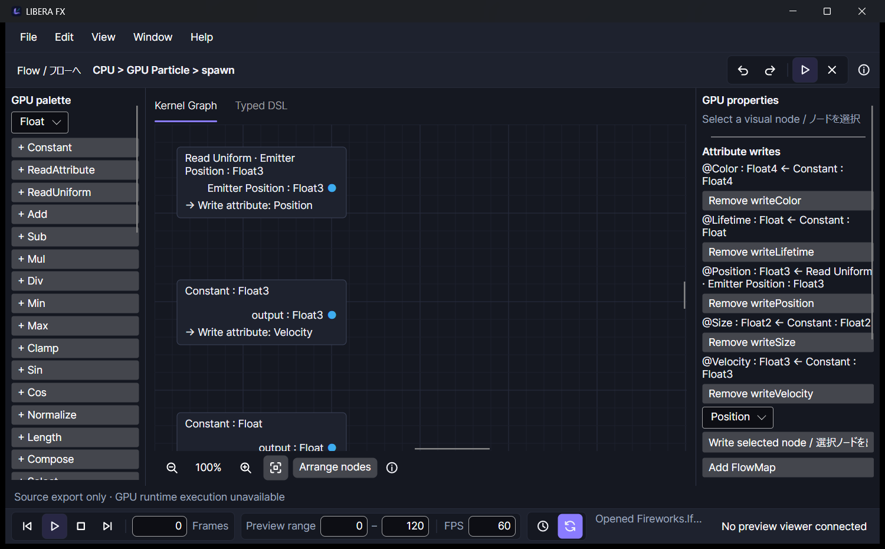
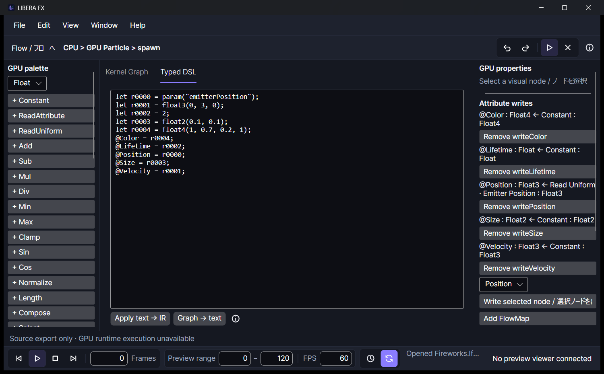

[Home](index.md) · [Editor reference](editor-reference.md) · [Built-in nodes](node-reference.md)

# GPU Particle Authoring

A **GPU Particle** node is a container on the main effect graph. Its contents
are edited in a separate workspace: the outer graph owns effect scope and
Signals, while a GPU kernel computes typed values for particles. A CPU Signal
connection is not a GPU data wire.

## Open the particle program

1. In **Node List → Core / GPU**, add **GPU Particle** to the main graph.
2. Double-click the node marked **GPU Program — double-click to edit**. The
   breadcrumb changes from the CPU graph to the GPU workspace.
3. Use **Open kernel** on a Spawn or Update card to edit its calculations.
   **Back** returns to the flow; **CPU / Close** returns to the main graph.

The center lists the authored execution order, **not** a trace of a running
effect. Read the cards in this order:

| Phase | What to edit |
| --- | --- |
| **Spawn** | Initial particle attributes, such as Position, Velocity, Lifetime, Size, and Color. In the starter program, `emitterPosition` is a host uniform, not an output from another phase. |
| **Update** | Per-step simulation. Read the current attributes, compute new values, and write the attributes that should persist for the next step. Use `deltaTime` for a rate expressed per second. |
| **RenderBillboard** | Drawing of the simulated state. Set the texture, material preset, and draw-size multiplier in the renderer properties. A draw-size multiplier changes the rendered size, not the simulated Size attribute. |

Set **Particle capacity** at program level and apply the change with the
checkmark. Capacity limits the particle storage; it is not an emission rate.

## Edit a kernel

1. Open a Spawn kernel and select the value driving the **Lifetime** write.
   For a first experiment, change its Float constant, then compile. This
   changes particle lifetime, not the lifetime of the enclosing CPU effect.
2. To add a calculation, select a type in **GPU palette**, add the operation,
   and connect the output to a compatible input. Select a node to inspect its
   settings. If a node has no downstream use and drives no write, it will not
   update particle state.
3. In **Attribute writes**, assign the computed value to the attribute you
   intend to update. For example, an Update kernel can read Position and
   Velocity, calculate `Position + Velocity × deltaTime`, and write Position.
   Check **Diagnostics** for mismatched types, missing inputs, or invalid flow.

**Kernel Graph** and **Typed DSL** edit the same program; they are not two
independently executed kernels. The text tab is a restricted typed language,
not HLSL, VEX, or a general scripting console. Use **Graph → text** to regenerate
text from the visual graph, and **Apply text → IR** to apply a text edit.
Invalid text is kept as a draft without replacing the last valid graph.

## Compile, export, and verify in the engine

Run **Compile** and fix diagnostics before exporting. The workspace can export
portable IR or supported shader source; retain the matching metadata when
exporting a shader. **A successful compile or export does not run the GPU.**
Use the target engine's integration to resolve bindings, build or import the
backend artifacts, and verify simulated motion and rendering. Do not treat
standalone shader source or raw `.lfxb` bytecode as a complete GPU effect
package. See [Engine integration](engine-integration.md).
