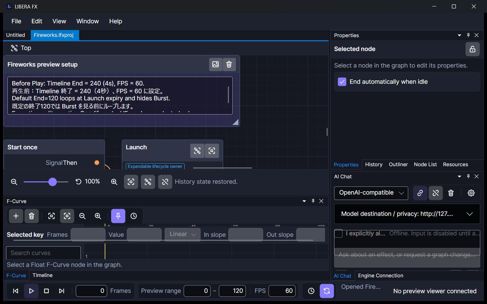

# Make an effect, then play it in your game

LIBERA FX is a graph editor for effects that run in **Unity, Unreal Engine and Godot**.
Connect nodes to build motion and appearance, check the result in an engine preview,
and export the effect for your game. Start with the visual editing guides below;
SDK and programming details have their own section.

## Your first three steps

| Step | Guide | What you will do |
| --- | --- | --- |
| 1 | [Install and start](getting-started.md) | Open the editor and choose how to preview effects. |
| 2 | [Learn the workspace](workspace-tour.md) | Select nodes, edit values, connect pins and return from child graphs. |
| 3 | [Make a fountain](first-fountain.md) | Change emission, speed, gravity, size and lifetime in a CPU particle effect. |

Graph editing works without an engine connection. Use a connected engine preview
to judge the complete particle effect's appearance.

## Choose what to make

| I want to… | Read |
| --- | --- |
| Create sparks, fountains or animated sprite particles | [CPU particles](cpu-particles.md) |
| Edit GPU simulation and billboard appearance | [GPU particles](gpu-particles.md) |
| Animate particle textures or layer several image parts | [Particle animation](sprite-animation.md) |
| Make smoke, water or fire | [Fluid2D](fluid-2d.md) |
| Generate a mesh, texture or material in the graph | [Procedural resources](procedural-resources.md) |
| Draw a ribbon or moving trail | [Ribbons and trails](flexible-plane-draw.md) |
| Sequence several parts of an effect | [Graph fundamentals](authoring.md), then [Afterimage Gate](afterimage-gate.md) |

## Connect to your game

[Connect and deliver](production-workflow.md) follows the process from SDK installation
through resource assignment, live preview, export and playback without the editor.
Choose the instructions for your engine; their browsing and preview paths differ.

For integration code, coordinate conversion, instance preparation and rendering limits,
use the [SDK and runtime reference](engine-integration.md).
Use [batch conversion](batch-conversion.md) when automating exports or game builds.

## Find an answer

- Looking for a setting? Open [Windows and panels](editor-reference.md).
- Looking for a node or an unfamiliar word? Use the [node reference](node-reference.md) or [glossary](glossary.md).
- Nothing appears, or a connection fails? Start with [troubleshooting](troubleshooting.md).
- Updating an installation? Check [release notes](release-notes.md) and download the editor and SDKs from the same release.

[Preview downloads](https://github.com/Libra-Works/LibraFX/releases) ·
[Source repository](https://github.com/Libra-Works/LibraFX) ·
[MIT license](https://github.com/Libra-Works/LibraFX/blob/main/LICENSE)
