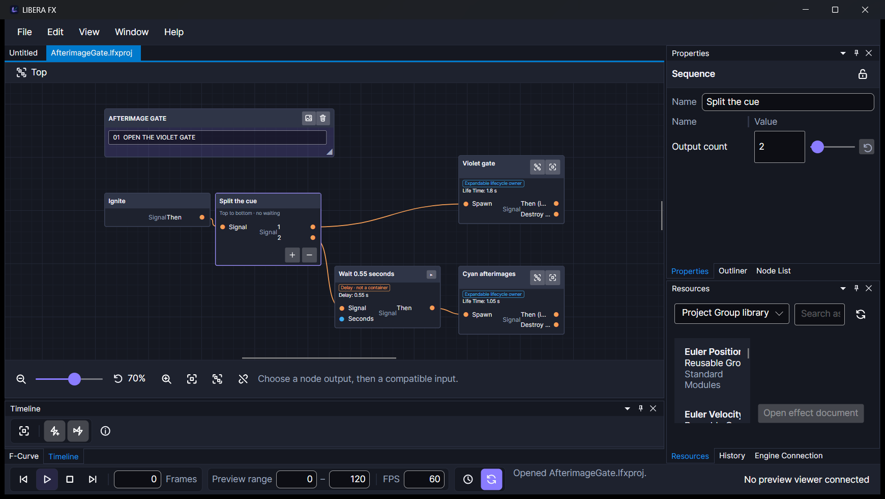

# LIBERA FX Documentation

LIBERA FX is a node-based editor for authoring effects that play in Unity,
Unreal Engine, and Godot. Build a graph in the editor, compile your project
with the standalone converter, and play it through a game-engine integration.

**Current Preview downloads:** [GitHub Releases](https://github.com/Libra-Works/LibraFX/releases).

| Start here | What you will learn |
| --- | --- |
| [Getting started](getting-started.md) | Install the editor, open **Afterimage Gate**, and follow the signals that drive it. |
| [Glossary](glossary.md) | Look up words such as node, Signal, Spawnable, and runtime, with short examples. |
| [Editor window and panel reference](editor-reference.md) | Find tools, settings, and dialogs with screenshots and step-by-step examples. |
| [GPU Particle Authoring](gpu-particles.md) | Edit the GPU flow, visual kernels, typed DSL, and billboard settings. |
| [2D smoke and ink](fluid-2d.md) | Use the resource-first GPU grid solver, its source settings and density texture. New source feature; not in the published Preview. |
| [CPU Particle Authoring](cpu-particles.md) | Author Spawn/Update particle graphs, emission, and CPU Property/Signal interactions. |
| [Flexible Plane Draw](flexible-plane-draw.md) | Build a ribbon from authored points or a bounded position history. |
| [Graph authoring guide](authoring.md) | Connect pins, animate with curves, and manage Spawnable lifetime and Group reuse. |
| [Built-in node reference](node-reference.md) | Browse nodes by category and subcategory, with their pins and default settings. |
| [Scalar math recipes](scalar-math-nodes.md) | Use the ten new math nodes, including wrapping, easing, thresholds, and inverse interpolation. Requires the updated runtime/SDK. |
| [Quaternions and random values](quaternion-random.md) | Compose rotations and sample repeatable random values using an explicit seed and sample index. |
| [Engine integration](engine-integration.md) | Install the matching SDK, play a compiled effect, and choose between script actions and native nodes. |
| [SDK distribution reference](https://github.com/Libra-Works/LibraFX/blob/main/docs/sdk-distribution.md) | Build from source, stage packages, and check engine and platform limits. |

*The Afterimage Gate graph in the editor. The screenshot does not show engine rendering.*

## Future direction: fluids

The first implementation is **smoke-first: 2D GPU smoke / advected dye**.
The updated source adds a fixed grid solver and a resource-first Flow; see
[2D smoke and ink](fluid-2d.md) for its settings, engine verification and limits.
It is **not included in the published 2026.11.22 Preview**. Use matching source
revisions of the editor, converter and SDK.

The coordinated Unity, Unreal and Godot renderer migration, CPU particle Flow
and GPU emitter shapes are already in source. **2D verification comes before
3D**. Liquids and combustion remain future work; smoke / dye does not implement
water surfaces or fire. The solver's Resources / Targets declaration is the
first limited implementation of [issue #68](https://github.com/Libra-Works/LibraFX/issues/68),
not a general-purpose resource graph or access to the main framebuffer.

[Source repository](https://github.com/Libra-Works/LibraFX) ·
[MIT license](https://github.com/Libra-Works/LibraFX/blob/main/LICENSE)
