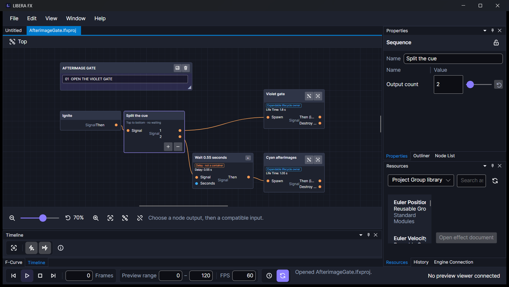

# 残像サンプルを読む

`Assets/Samples/AfterimageGate.lfxproj` を開き、紫のリングと、少し遅れて現れる水色の残像をたどります。
**Sequence・Delay・Spawnable Group・Time・Life Time**の役割を学ぶサンプルです。
粒子の編集が初めてなら、先に[最初の噴水](first-fountain.md)を試してください。

グラフを読むだけなら、エンジンは不要です。素材参照はUnreal向けなので、下の描画手順ではUnrealの専用プレビューを使います。

## 1. 2本のSignalをたどる

1. サンプルを開き、**File → Save As** で自分用のコピーを保存します。
2. **Ignite**を見つけ、そのSignalが入る **Sequence** を確認します。
3. 一方の枝は紫のリングを作ります。もう一方は **Delay** で `0.55` 秒待ってから、水色の残像を作ります。
4. それぞれのSpawnable Groupを開きます。**Time**はそのインスタンスが生まれた時刻から始まり、
   **Life Time**は放出や寿命の期限を決めます。

画像はエディターのグラフで、エンジンの描画結果ではありません。

## 2. タイミングを変えて比べる

Delayの値だけを変更し、同じ範囲を再生します。最初の演出はそのままで、2つ目の合図が移動します。
Undoで戻して違いを比べてください。見失ったノードは `Ctrl+P` で探せます。

## 3. Unrealで描画を確認する

[Unreal用SDK](production-workflow.md#unreal)を導入し、**Window → LIBERA FX Preview → Connect to Libra** を選びます。
タイムラインを **60 FPS**、**End = 144** にして再生・シークします。**54〜63フレーム**付近で2つの演出が重なります。
リングを正面から見られるようにカメラを調整してください。

ライブプレビューはUnreal標準のSphereと専用マテリアルを使います。
通常の `.lfxb` 再生では、エンジン側で素材を割り当ててください。
プレビューが作る一時的なマテリアルは、Unrealアセットとして書き出されるものではありません。

自分の演出を組むには[グラフ制作の基本](authoring.md)、ゲームへ持ち込むには[接続からゲームでの再生まで](production-workflow.md)へ進みます。
