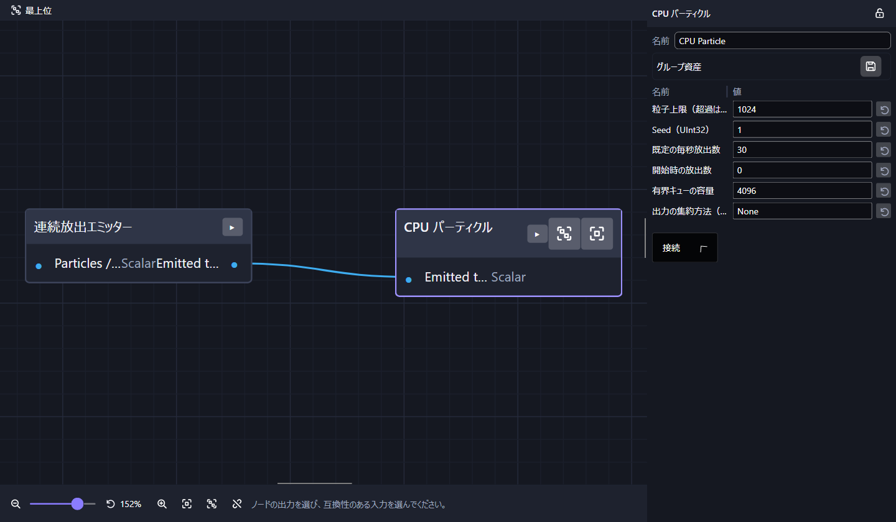
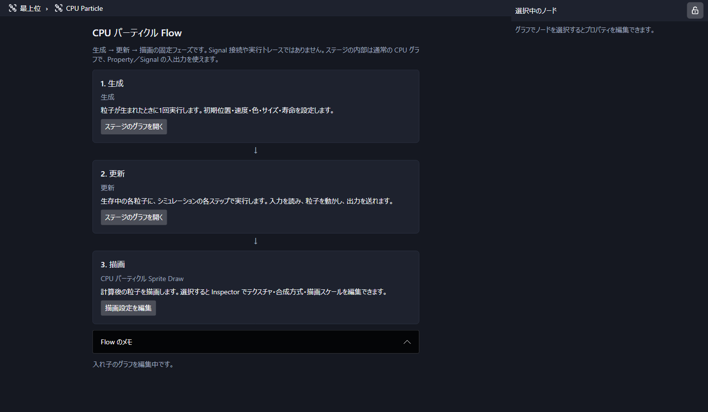
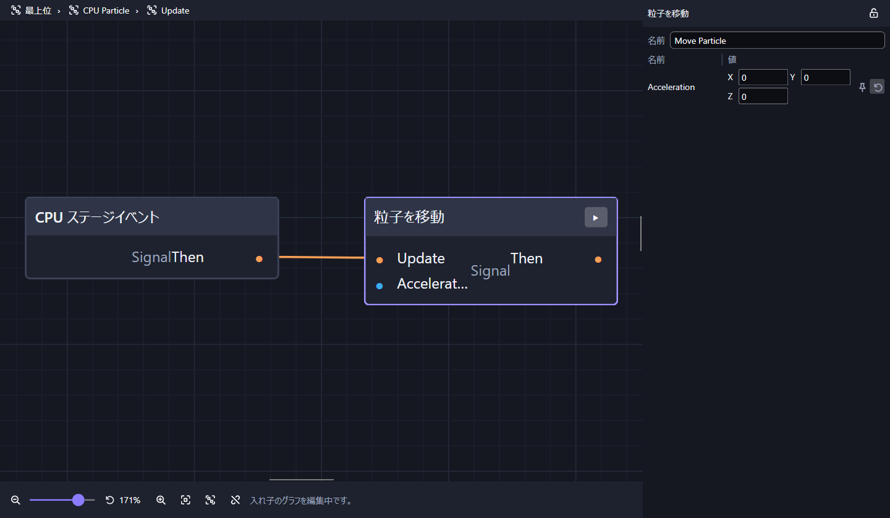
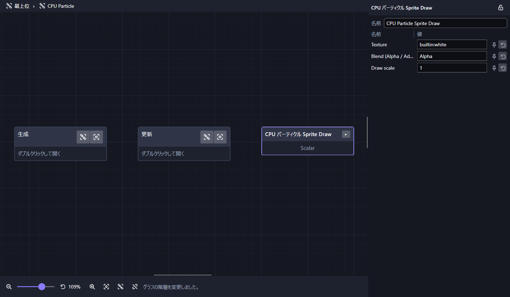

# CPU パーティクルとエミッター

> 対応する更新版エディター・コンバーター・native library・エンジンアダプターが必要です。
> 旧 **2026.11.8 SDK には含まれません**。
> [Preview 配布ページ](https://github.com/Libra-Works/LibraFX/releases)の更新版を組み合わせてください。
> ビルドや回帰テストの結果だけでは、エンジン実行・UI 操作性・描画結果の確認にはなりません。

## 5つの実画面で編集の流れを確認する

以下は、隔離したサンプルを実際のエディターで開いて撮影した画面です。
エンジン上のパーティクル描画結果ではありません。画像を開くと、ピンや
インスペクターの値を原寸で確認できます。
以下の Flow 表示は 2026.11.22 より後の Preview 更新が必要です。
旧アーカイブでは従来の三つの構造ノードを表示します。[リリースノート](release-notes.md)も参照してください。

### 1. 親グラフで放出数をつなぐ

**連続放出エミッターの Emitted total → CPU パーティクルの Emitted total**
を接続します。右側では粒子上限・Seed・開始時バースト・キュー容量を設定します。
この接続がある場合、コンテナの「既定の毎秒放出数」ではなく、
エミッター側の放出率を使います。二つの放出率を加算するわけではありません。

[](../images/editor/cpu-particles-root-ja.png)

### 2. CPU パーティクルを開き、編集する階層を選ぶ

中には GPU と同じステージ中心の **生成 → 更新 → 描画** Flow カードが並びます。
生成・更新の「ステージのグラフを開く」で粒子の処理を編集し、描画の「描画設定を編集」で
従来の Inspector を開きます。これは固定のシミュレーションフェーズ順で、Signal 接続や
実行トレースではなく、任意の追加パスにも未対応です。内部の通常 CPU グラフでは
Property／Signal の入出力を使えます。「Flow のメモ」では既存コメントを保持し、
通常の Undo 履歴でメモを追加・編集できます。

[](../images/editor/cpu-particles-stages-ja.png)

### 3. Spawn で生成時の初期値を決める

初期状態の **CPU ステージイベント → 粒子の速度を設定** は、生まれた粒子に
速度 `(0,1,0)` を設定します。右側の X・Y・Z がその値です。位置・色・寿命も
初期化したい場合は、対応する setter をオレンジ色の Signal につなぎます。
setter は置くだけでは実行されません。

[](../images/editor/cpu-particles-spawn-ja.png)

### 4. Update で生存中の粒子を動かす

**CPU ステージイベント → 粒子を移動** が、シミュレーションの各ステップで
現在の粒子を更新します。右側で加速度と抵抗を設定します。画像は初期値です。
下向きに加速したい場合は、Spawn の初速度を毎回設定し直すのではなく、
こちらの加速度を変更します。画面上部のパンくずでも Update の階層を確認できます。

[](../images/editor/cpu-particles-update-ja.png)

### 5. Sprite Draw で粒子群の見た目を設定する

Flow に戻り、**描画**の「描画設定を編集」を選びます。
右側でテクスチャ、Alpha／Additive、描画倍率を設定します。
`builtin:white` は明示的に選んだ組込白テクスチャであり、
見つからないアセットを勝手に置き換えるための値ではありません。
この画面は描画設定で、エンジン上の再生プレビューではありません。

[](../images/editor/cpu-particles-draw-ja.png)

### 通常の Draw では MeshComponent が増える？

旧版の **2026.11.22 Preview** では、Unreal の通常 Draw に MeshComponent、
CPU 粒子群ごとに一つの InstancedStaticMeshComponent を使います。
粒子ごとの Component ではありません。その後の Preview 更新では、
これらの描画 Component を廃止し、エフェクト側が描画データと互換なバッチを所有します。
Unity は直接描画、Unreal は native primitive／proxy、Godot は RenderingServer の
instance を使います。エフェクト全体を再生する Component／Node は残します。

Component を消しても、メッシュ・マテリアルのリソースや描画命令までなくなるわけでは
ありません。マテリアル、パラメーター、透明物の順序によっては描画を分けます。
粒子データ、CPU・メモリ・転送・オーバードローの負荷も内容に応じて増えます。
旧アーカイブと更新版の違いは[エンジンの描画範囲](engine-integration.md#rendering)を参照してください。

## Sprite の粒子群を作る

**CPU パーティクル**から CPU Particle を追加して開き、**生成（Spawn）** または
**更新（Update）** の子グラフを開きます。GPU 専用言語ではなく通常の CPU グラフです。
UUID・ピン・値・履歴・コピー貼り付け・保存は通常の子グラフと同じ仕組みです。
階層の移動自体は Undo を増やしません。
Flow は既存ステージの ID をそのまま表示する方式で、保存形式の移行はありません。
旧プロジェクト、子グラフの編集、境界ポート、履歴の分岐も維持します。

初期 Spawn は速度 `(0,1,0)` を設定し、Update は **CPU ステージイベント → 粒子を移動**
につながっています。初期値は位置原点・白色・サイズ `(1,1)`・経過時間ゼロ・寿命2秒です。
Spawn の Signal setter で初期属性を変え、Update のイベントから移動や属性変更を
つなぎます。移動は半陰的 Euler の順序です。

```
速度 += 加速度 × stepDelta
位置 += 速度 × stepDelta
```

属性ノードはステージ開始時の値を読みます。setter ごとに暗黙の再読込はしません。
**粒子のステップ時間差**はシミュレーションの時間差（生成時はゼロ）を返し、
通常の Frame Delta はホストのゲームフレーム時間差を維持します。
Spawn は生成時の一度、Update は正のシミュレーションステップごとに一度
（生成時にも delta=0 で一度）実行します。寿命に達した粒子は、その Update 前に消えます。

同階層の **CPU Particle Sprite Draw** が全粒子をバッチ描画します。粒子ごとの
actor/component は作りません。テクスチャ（`builtin:white` は明示的な組込リソース）、
Alpha/Additive、正の描画倍率を指定します。位置・XY サイズは effect-local で、
描画倍率は双方に適用します。更新版では、Unity は再利用する結合 Mesh の
直接描画、Unreal は native のインスタンス描画、Godot は RenderingServer の
MultiMesh データ一括転送を使い、粒子ごとのシーンオブジェクトを作りません。
RGBA・XY サイズを保持しますが、半透明の粒子単位ソートはありません。
この変更がダウンロード済みの 2026.11.22 SDK に自動反映されることはありません。

Unreal は `USAGE.txt` 記載のインスタンス RGBA 対応 Sprite マテリアルが必要です。
**そのマテリアル自体は今回同梱していません**。不足・非互換なら明示的に失敗し、
仮リソースへ置換しません。

## 放出・形状・決定的な乱数

コンテナで粒子上限・UInt32 Seed・既定の毎秒放出数・開始時バーストを指定します。
**Emitted total** を接続すると既定の連続放出率に代わって累積放出数を読みます
（開始時バーストは引き続き加算）。

* **連続放出エミッター**は毎秒放出数の端数を繰り越します。
* **バーストエミッター**は通常の Signal が届くたびに設定した固定数を加算します。
  連続放出と併用する場合は、両方の累積出力を Add で加算します。
* **Box 放出位置**は半径幅内、**Sphere 放出位置**は球の体積内、
  **Circle 放出位置**は XY 円周です。Spawn の位置 setter へ接続します。
  定位置の設定が Point 放出に相当します。

サンプリングはシステム Seed と粒子 ID を使い、グローバル RNG を使いません。
ID・Seed は通常の決定的 Random ノードの SampleIndex・Seed にも接続できます。
ID は再生中に単調増加する非ゼロ UInt32 で、スロット再利用時にも再利用しません。
枯渇はエラーです。同じグラフ・Seed・ステップ列での決定性であり、
任意のフレーム分割が同じ軌跡になる保証ではありません。

## プロシージャルメッシュの表面から放出する

**Procedural Model** の表面を、CPU パーティクルの発生位置にできます。
エンジンからメッシュを読み込まず、ツール内だけで放出形状を作れます。

1. 親グラフに **Procedural Model** と **CPU Particle** を追加します。
   モデルの Inspector または Flow で、Sphere などの形状を選びます。
2. モデルの出力を **CPU Particle → Emitter Mesh** へ接続します。
3. **CPU Particle → Spawn** を開き、**Mesh Surface Position → Position** を
   **Set Particle Position → Position** へ接続します。
4. **CPU Stage Event** から **Set Particle Position** へ Signal を接続します。
   ほかの初期値設定も、その後ろへ順番につなぎます。
5. 表面から外向きに飛ばすには、**Mesh Surface Normal** に速度を掛け、
   同じ Signal の列にある **Set Particle Velocity** へ渡します。
6. 初期放出数または放出レート、Sprite Draw の見た目を設定し、対象エンジンで再生します。
   形状の表面に粒子が生まれ、法線の方向へ広がれば成功です。

`CpuMeshSurface` サンプルで、位置と法線の接続を確認できます。
**Mesh Surface UV** と **Mesh Surface Color** も同じ表面上の点を参照します。
Color はメッシュの頂点色で、画像テクスチャーの色を自動取得する機能ではありません。
エミッターの配置には CPU Particle の **Emitter Matrix** を使います。

時間で変形するプロシージャルメッシュも、放出前に更新します。
新しい粒子はその時点の表面から生まれ、既存の粒子はメッシュに貼り付かず、
それぞれのシミュレーションを続けます。対象は **CPU パーティクルとプロシージャルメッシュ**です。
外部エンジンの Static Mesh・Skinned／Skeletal Mesh、および GPU のメッシュ放出は未対応です。

更新済みのネイティブ連携では、このエミッターを Spawnable の内部でも、
事前確保・再利用・共有実行と組み合わせて使えます。
[事前確保と共有実行](engine-integration.md#prepared-playback)も参照してください。
対応するソース・ネイティブライブラリーへ揃えて更新してください。
このページの更新だけで、以前ダウンロードした Preview の機能は変わりません。

## 通常の Property・Signal のやり取り

Spawn・Update に名前付きの粒子 Float・Vector3・Vector4 入出力を追加すると、
コンテナにピンが現れます。その他の数値型は通常の明示的な CPU 変換を使います。
Matrix・Int32・Color・Vector2 専用の境界はまだありません。演算・比較・Signal capture・
対応済みの通常 custom node は GPU DSL に置換せず、粒子ごとの VM 状態で実行します。

入力 Property はシステムの各ステップで一度コピーし、そのステップの全粒子が
一貫した値を読みます。Spawn 入力は生成時の値、Update 入力はライブ値です。
**粒子 Signal 入力は Update に置きます**。外側からの各到着は有界 FIFO に入り、
次のステップで処理される全粒子（そのステップの新生粒子も含む）へ broadcast します。
Spawn は継続的な外部イベントのスコープではありません。

出力 Property・Signal は次の識別情報を保持したキューメッセージです。

```
systemId, nodeId, particleId, time, kind, width, values[4]
```

同じステップで粒子が消えても通知は残ります。外部コードは
`SpawnableHost::popCpuParticleEvent`、対応 C ABI、または各アダプターの
イベント読出 API で取得します。**利用側は有界イベントキューを読み出してください**。
満杯ならエラーになり、黙って破棄しません。simulation worker から
エンジン SDK の callback を呼びません。

多数の粒子を一つの外側 Property に接続する場合、コンテナで
`outputReduction = LastById` を明示しなければコンパイルを拒否します。
これはスロット評価順ではなく最大の粒子 ID を選びます。集約値と外向き Signal は
次のシミュレーションステップに配送します。個々の値・ID が必要な場合は
scoped event API を使ってください。フィードバックは再帰的実行ではなくキューです。

## Spawnable の所有関係

CPU システムは Spawnable Group 内にも配置でき、Spawnable 自体のネストにも対応します。
粒子・イベントキュー・描画バッチは動的インスタンスごとに独立します。
Capture/Live はルートや同一テンプレートの別個体ではなく、直近の親インスタンスを参照します。
Life Time 到達時はそのスコープの放出を停止し、生存粒子・子孫・予約処理が完了するまで
スコープと描画を維持します。親の強制終了はその配下だけを破棄し、無関係な兄弟には影響しません。

従来の CPU イベント読出 API は引き続き root 専用です。子の通知にはコンテナ GUID と
native instance ID を指定し、Unity/Unreal の `PopScopedCpuParticleEvent`、
Godot の `pop_scoped_cpu_particle_event`、または native の scoped CPU API を使います。
自然退役後も未読通知は元のスコープから読めます。明示 Stop・再生し直しでは破棄します。

## コマ割りテクスチャを再生する（Flipbook）

### Spriteエディターで作ったアニメーションを使う

更新済みソースの連携では、Spriteエディターで作った任意のセル、コマ順、
コマごとの表示時間、再生範囲、ループ設定をCPUパーティクルにも使えます。
複数パーツの合成も、表示中のパーツの順番と、位置・回転・拡縮のキーを引き継ぎます。

1. **Window → Sprite Animation** を開き、元のテクスチャーを選んでセルとタイムラインを編集します。
   合成する場合はパーツも追加します。
2. 同じグラフで、適用先の **CPU Particle**、またはFlow内の **Draw** を選択し、
   Spriteエディターの **選択ノードに適用** を押します。
   別のSprite Drawノードや、JSONの手書きは必要ありません。
3. エフェクトを再生します。各粒子が生まれた時点から、それぞれのアニメーションを開始します。
   エフェクトの停止・スロー再生も反映します。ループしない場合は、粒子が生きている間は最終コマを保ちます。
4. 再編集するときは対象を選び、**選択ノードの設定を読み込む** を使います。
   設定は保存・再読み込み、Undo/Redoにも残ります。

CPUのDrawにある **Spriteエディターのアニメーションを使う** をオフにすると、
編集データを残したまま無効にできます。有効な編集データがある場合は、
下記の等間隔Flipbook設定より優先します。FPS・再生範囲・ループはSpriteエディターの値を使い、
Flipbook側の「粒子の寿命に合わせる」では、このアニメーションの時間を変更しません。

元画像の幅・高さを粒子のキャンバスとして、各パーツの大きさや移動量を解釈します。
パーツのサイズと変形キーを粒子のXYサイズに適用し、非表示パーツは描画しません。
表示パーツの分だけ描画用の形状は増えますが、粒子自体や粒子ごとのシーンオブジェクトは増やしません。
別々の半透明粒子どうしを並べ替える機能ではありません。

エンジン側には、編集時と同じサイズの元テクスチャーを割り当てます。
Unrealでは、従来どおり **Texture** と **AtlasRect** に対応したCPU用材質も必要です。
CPU描画メタデータのバージョン **4** を使うため、対応する連携ソースへ更新してください。
以前の配布バイナリーの機能は変わりません。

### 等間隔のグリッドを直接再生する

**CPU Particle → Sprite Draw** を開き、テクスチャを指定して **Flipbookを使う** を
オンにします。4×4枚の画像を毎秒12コマで再生する場合は、**列数**を4、**行数**を4、
**毎秒のコマ数**を12にします。コマは画像の左上から右へ、行ごとに進みます。
**開始コマ**は0始まりです。**ループ**をオフにすると最後のコマで止まります。
**寿命全体に合わせる**をオンにすると、開始コマから最後までを各粒子の寿命で一度再生し、
毎秒のコマ数とループ設定は使いません。エフェクトのスロー再生や停止にも追従します。

列数・行数はそれぞれ1〜64、合計256コマまでです。毎秒のコマ数は0〜1000で、
0は開始コマの静止表示です。追加ノードやJSONの手書きは必要ありません。
合成方式と出力の集約方法も選択式になり、従来の保存値を引き続き使えます。

UnityとGodotではアダプターがUVを処理します。UnrealではCPU用マテリアルに
ベクトルパラメーター **AtlasRect**（既定値`0,0,1,1`）を用意し、
`TexCoord0 * AtlasRect.zw + AtlasRect.xy`で`Texture`をサンプリングします。
既存の粒子色・透明度の設定も使います。Unrealはコマごとに粒子をまとめるため、
エミッターのスコープごとに、使用中のコマ数に応じたインスタンス描画になります。

Flipbook使用時の描画メタデータは`cpuParticleVersion:3`、Draw Matrixのみの場合は2、
従来のCPUエフェクトは1を維持します。対応版のアダプターとnativeライブラリーを組にして
更新してください。80バイトの既存snapshot ABIは維持し、経過時間と寿命は別のscoped APIで取得します。

## 制限・所有権・互換性

* root・通常 Graph Group・Spawnable Group 内の CPU システムに対応します。
  CPU/GPU コンテナの粒子ステージ内入れ子、ステージ内 Draw、
  `Delay`・`LifeTime` 等の遅延 lifecycle は明示的にコンパイルを拒否します。
* Sprite billboard が対象です。Mesh Draw・Cone・衝突・trail・粒子 ID 指定の
  外部 Signal 配送は未実装です。グラフ入力 Signal は broadcast です。
* 外向き Signal は、Reset などの名前付き入力も含め、配線した入力に届きます。
  コンパイラが出力プログラムに中継を追加するため、グラフに中継ノードを置く必要はありません。
* 粒子上限とキュー上限は固定です。放出要求超過・容量不足・メモリ上限・キュー満杯は
  エラーになり、既に実行した部分はロールバックしません。設定を修正して再生し直します。
* whole-effect host が粒子スロットと連続 work/default バッファを所有し、
  CPU 粒子更新は初期確保後に粒子・ノード・フレームごとのヒープ確保をしません。
  無関係な既存 Spawnable 処理全体が allocation-free という主張ではありません。
* 時刻は単調増加です。逆方向 seek は再生を作り直します。自然終了は放出停止後に
  生存粒子を排出し、Stop・Force は粒子と CPU 通知を消去します。
* root のみの CPU を含む `.lfxb` は既存 `LFXP` envelope の **format 4 / package 12** と、
  little-endian の CPU payload v1 を使います。テンプレート内 CPU または Spawnable の
  ネストには **format 5 / package 13** を使います。CPU もネストもない場合は
  format 3 / package 11 を維持します。更新版 reader は旧形式を読み、
  旧 reader は新形式の内容を黙って捨てず非対応として拒否します。
* 描画 metadata に `cpuParticleVersion:1` と `cpuParticles` を追加します。
  native snapshot は80バイト、scoped event は88バイトです。既存 UUID・値 ABI は変えません。

standalone converter はエディター起動なしで CPU を出力します。既存の GPU 拒否は維持します。
グラフ・package・native pool の回帰テストと、コンパイラーで生成したバイナリーの
native 実行を検証対象にしています。エンジン上の描画確認は別途必要です。
