[トップ](index.md) · [グラフ制作ガイド](authoring.md) · [標準ノード図鑑](node-reference.md)

# ウィンドウとパネルのリファレンス

初めて操作する場合は [はじめての画面操作](workspace-tour.md)から進めてください。このページでは、目的やメニュー名からパネルの使い方を調べられます。

ドック・インスペクター・アウトライナー・MCP の意味は[エディターの用語](glossary.md#editor)を参照してください。

多くのツールは独立ウィンドウではなく、移動・ドッキングできるパネルです。
**Window** や **View** メニューから開けます。グラフを見るパネルは通常、
アクティブなドキュメントタブに追従します。メニュー名は英語 UI を基準にし、日本語の実画面はキャプションで示します。
画像は同梱サンプルを使ったエディターの画面で、エンジン上の描画ではありません。

[ワークスペースと編集](#workspace-and-editing) · [アニメーション](#animation) ·
[エンジン接続と診断](#engine-connection-and-diagnostics) · [初回起動と設定](#first-launch-and-settings)

このページの内容

* TOC
{:toc}

## グラフ制作

| 画面 | 開き方 | 使い方 |
| --- | --- | --- |
| メインウィンドウ・ドキュメントタブ | **File → New / Open** | 複数のグラフを開いてタブで切り替えます。試作は **Save As** で別名保存します。パネルを移動してもドキュメントは変わりません。 |
| グラフキャンバス | ドキュメントを開く | ノードを置いて互換性のあるピンを接続します。Group に入って子グラフを開き、パンくずから親へ戻ります。[制作ガイド](authoring.md)も参照してください。 |
| ルーター | 接続線を右クリック → **ルーターを追加** | 接続の意味を変えずに中継点を挿入します。Signal 出力は引き続き接続先を一つだけ持てます。Undo で元の接続に戻せます。 |
| エニシング検索 | **Edit → Search anything** または既定の `Ctrl+P` | コマンド・ノード・アセットを横断検索します。矢印キーで選び、Enter で開くか実行します。 |
| アウトライナー | **Window → Outliner** | キャンバス上で探さず、一覧からノードを選択します。 |
| ノード一覧 | **Window → Node List** | ノードを検索し、グラフへドラッグします。標準ノードと現在のプロジェクトの定義が対象です。 |
| プロパティ・インスペクター 1〜4 | **Window → Inspectors** | 選択ノードの値・オプション・接続を編集します。ノード名の横にあるロックボタンでパラメーターをロック／解除できます。別のスロットも開けます。 |
| F カーブ | **Window → F-Curve** | 編集するチャンネルやカーブを選び、数値キーと補間を調整します。共有の再生位置でタイミングを確認できます。 |
| タイムライン | **Window → Timeline** | 再生範囲の設定、シーク、コマ送り、時刻付き Signal キーの編集ができます。F カーブと再生位置を共有します。プレビューのループ設定は実行時の寿命とは別です。 |
| 再生コントロール | タイムラインやワークスペースの操作バー | 再生、一時停止、シーク、コマ送りを行います。再生位置の移動とエンジン上の描画を区別するため、接続状態を確認します。 |
| カラーエディター | インスペクターの色コントロールを開く | 色の各チャンネルとアルファを編集します。公開されているカラー曲線は対応する曲線コントロールから開きます。 |
| GPU ワークスペース | GPU Particle ノードをダブルクリック | Spawn・Update カーネルやビルボード設定を編集します。[GPU パーティクル制作](gpu-particles.md)で専用の編集手順を説明しています。 |
| プロシージャルワークスペース | **プロシージャルモデル**・**プロシージャルテクスチャ**・**プロシージャルマテリアル**をダブルクリック | メイン画面で生成処理の順序付き Flow を編集します。出力を Model Draw に接続します。[プロシージャルリソース](procedural-resources.md)を参照してください。 |
| エフェクト設定 | ルートグラフのツールバーにある設定ボタン | フライアウトで**アイドル時に自動終了**を設定します。ネストしたグラフからは設定できません。 |
| スプライトアニメーション | **Window → Sprite Animation** | アトラス、セル、タイムラインを使い、アニメーションとコンポジションを作ります。ペイン内の確認とエンジン上の描画は別です。 |
| グラフの問題 | **Window → Graph problems** | 編集中の診断を確認します。見つからない定義や互換性のない接続を直してから、再度コンパイルします。 |
| 履歴 | **Window → History** | 編集履歴を枝分かれしたツリーで確認し、状態を選んで移動したり、必要な状態をピン留めしたりします。過去の状態から編集すると枝が作られますが、Git コミットは作られません。 |

接続線をクリックすると選択できます。Ctrl を押しながらクリックするとノードや接続線の選択を切り替えます。
範囲をドラッグすると交差するノードと線を選択でき、Ctrl を押しながら操作すると選択に追加できます。
Delete は選択したノードと線を一度に削除し、一回の Undo で戻せます。選択した線を右クリックして
**ルーターを追加**を選ぶと、選択中の各線にルーターを挿入します。ドラッグ中の線は展開した子キャンバスの
外側も含めてノードの手前に表示され、操作後の線はノードの背面に戻ります。

パンくずにはドキュメントとグラフ・ワークスペースの階層が表示されます。**戻る**／**進む**で
グラフ、GPU、プロシージャルの場所をたどるか、項目をクリックして戻れます。移動は編集履歴に追加されません。

MCP では `libera_graph_read` でノード ID と接続のポート ID を確認できます。
`libera_graph_insert_reroute` は指定した接続にルーターを挿入し、
`libera_graph_remove_reroute` は接続済みのルーターを削除して接続元と接続先をつなぎ直します。
どちらも Undo できます。グラフから取得した正確な ID を指定してください。

## プロジェクト・資源・共有 Group

| 画面 | 開き方 | 使い方 |
| --- | --- | --- |
| ローカルプロジェクト | **Window → Local projects** | ローカルのエフェクトファイルを探して開きます。チーム・プロジェクトのプロファイルとディレクトリは Settings で設定します。 |
| コンテンツ・エンジンアセット | **View → Content** | 選択したソースやプロジェクトのアセットを表示します。対応する場合は型付きアセットをドラッグするか、インスペクターで割り当てます。同名ファイルでも自動的に同じアセットとはみなしません。 |
| リソース | **Window → Resources** | エフェクトが使用するリソースやエンジン参照を確認し、選択項目に使える操作を実行します。 |
| アセット参照 | アセットまたはリソースの参照操作 | 割り当てを替える前に使用箇所を見ます。実際に報告された参照と、別のソースで似ているだけの候補を区別します。 |
| リソース識別情報 | リソースや割り当ての詳細 | 参照元とエンジン識別子を確認します。持ち運べる識別子を、特定のマシンにしかないパスへ置き換えないようにします。 |
| Group の公開項目 | Group のインスペクター | 外部から利用できるパラメーターやピンを選びます。共有アセットがロックされていても、インスタンスの公開値は編集できます。 |
| Group の更新 | リンク済み Group に更新がある場合 | バージョンを比較し、選んだインスタンスに更新を適用するか、保存済みの版を使うか決めます。 |
| リビジョン履歴とグラフ差分 | **Edit → Revision history and graph diff**、またはリソースのバージョン管理操作 | Git のリビジョンとグラフの差分を確認します。エディターの Undo 履歴とは別です。 |
| グラフファイル比較 | **Edit → Compare Graph Files** | 保存済みファイルを指定して差分を確認します。比較するだけではマージやファイル変更を行いません。 |

## エンジン接続・診断・支援

| 画面 | 開き方 | 使い方 |
| --- | --- | --- |
| エンジン接続 | **Window → Engine Connection** | プレビュー転送とクライアント状態を確認します。対応 CPU セッションのランタイムデバッガーでは開始・切断、ブレークポイント、一時停止、ステップ、再開、現在ノードへの移動を行えます。招待情報は共有しないでください。 |
| プレビュー接続 | **View → Preview connections** | 許可済み接続を管理し、接続中のクライアントを確認します。接続や転送成功だけで描画を確認したことにはなりません。デバッガーの招待とは別です。 |
| ネイティブプレビュープロファイラー | **View → Native preview profiler** | ネイティブプレビューの時間計測結果、コスト、履歴を確認します。別のエンジンや対象環境のベンチマークではありません。 |
| ゲーム内インスタンス | **View → Live Game Instances** | 許可したゲーム開発セッションに接続し、変更送信前に対象インスタンスと状態を確認します。通常のアセット書き出しとは別です。 |
| ログ | **View → Log** | コンパイル・リソース割り当て・プレビューがうまく動かない場合に最近のメッセージを確認します。共有前に個人のパスなどがないか確認します。 |
| クラッシュレポート | **View → Crash Reports** | ローカルのクラッシュ情報を確認し、コピーや共有の前に内容を確認します。 |
| MCP | **View → MCP** | ローカルのツール接続や設定情報を確認します。接続情報は公開せず、外部クライアントには同梱の操作ガイドを使います。 |
| AI チャット | **View → AI Chat** | 対応接続先を設定し、グラフのコンテキストや添付を確認します。プロンプトの送信と、提案されたグラフ編集の承認は別の操作です。 |

## 設定・レイアウト・ダイアログ

| 画面 | 開き方 | 使い方 |
| --- | --- | --- |
| 設定 → 外観 | **Edit → Settings** | UI とノード名の言語を別々に設定し、テーマとアクセントを選びます。プロジェクトに保存したノード名は変更されません。 |
| 設定 → ショートカット | **Edit → Settings** | コマンドやグラフ・カーブの操作割り当てを確認・変更します。このサイトでは既定の割り当てを説明しています。 |
| 設定 → サーバー | **Edit → Settings** | MCP とプレビュー用のポートを確認・変更し、必要なら接続側も更新します。 |
| 設定 → プロジェクト | **Edit → Settings** | プロファイルを選び、ノード定義と Group アセットのディレクトリを設定します。切り替えても開いているグラフの中身は書き換わりません。 |
| 設定 → インスペクター・拡張機能 | **Edit → Settings** | 拡張機能、インスペクターの提供元・既定値、プラグインコマンドを管理します。外部コードを有効にする前に信頼確認を読みます。 |
| ウィンドウレイアウト | **Window → Window layouts** | パネル配置の保存、選択、管理、初期レイアウトへの復元を行います。グラフは変更されません。 |
| 初期設定 | 初回設定時 | 起動時の設定項目を選びます。後から Settings で見直せます。スプラッシュ画面は起動中であることを表示するだけです。 |
| 未保存の変更 | 変更済みのドキュメントやワークスペースを閉じるとき | 保存、破棄、閉じる操作のキャンセルを選びます。ファイルダイアログでは入出力先を指定し、VFX 書き出しでは `.lfxp` パッケージが生成されます。 |
| はじめに・アプリ情報 | **Help** メニュー | 同梱のヘルプやアプリ情報を開きます。配布 SDK の導入は[ゲームエンジンとの連携](engine-integration.md)を参照してください。 |

インスペクター提供元の信頼確認、リソースやスプライトの操作、チャットの提案、
診断情報のコピーなどは、対応する操作中に確認画面が表示されます。
承認する前に対象と内容を確認してください。OS のファイルダイアログは環境によって異なります。

## ワークスペースと編集

### メインウィンドウとグラフ

1. **ドキュメントタブ：** サンプルを編集するには、隣の無題タブではなく `Fireworks.lfxproj` を選びます。試作する場合は、編集前に **File → Save As** でコピーを保存します。
2. **グラフキャンバス：** Signal の接続を実行順にたどります。Fireworks では **Start once** から **Launch** が始まります。子グラフを開くボタンで内部を大きく表示し、パンくずの **Top** でルートに戻ります。ズームや表示範囲の調整はグラフ自体を変更しません。
3. **ツールタブ：** 右側で Properties、History、Outliner、Node List、Resources を切り替えても、アクティブなドキュメントは変わりません。パネルのドッキングやサイズ調整もグラフの編集にはなりません。
4. **再生バー：** 最下部で現在フレーム、プレビュー範囲、FPS、ループ、ビューアーの接続状態を確認できます。ここでは実行時の寿命を設定しません。

### アウトライナー・ノード一覧・プロパティ

| 既存ノードを探す | ノードを追加する |
| --- | --- |
| 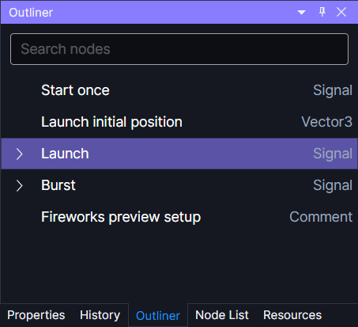 | 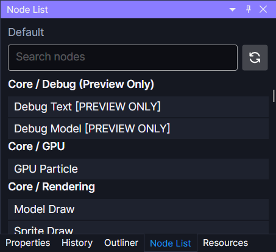 |

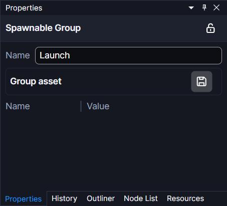

**Outliner** では、現在のグラフにあるノードを選びます。**Properties** に切り替えると、
選んだノードの詳細を確認できます。選択がないときはグラフ全体の設定が出ます。
表示項目はノードによって異なります。あるノードを表示したまま別のノードを調べるには、
インスペクターをロックし、別のスロットを開きます。

**Node List** では、型を検索してキャンバスへドラッグします。追加できることと、
他のピンに接続できることは別です。配線前にピンの型と、値か Signal かを確認してください。
基本のピン定義は[標準ノード図鑑](node-reference.md)に掲載しています。
ノード一覧、キャンバスのノード追加検索、エニシング検索では、翻訳名に加え、
元の英語のノード名や分類名でも検索できます。ユーザーが付けたノード名やアセット名はそのままです。

### エニシング検索

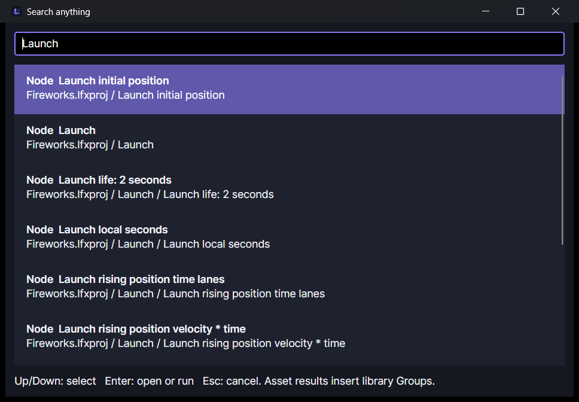

**Edit → Search anything** または `Ctrl+P` で開きます。Fireworks で `Launch` と入力し、
**Node** の結果を選ぶとそのノードへ移動できます。Enter を押す前に結果の種類を確認してください。
グラフの結果はグラフを、パネルの結果はツールを開き、Group ライブラリの結果は
インスタンスを追加する場合があります。何も実行せず閉じるには Escape を押します。
標準の結果分類やパネルも、画面の言語に関係なく英語名で検索できます。

### 履歴

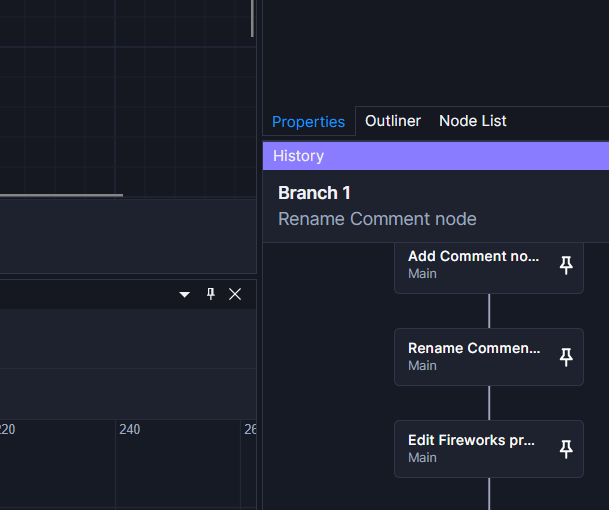

**History** は編集履歴をノードでつないだ分岐ツリーとして表示します。強調された経路が現在の状態です。
過去のノードを選ぶとその時点へ移動できます。
当時のグラフに戻れます。見返したい状態はピン留めできます。過去へ戻った後で編集すると、
元の履歴を上書きせず新しい枝に記録します。保存済みファイルの差分を調べるときは、
このパネルではなくリビジョン履歴やグラフ比較を使います。

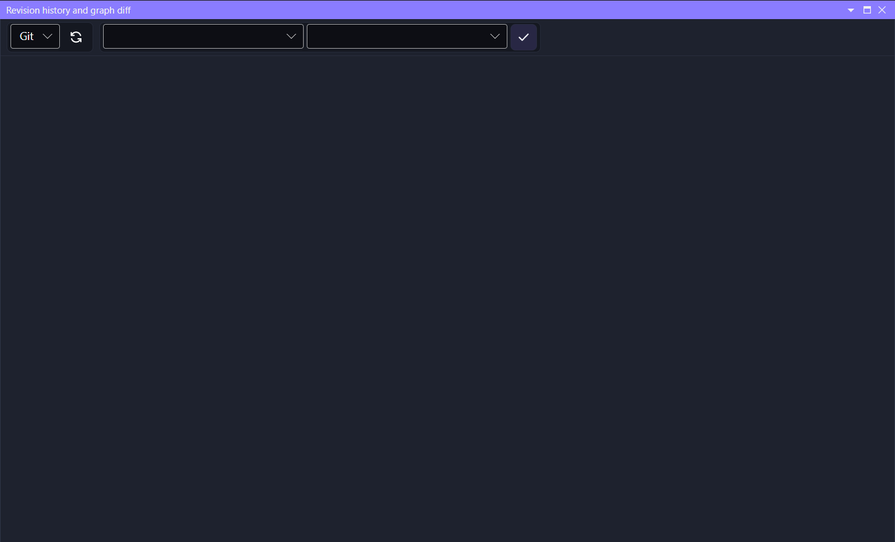

Git 管理下のプロジェクトでは、一覧を更新して保存済みのリビジョンを2つ選び、比較を実行します。
同梱サンプルなどでリビジョンが出ない場合は、**Compare Graph Files** で2つの保存済みファイルを
比較します。どちらもエディターの Undo 履歴を置き換えたり、変更をマージしたりしません。

## アニメーション

### タイムラインと再生バー

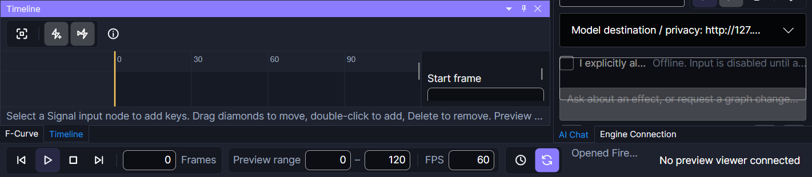

Fireworks を4秒間プレビューするには、範囲を **0〜240**、FPS を **60** に設定します。
初期値の **0〜120** では Launch の寿命が終わる頃にループし、Burst が見えないことがあります。
シークやコマ送りで時刻を確認し、描画結果は対応エンジンのビューアーを接続して確認します。
タイムラインのツールバーにある **Zoom Out** / **Zoom In** ボタンで表示範囲を拡縮し、
時計アイコンの切り替えでルーラー表示をフレーム単位と秒単位に切り替えられます。

時刻付き Signal を作るには、対応する Signal 入力ノードを選んで Timeline のキー追加操作を
使います。**Preview Signal** はエディターのプレビュー用、**Runtime Signal** は対応する
実行パッケージへの書き出し用です。ひし形をドラッグすると時刻が変わり、選択すると
時刻の編集や削除ができます。どちらも **Life Time** ノードの代わりにはなりません。

連続プレビュー再生は 120 秒の上限なく継続でき、前後への長距離シークも
1 フレームあたりのステップ数・時間予算内で複数フレームに分散して追いつくため、
エディターやエンジンが固まらずに目的時刻へ移動できます。追いつき中は
プレビューステータスに進行状況が表示され、新しいシーク・Stop・グラフ編集・切断を
行うと古い処理は即座に破棄されます。なお、手動送信した Editor Send シグナルや
外部エンジン入力は任意の後方シークでは完全再現されません。

### F カーブ

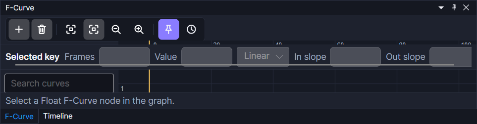

**Float F-Curve** ノードを選ぶとカーブが表示されます。キーを追加または選択し、
**Selected key** で時刻、値、補間を設定します。傾きは接線に対応する補間で使います。
キーが表示範囲外なら **Frame all** で全体を表示します。再生位置は Timeline と共通ですが、
F カーブのキーは値を作るもので、Signal を発火させるものではありません。

### スプライトアニメーション

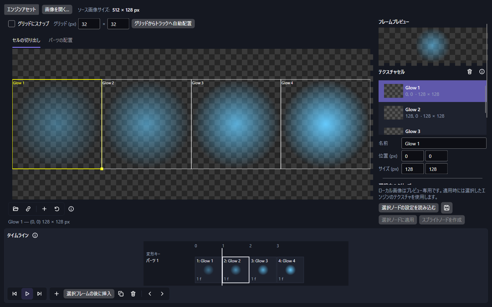

画像は2026.11.72のエディターにローカルの説明用画像を読み込んだ状態です。エンジンの描画ではありません。読み込みから適用までの手順は [パーティクルのアニメーション](sprite-animation.md)を参照してください。

1. ローカル画像を開くか、接続中のエディターから対応テクスチャを選びます。ピクセル単位で矩形を編集するには **Source dimensions** が必要です。
2. **Cut cells** で矩形を描くか追加し、ピクセル単位で位置とサイズを整えます。等間隔のアトラスはグリッド寸法を入力し、必要ならスナップを有効にして **Fill track from grid** を使います。
3. 下部の **Timeline** でフレームを挿入・並べ替え・再生します。パーツを重ね、別々に変形キーを打つには **Arrange parts** を使います。選択した CPU Particle・GPU Particle・Sprite Draw に反映する前に **Frame preview** で確認します。

### コンテンツとアセット参照

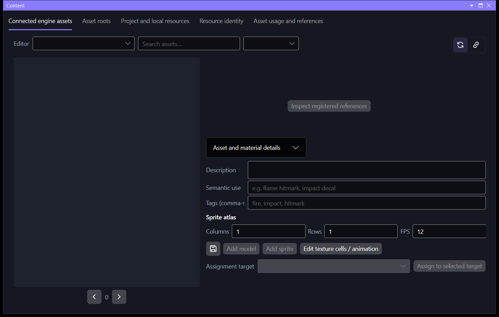

**Connected engine assets** で利用するエディターを選び、アセットを検索します。未接続で一覧が空でも、
エフェクトにローカルリソースがないとは限りません。ローカルリソースは **Project and local resources**、
使用可能な参照元は **Asset roots** で確認します。差し替え前には **Resource identity** で割り当てを、
**Asset usage and references** で使用箇所を見ます。同名ファイルでも、別のエンジンの割り当てが
同じアセットを指すとは限りません。

## エンジン接続と診断

### エンジン接続

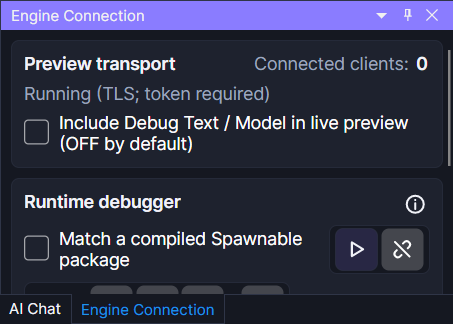

まず **Preview transport** を確認します。画像ではローカルサーバーは稼働していますが、
**Connected clients: 0** なので外部ビューアーは未接続です。接続後も、見えない原因を
グラフと判断する前に、送信先と転送状態を確認します。エンジン側の準備は
[ゲームエンジンとの連携](engine-integration.md)を参照してください。

**Runtime debugger** はプレビュー転送とは別機能で、対応する CPU デバッグセッションが必要です。
セッションと書き出し済みの Spawnable を対応づける場合は **Match a compiled Spawnable package**
を使います。招待情報は対象のクライアントだけに渡し、公開画像には映さないでください。

### ネイティブプレビュープロファイラー

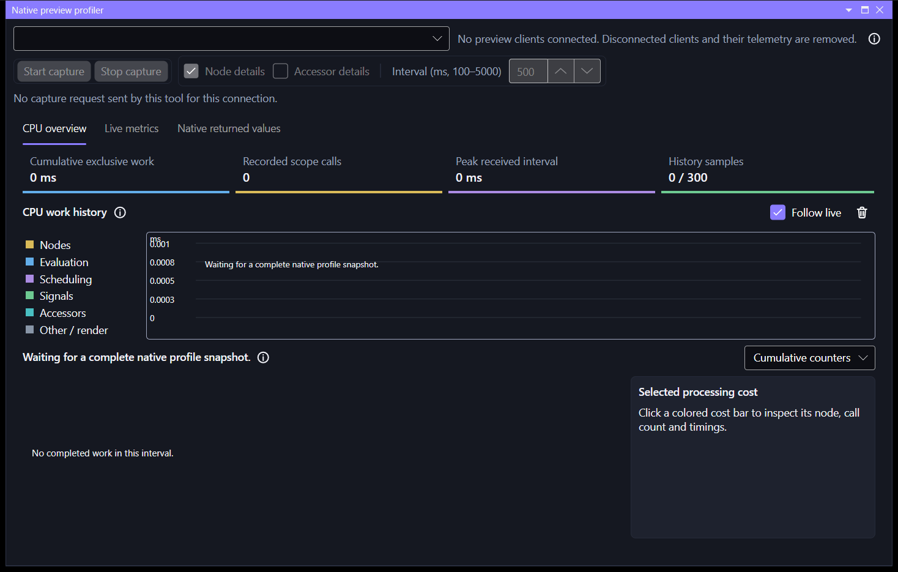

対応するプレビュークライアントを選んで計測を開始します。**CPU overview** は報告された処理コストの概要です。
結果が届いたら、色付きのバーを選んで対象スコープ、呼び出し回数、処理時間を確認します。
**Live metrics** と **Native returned values** では計測時間とは別の情報が見られます。
最初の計測結果が届く前の空グラフやゼロは、負荷を測定した結果ではありません。

### ゲーム内インスタンス

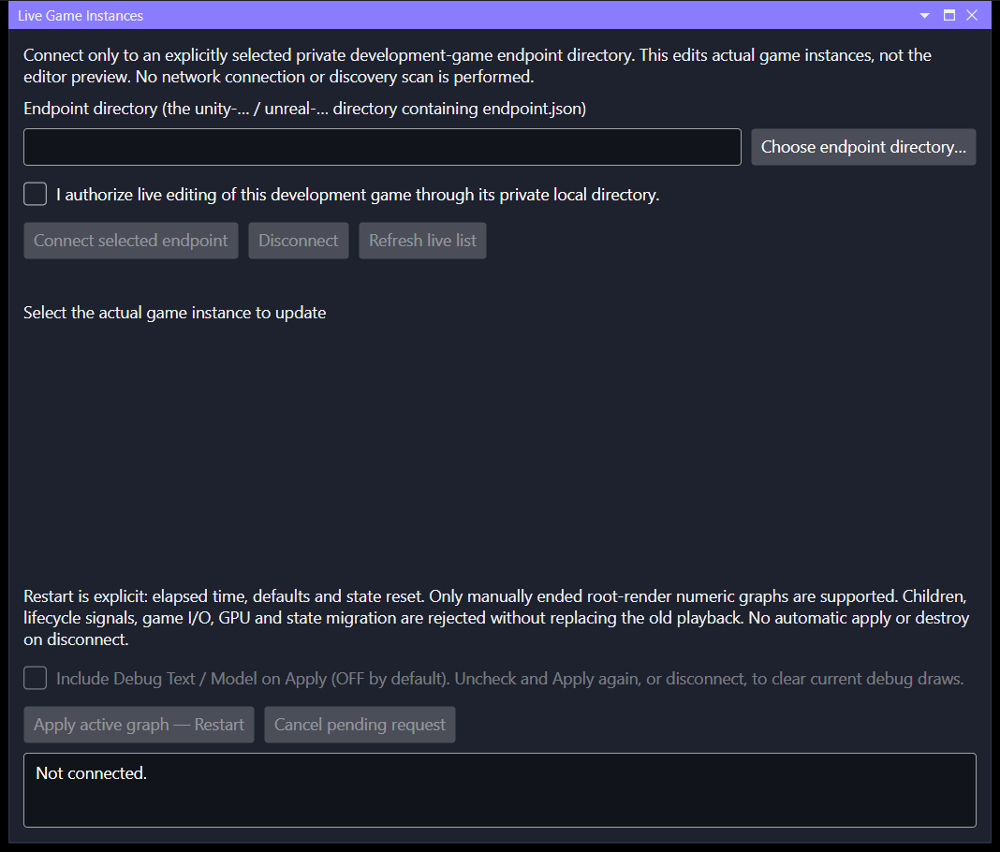

これはプレビューではなく、開発中のゲーム内にある実インスタンスを変更する画面です。
専用の接続先ディレクトリを選んで明示的に許可し、変更するインスタンスを選びます。
**Apply active graph — Restart** は対応する再生を最初からやり直し、経過時間と状態をリセットします。
状態の移行は行いません。適用前に画面内のグラフ制限を確認してください。

### ログ・AI チャット・クラッシュレポート

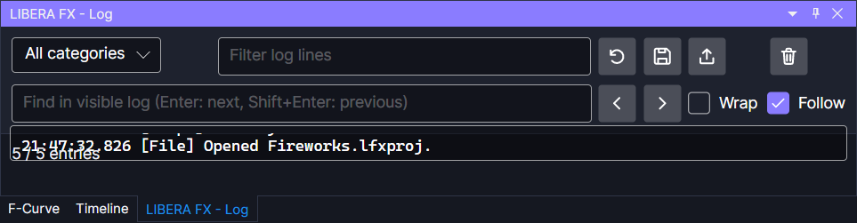

まずカテゴリとテキストで対象を絞り込みます。**Find in visible log** は表示中の結果内を移動します。
新着へ自動スクロールせず過去の行を読むには **Follow** を外します。
書き出したログを共有する前には、パスや接続情報を確認してください。

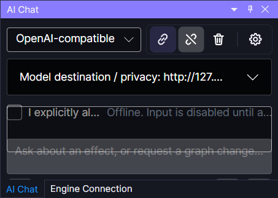

**AI Chat** では、グラフの文脈を送る前にアダプターと送信先を確認します。
ローカルツールへの接続は、モデルへの送信許可とは別です。グラフ変更が提案されたら、
内容を別途確認してから適用してください。

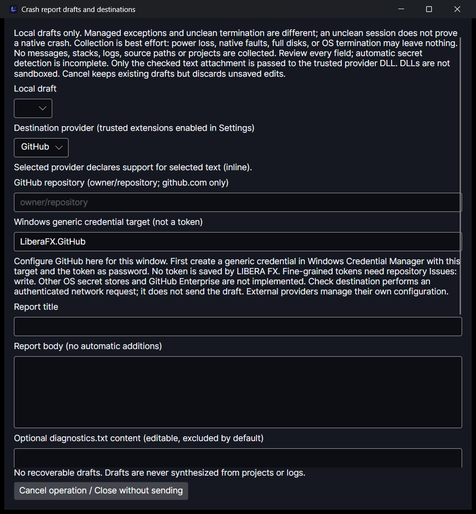

ローカルの下書きを選び、送信先と公開範囲、件名、本文、任意の診断情報を確認します。
**Check destination** は送信そのものではありません。画像では復元できる下書きがなく、
この画面がプロジェクトやログから自動でレポートを作ることはありません。

## 初回起動と設定

### 初期設定

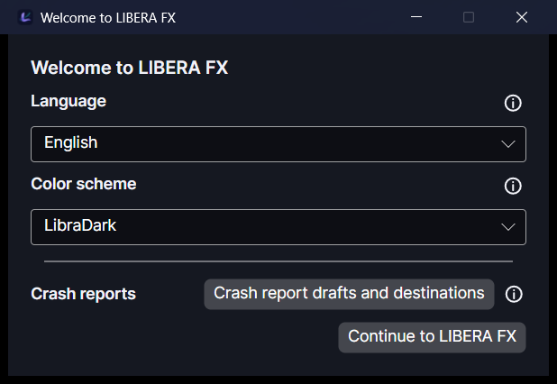

**Language** と **Color scheme** を選び、**Continue to LIBERA FX** で進みます。
クラッシュレポートのボタンは下書きと送信先の管理を開きます。配色を選んだり起動を続けたり
するだけではレポートは送信されません。外観は後から **Edit → Settings** で変更できます。

### 外観とショートカット

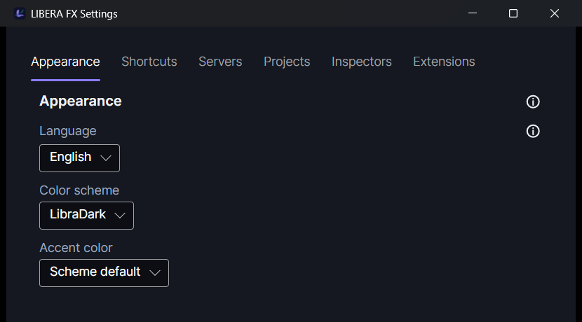

**Language** はメニューやダイアログ、**Node names** は標準ノードのラベルに適用されます。
日本語 UI で英語のチュートリアルを使うときは、ノード名だけ英語にできます。
配色やアクセントはエディターの見た目にだけ反映されます。
ノード名専用の言語欄はこの画像には写っていません。

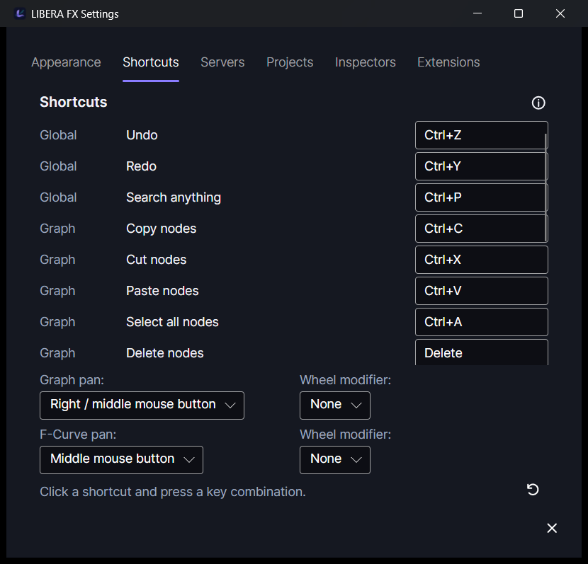

**Shortcuts** で使いたいコマンドを探し、現在の割り当てを確認します。グラフやカーブの
パン操作とホイールの修飾キーは、コマンドの割り当てとは別です。別のマシンで操作が違う場合、
グラフの問題と判断する前にここを確認します。割り当てを初期化しても開いているグラフは変わりません。

### サーバーとプロジェクト

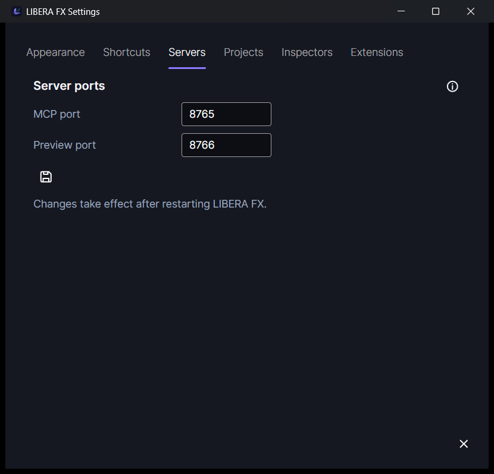

**Servers** では MCP とプレビューのポートを別々に確認できます。変更後は **Save** で保存し、
状態メッセージを確認します。エディターを再起動し、
クライアント側の接続先も合わせます。ポート番号はアクセストークンではありません。

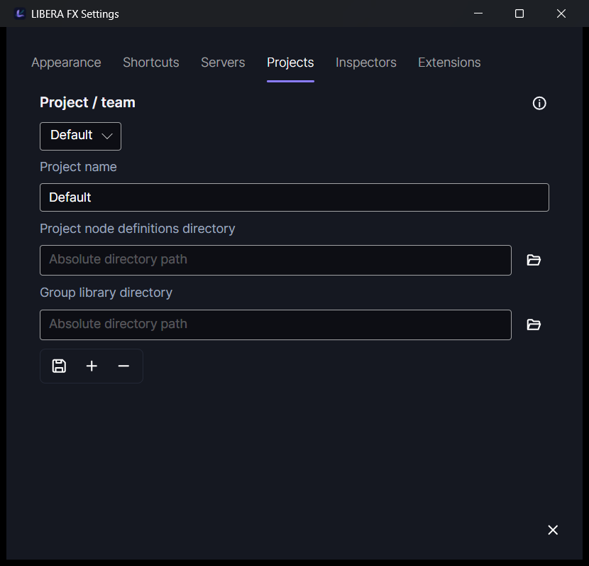

**Projects** では、追加で使うノード定義と再利用 Group を切り替えます。プロファイルを選ぶか作成し、
**Project node definitions directory** と **Group library directory** を設定して保存します。
追加カタログを使わない作業に戻るには **Default** を選びます。切り替えても、開いている
グラフに保存済みのノードや Group のリビジョンは書き換わりません。

### インスペクターと拡張機能

| インスペクター | 拡張機能 |
| --- | --- |
| 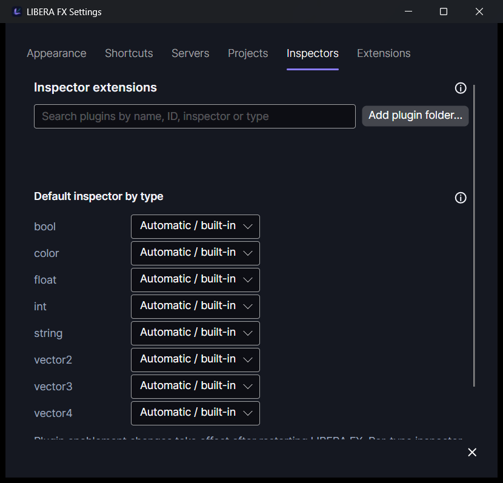 | 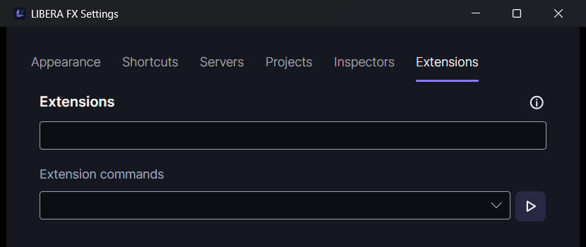 |

**Inspectors** では登録済みの提供元を確認し、値の型ごとに既定のインスペクターを選びます。
標準の選択動作へ戻すには **Automatic / built-in** を選びます。**Extensions** では
インスペクターとは別に拡張コマンドを確認できます。プラグインはグラフファイルとは違い、
コードを実行するので、信頼できるものだけを有効にしてください。
画像ではローカルディレクトリを伏せています。
