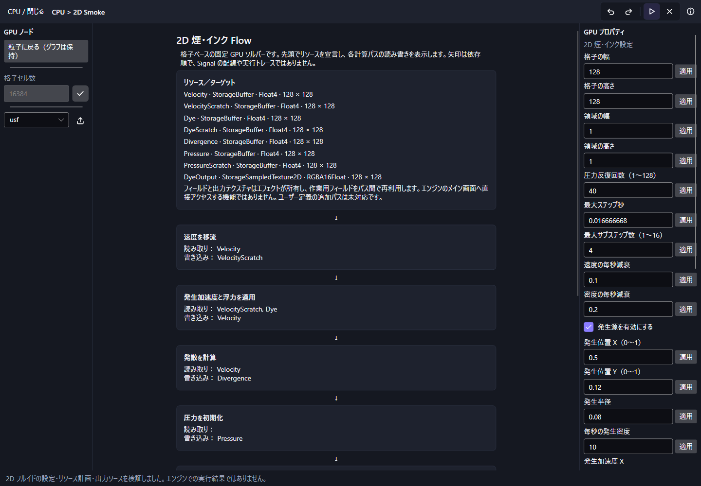
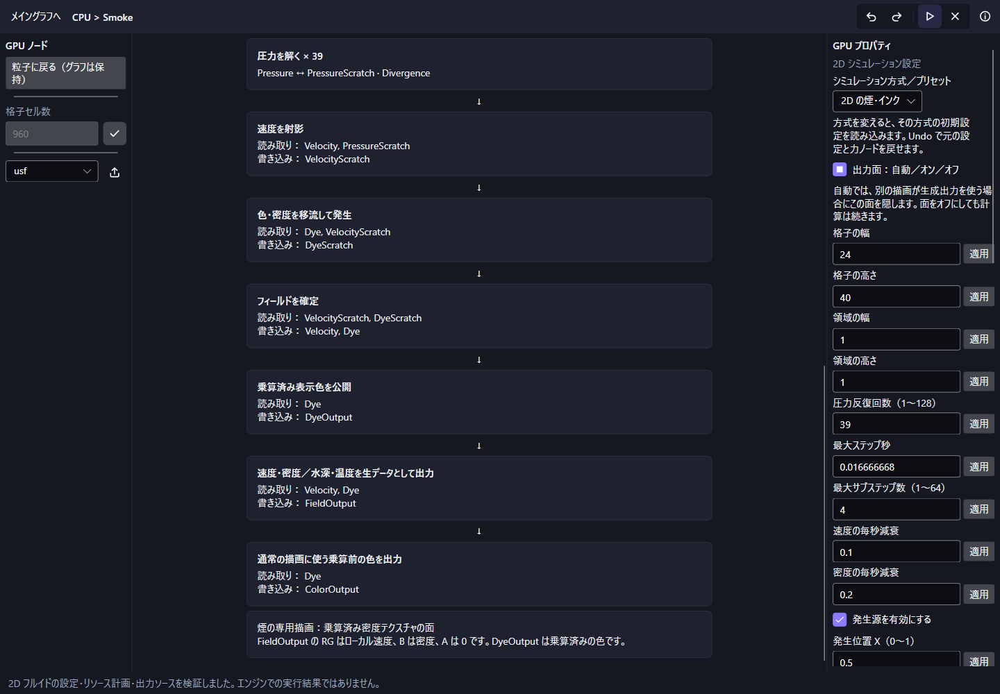
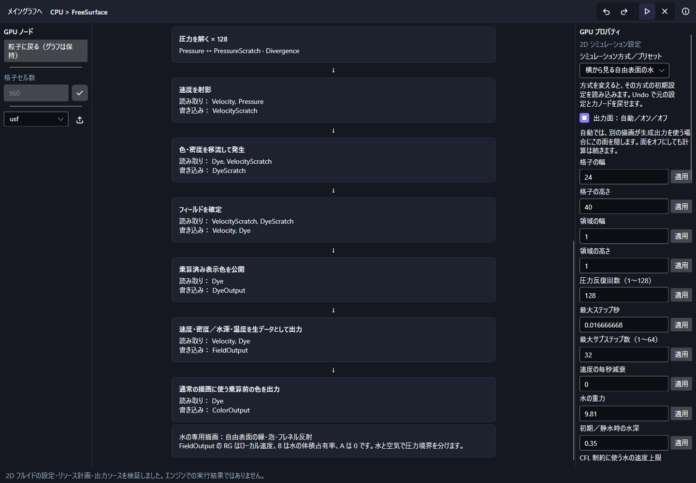
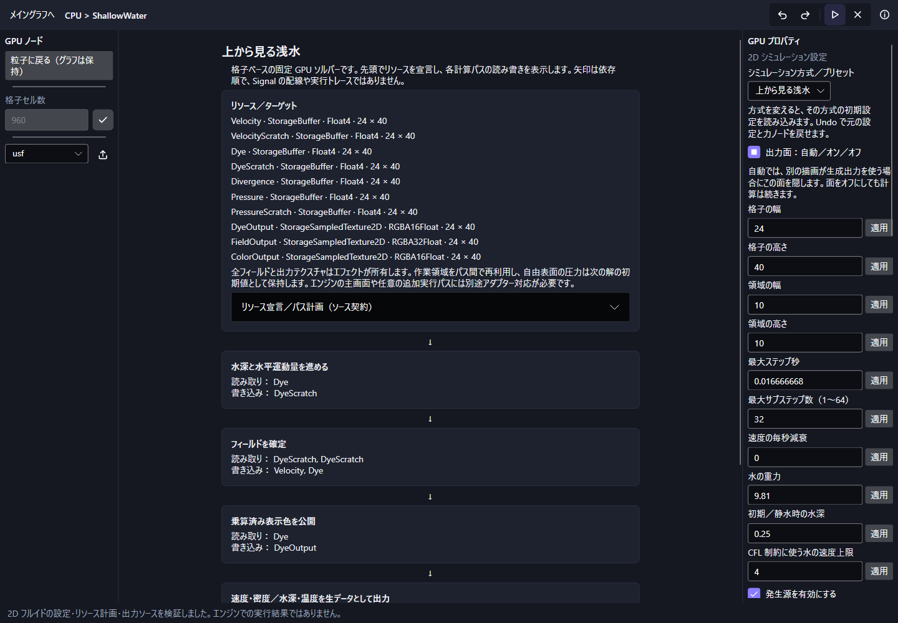
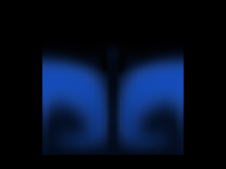
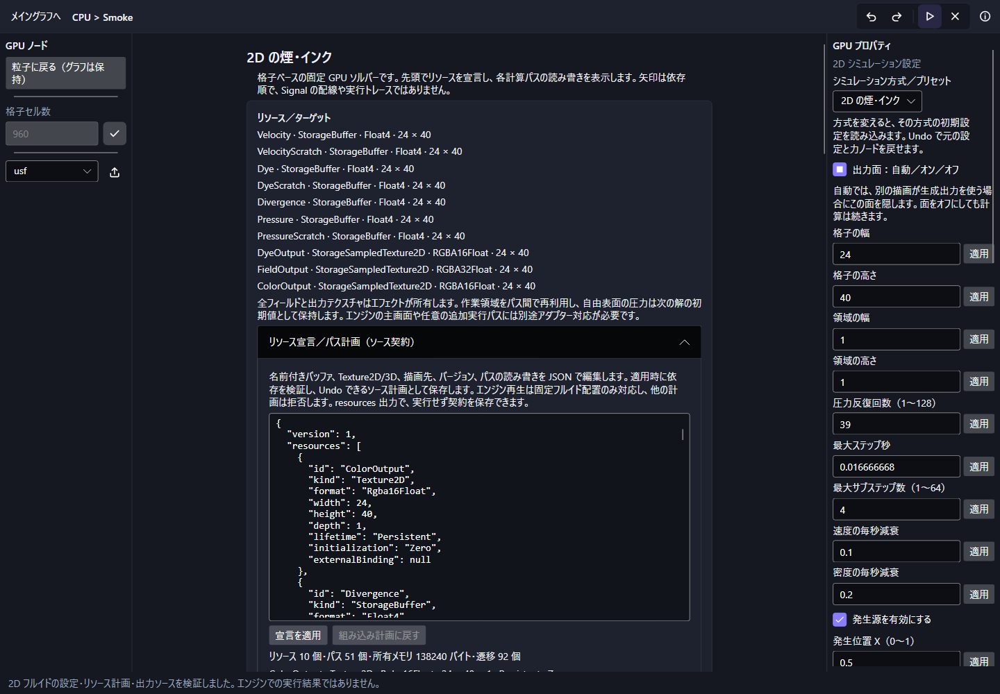

# 2D フルイド：煙・水・炎

4 方式の流体・セル外力・通常描画への接続は
[2026.11.42 Preview](https://github.com/Libra-Works/LibraFX/releases/tag/v2026.11.42)
に含まれます。対応するエディターと SDK を使ってください。それ以前の
アーカイブは変更されません。[更新案内](preview-update.md)も参照してください。
下記の Windows 実 GPU 環境で受け入れ確認済みです。

## 水・炎のエフェクトを作る

1. **GPU Particle** を追加し、専用ワークスペースで **Fluid2D を使う**を選びます。
2. **シミュレーション方式／プリセット**を選びます。モデルの変更はプリセット設定を読み込み、以前の外力ノードを置き換えます。Undo で戻せます。
3. グリッド・領域・発生源・モデル固有の設定を調整します。小さいグリッドから始めてください。発生源の座標は正規化値、半径と水深は計算領域の距離単位です。
4. **出力面：自動／オン／オフ**を自動のままにすると専用レンダラーを使います。連続再生するルートでは**処理がなくなったら自動終了**を無効にします。Spawnable テンプレートには Spawn Signal と適切な **Life Time** が必要です。
5. エフェクト全体を `.lfxb` へ書き出し、対応 SDK で再生します。CPU 専用コンバーターは GPU を拒否します。検証・コンパイルやソース書き出しだけでは GPU は実行されません。




画像は日本語・LibraDark の開発版エディターを実際に撮影したものです。エンジンの再生画像とは区別します。

| モデル | 計算 | 専用レンダラー |
| --- | --- | --- |
| Fluid2D（煙 / インク） | セル中心速度の圧力投影と色密度の移流 | 乗算済みアルファの密度平面 |
| 横から見る自由表面の水 | MAC の面速度、空気側の圧力境界、閉じた矩形領域の保存的な水体積率輸送 | 水色・Fresnel 反射・表面の泡・ハイライト |
| 上から見る浅水 | 平坦な底面の一次 HLL 法による水深・水平運動量 | GPU で高さを変位させた水平グリッド・法線・Fresnel・泡 |
| 燃料 / 温度による燃焼 | 燃料注入・着火温度を使った反応・発熱・冷却・煙の輸送 | 温度による発光と煙の不透明度 |

自由表面の飛沫はグリッド内の水体積率として輸送します。独立した水滴メッシュや粒子ベースの液体計算は生成しません。浅水は水平セルごとの水深で表すため、巻き返す波は表現できません。固体障害物・底面地形には未対応です。炎の発光表示と、燃料消費・温度変化の計算は別です。

## エディターとエンジンの実例




以下は Unity 7000.0.0a16 / D3D11 / Built-in RP fallback で、24×40 の合成検証サンプルを固定更新 120 回後に撮影したものです。自由表面は初期のたまり水の上へ注入する発生源ありの別設定、浅水は水深の発生源ありです。小さい格子による描画基礎の確認画像で、完成した水景観の作例ではありません。




従来の煙の検証では、初期の空状態から煙が上昇する状態も撮影しています。


## リソースと時間更新

パスより前にリソースを表示します。Float4 バッファ 7 本が速度・速度作業領域・状態・状態作業領域・発散・圧力の ping-pong を保持します。描画・サンプリング用の出力は次のとおりです。

| 出力 | 形式 | チャンネル / アルファ |
| --- | --- | --- |
| `DyeOutput` | RGBA16Float | 乗算済み表示 RGB と不透明度 |
| `ColorOutput` | RGBA16Float | ストレート表示 RGB と不透明度。通常の Sprite / Flexible Plane 向け |
| `FieldOutput` | RGBA32Float | RG = セル中心のローカル速度、B = 煙密度・水体積率・浅水の水深、A = 燃焼温度（他モデルでは 0） |
| `VelocityOutput` | `FieldOutput` のビュー | RG の生速度。追加確保なし |
| `DensityOutput` | `FieldOutput` のビュー | B の密度 / 水深と A の温度。追加確保なし |

所有する計算領域は**セル当たり 144 バイト**です。128×128 で 2.25 MiB、1024×1024 で 144 MiB。メッシュ・消費側粒子・ドライバーの追加領域は含みません。エフェクト / スコープのインスタンスごとに独立して確保します。生成元を停止すると借用中の出力テクスチャを無効化し、キュー上の GPU 処理が必要な領域は完了まで保持します。

内部状態は、自由表面では W が水体積率、浅水では XYZ が水深と二方向の運動量・W が数値上の水深制限の記録、燃焼では XYZW が燃料・温度・煙・反応速度です。表示テクスチャの配置とは異なります。

最大ステップとサブステップ数で仕事量を制限します。水はセル間隔と速度上限による二次元 CFL 条件も使い、浅水では重力波速度も加味します。超過時間は無制限に持ち越さず、破棄量を記録します。浅水には基準水深の 16 倍の安全上限があります。これらは任意の設定の精度を保証しません。経過時間 0 では注入・シミュレーションを実行しません。

煙・自由表面・燃焼では圧力反復を使います。自由表面の圧力は前の解を初期値に使い、浅水は圧力投影を使わず水深・運動量を更新します。渦度強調は近傍の速度から求める別の外力で、発散と圧力投影より前に適用します。0 で無効です。

## リソース宣言を編集する

通常の煙・水・炎は右側のフルイド設定で調整できます。発生源の有効・無効はチェックボックス、方式は選択欄、グリッドや速度は数値欄から変更します。JSON の手書きは不要です。

リソース構成自体を編集する場合は、リソース／ターゲット内の**リソース宣言／パス計画（ソース契約）**を開きます。以下は開発版のフォーム操作です。

1. リソース名を開き、種類・形式・寿命・初期状態を選び、幅・高さ・奥行きを入力します。バッファの幅は要素数です。**リソースを追加**や**削除**で行を変更できます。
2. パス名を開き、演算名を入力します。**このパスより先に実行するパス**にチェックを入れて実行順序を指定します。
3. 各読み書きの項目で参照リソース・アクセス方法・フレームを選びます。バージョン 0 は初期状態で、書き込み後のバージョンは 1 から指定します。**読み書きを追加**で参照を増やせます。
4. **フォームの設定を適用**で内部的に JSON を生成し、依存関係を検証して保存します。追加・削除も適用するまでは下書きです。不正な計画は保存されません。保存は 1 回の Undo で戻せます。
5. **組み込み計画に戻す**で上書きを解除します。直接編集が必要な場合だけ**詳細：JSON を直接編集**を開き、**宣言を適用**を使います。フォームと詳細欄は別の入力元なので、使う方の適用ボタンを選んでください。

プロジェクト・履歴・MCP にも保存し、`resources` 出力でソース契約とコンパイル情報を書き出せます。



この編集は配置と依存の宣言で、任意のエンジンカーネルや主画面を提供するものではありません。変更していない組み込みフルイド計画は再生できます。別の配置・演算は `ResourcePlanRuntimeUnsupported` として再生を拒否します。フルイドを再生するには組み込み計画に戻してください。外部描画先の宣言だけで、ホスト上の利用可否・書き込み許可・所有権は保証しません。Texture3D の実行は別途対応が必要です。

## 通常描画へ渡す

フルイドの描画先設定で、**同じ実行スコープ**内の対象ノード・テクスチャ入力・出力を選んで接続します。通常の **SpriteDraw** / **FlexiblePlaneDraw** の主テクスチャには `ColorOutput` を使います。マテリアルのテクスチャ引数にはストレート色・乗算済み色・生フィールドを渡せます。マテリアル側で形式を解釈してください。Sprite Animation / Composition の主テクスチャは対象外です。

表示色を消費する描画があると、明示的に上書きしない限り生成元の自動平面を非表示にします。生フィールドのサンプリングだけでは専用描画を残します。平面を消しても計算は継続します。マテリアルはプロジェクト固有の明示的バインドを使います。Unreal の通常描画には SDK 指定の Sprite / Flexible Plane 用マテリアルが必要です。未解決のマテリアルはエラーです。

## 別の GPU 粒子を動かす

同じスコープの GPU コンテナに Flow Map リソースを追加し、生成元と `VelocityOutput` / `DensityOutput` を選びます。対応する生速度・密度のエンコードと生成元平面の座標系を選択します。静的 Flow Map は従来の符号付き正規化変換とワールド境界を維持します。

`sampleFlowMap("field", @Position)` は粒子位置を生成元の平面へ変換し、領域外では端へクランプします。生速度は粒子の計算座標へ変換します。密度は密度 / 水深と温度を返します。

```text
@Velocity = sampleFlowMap("velocity", @Position);
@Alive = greaterthan(sampleFlowMap("density", @Position).x, .01);
```

ランダムな候補位置・比較・数学演算と組み合わせて発生マスクや確率を組みます。密度に応じた発生量は明示的なグラフで表現し、自動的には変更しません。生成元を消費側より前に実行します。親子をまたぐ共有・暗黙の同一フレーム循環は未対応です。接続した Draw Matrix はワールド座標の上書きで、生成元平面のサンプリングには双方の可逆な変換が必要です。

## セルごとの外力を組む

外力エディターは順序付きの最大 8 ノードです。**セル位置**・**シミュレーション時間**・ノイズ / カールノイズ・**密度 / 水深**・**温度**・数学 / マスク演算を追加します。**入力 A / B** は前のノードから選びます。ノイズの A は位置、B は時間です。未接続ならセル位置・計算時間を使います。

例：セル位置・時間 → カールノイズ、カールノイズ × 密度 → 外力。加算・乗算・サイン・Smoothstep マスクをセル単位で評価します。ノイズには周波数・シード・オクターブ・粗さ・時間変化を設定できます。Smoothstep の X/Y は下限・上限です。後続が消費していない数学・ノイズ・加速度の出力を外力として合計します。位置・時間・場の取得ノードだけでは外力を加えません。削除時は消費側の接続を外します。先への参照と循環は拒否します。

煙・自由表面・燃焼では圧力投影より前に外力を適用し、浅水では運動量へ加速として適用します。渦度強調は独立した近傍場演算です。設定・ノード ID・接続・出力バインドは保存 / 読み込みと Undo/Redo に対応します。

## 互換性と検証範囲

粒子のみの実行ペイロードは version 1、通常のフルイドは version 2、生成リソース / 描画参照と自動平面の明示指定は version 3 です。CPU バイトコードと粒子ストレージ配置は変更しません。フルイドのシェーダー uniform は 512 バイトです。再生成した対応 SDK シェーダーを使ってください。古い SDK は未対応ペイロードを拒否します。

Windows / Radeon RX 6700 XT で実 GPU 検証を通過しました。対象は Unity 7000.0.0a16 D3D11 + Built-in RP fallback、Unreal 5.7 D3D11 SM5、Godot 4.7.2 Vulkan Mobile / Forward+ です。水の質量・静止状態、有限値、温冷燃料、専用描画、通常描画への生成テクスチャ接続、停止と再生を確認しています。Unreal は全体の Clang コンパイル、最後に変更したファイルの個別 Clang コンパイル、最終 MSVC リンク、実 GPU 検証を通過しています。Godot Compatibility に計算の代替経路はありません。他 API・コンソール・エクスポートしたプレイヤーは別途検証が必要です。UE 5.8 / 5.9 は別 Issue で追跡し、5.7 の結果から対応済みとは判断しません。

共通リソース計画は所有権・バージョン・パスの読み書き・依存・ハザード・生存区間を宣言します。一般的な Texture3D 計算・任意の実行パス・前フレームのコンテナ間共有・エンジンの主画面への書き込みには追加のアダプター機能が必要です。宣言だけでは実行対応になりません。[リソース中心の Flow 案](https://github.com/Libra-Works/LibraFX/issues/68)。

`ColorOutput` はエンジンの通常画像の UV 方向に合わせます。`DyeOutput` / `FieldOutput` は下端を行 0 とする計算座標を維持します。生フィールドのサンプリングや、その方向を解釈するマテリアル向けです。Unreal / Godot では ColorOutput 公開時に行を反転し、通常描画のシェーダーに特別な UV 処理を要求しません。

Unreal の専用流体描画は現在、Tonemap 後の View Extension で描きます。シーン深度による遮蔽や透明物全体の描画順には対応していません。Unity・Godot はシーンのメッシュを使います。照明・屈折・完成した水面の合成には追加の描画対応が必要です。
