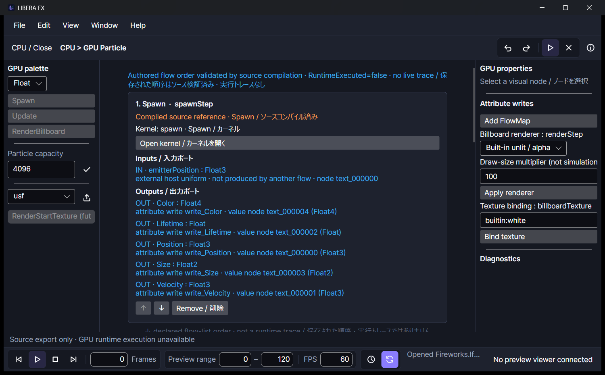
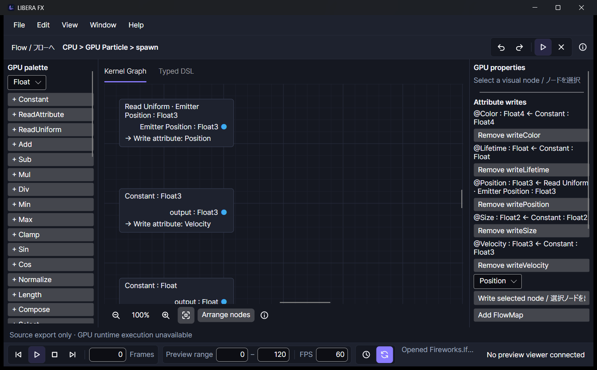
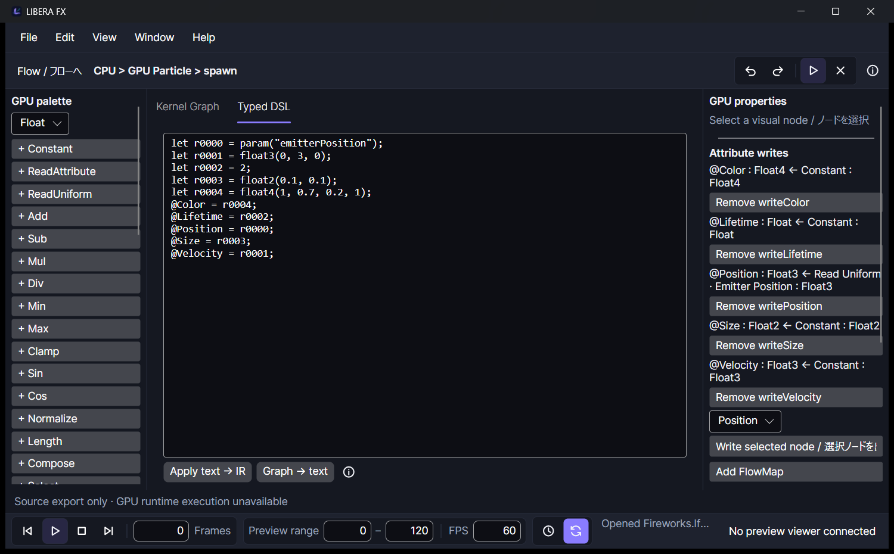

[トップ](index.md) · [画面リファレンス](editor-reference.md) · [標準ノード図鑑](node-reference.md)

# GPU パーティクル制作

**GPU Particle** はメイングラフに置くコンテナで、中身は専用のワークスペースで編集します。
外側のグラフはエフェクトの実行スコープと Signal を管理し、GPU カーネルは粒子の型付きの値を計算します。
CPU の Signal 接続と GPU の値の配線は別物です。

## パーティクルプログラムを開く

1. **Node List → Core / GPU** から **GPU Particle** をメイングラフに追加します。
2. **GPU Program — double-click to edit** と表示されたノードをダブルクリックします。
   パンくずが CPU グラフから GPU ワークスペースに切り替わります。
3. Spawn または Update カードの **Open kernel** を押すと、計算グラフを編集できます。
   **Back** でフローに、**CPU / Close** でメイングラフに戻ります。

中央に並ぶのは設定した実行順で、実行中のトレースではありません。カードは次の順で読みます。

| フェーズ | 編集する内容 |
| --- | --- |
| **Spawn** | Position、Velocity、Lifetime、Size、Color など粒子の初期値を決めます。初期プログラムの `emitterPosition` はホストから受け取る uniform で、ほかのフェーズの出力ではありません。 |
| **Update** | 更新ごとのシミュレーションです。現在の属性を読み、次のステップまで保持する値を計算して属性へ書きます。毎秒の変化量には `deltaTime` を掛けます。 |
| **RenderBillboard** | シミュレーション結果を描画します。テクスチャ、マテリアルプリセット、描画サイズ倍率を設定します。倍率が変えるのは描画サイズで、シミュレーションの Size 属性ではありません。 |

**Particle capacity** はプログラム全体の粒子容量です。チェックマークで変更を適用します。
粒子の保持数に関わる設定で、発生頻度ではありません。

## カーネルを編集する

1. Spawn カーネルを開き、**Lifetime** の書き込み元を選びます。最初の試し方として、
   Float の定数を変更し、コンパイルします。これは粒子の寿命で、CPU 側のエフェクトの寿命ではありません。
2. 計算を追加するときは **GPU palette** で型を選んで演算を追加し、互換性のある入力へ出力をつなぎます。
   ノードを選んで設定を確認します。ほかの演算や属性の書き込みに使われていない値は、粒子の状態を更新しません。
3. **Attribute writes** で、計算結果を更新したい属性に割り当てます。たとえば Update では
   Position と Velocity を読み、`Position + Velocity × deltaTime` を計算して Position に書きます。
   型の不一致、入力不足、フローの不正は **Diagnostics** で確認します。

**Kernel Graph** と **Typed DSL** は同じプログラムを編集する画面です。別々に実行されるわけではありません。
テキスト欄は制限された型付き言語で、HLSL、VEX、汎用スクリプトではありません。
**Graph → text** でグラフからテキストを生成し、**Apply text → IR** で変更を反映します。
不正なテキストは下書きとして残り、最後の有効なグラフを置き換えません。

## コンパイル・出力・エンジン上での確認

**Compile** を実行し、診断を解消してから出力します。専用ワークスペースから移植可能な IR や
対応シェーダーソースを出力でき、シェーダーを出力する際は対応するメタデータも保持します。
**コンパイルや出力が成功しても GPU 上で実行したことにはなりません。**
対象エンジンでバインディングを解決し、バックエンドに必要なアセットを構築または取り込んだうえで、
粒子の動きと描画を確認します。シェーダーソースや生の `.lfxb` だけでは GPU エフェクト一式になりません。
[ゲームエンジンとの連携](engine-integration.md)も参照してください。
