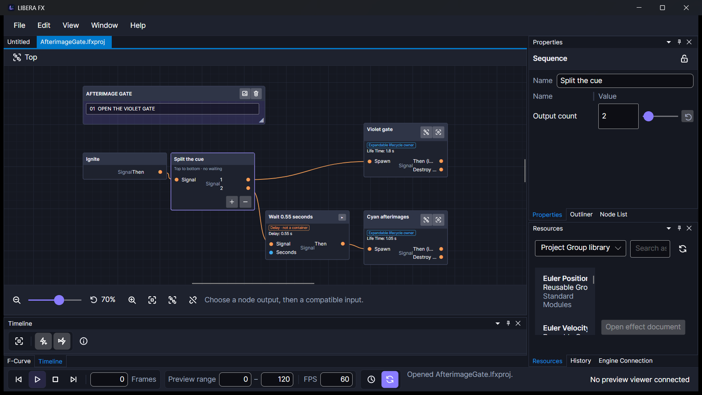

# LIBERA FX ドキュメント

LIBERA FX は、Unity・Unreal Engine・Godot で再生するエフェクトを、
ノードグラフで作るエディターです。エディターでグラフを組み、
同梱のコンバーターで変換してから、ゲームエンジン上で再生します。

**最新 Preview のダウンロード:** [GitHub Releases](https://github.com/Libra-Works/LibraFX/releases)

| ガイド | 内容 |
| --- | --- |
| [今回の Preview 更新と移行手順](preview-update.md) | フルイド・ネスト・描画の追加内容、SDK の更新方法、未対応項目を確認できます。 |
| [制作からゲーム組み込みまで](production-workflow.md) | Unity・Unreal・Godot 別に、導入・起動・資源取得・プレビュー・アセット化・配布まで進めます。 |
| [一括コンバーター](batch-conversion.md) | CPU 系の一括出力、共有ライブラリの解決、ゲームビルドへの組み込みを説明します。 |
| [はじめに](getting-started.md) | エディターを導入し、同梱の **Afterimage Gate** を開いて、エフェクトを動かすシグナルをたどります。 |
| [用語集](glossary.md) | ノード、Signal、Spawnable、ランタイムなどの言葉を、短い例と一緒に確認できます。 |
| [ウィンドウとパネルのリファレンス](editor-reference.md) | ツール、設定、ダイアログの使い方を実画面と操作例で確認できます。 |
| [GPU パーティクル制作](gpu-particles.md) | GPU フロー、ビジュアルカーネル、型付き DSL、ビルボード設定を編集します。 |
| [2D の煙・インク](fluid-2d.md) | リソース先頭の GPU 格子ソルバー、発生源、密度テクスチャを扱います。 |
| [CPU パーティクル制作](cpu-particles.md) | Spawn／Update 子グラフ、粒子の放出、CPU の Property／Signal のやり取りを説明します。 |
| [Flexible Plane Draw](flexible-plane-draw.md) | 自由配置の点列や、位置の履歴から帯状のポリゴンを作ります。 |
| [グラフ制作ガイド](authoring.md) | ピンの接続、カーブ、Spawnable の寿命、Group の再利用を説明します。 |
| [標準ノード図鑑](node-reference.md) | カテゴリーとサブカテゴリーから標準ノードを探し、入出力ピンや既定値を調べられます。 |
| [スカラー演算の使い方](scalar-math-nodes.md) | 新しい10ノードで、値の折り返し、なめらかな変化、しきい値、逆補間を扱います。更新後のランタイム・SDK が必要です。 |
| [クォータニオンと乱数](quaternion-random.md) | 回転を合成し、シードとサンプル番号を指定して再現可能な乱数を使います。 |
| [ゲームエンジンとの連携](engine-integration.md) | SDK を導入してエフェクトを再生し、スクリプトや独自 C++ ノードで拡張します。 |
| [SDK 配布リファレンス（英語）](https://github.com/Libra-Works/LibraFX/blob/main/docs/sdk-distribution.md) | ソースからのビルド、パッケージの組み立て、対応環境と検証範囲を確認できます。 |

*エディター上の Afterimage Gate グラフです。ゲームエンジンによる描画結果ではありません。*

## フルイドは 2D を先に充実

最初は **smoke-first：GPU による 2D の煙・色密度の移流**です。
今回の更新では固定の格子ソルバーとリソース先頭の Flow を追加しています。
設定・エンジン検証・制限は[2D の煙・インク](fluid-2d.md)を参照してください。
2026.11.22 より後の Preview 更新が必要です。エディター・コンバーター・SDK は
同じビルドを組み合わせてください。過去のアーカイブは更新されません。

Unity・Unreal・Godot の描画改修、CPU パーティクルの Flow、GPU 放出形状は
今回の更新に含みます。Spawnable のネストと内部 CPU 粒子も、個体ごとの所有・寿命に対応します。
**2D を充実させてから 3D へ進める**計画は
[issue #69](https://github.com/Libra-Works/LibraFX/issues/69)にまとめています。
液体や燃焼は今後の対象で、煙・色密度の計算は水面や炎の実装ではありません。
今回のリソース／ターゲット宣言は
[issue #68](https://github.com/Libra-Works/LibraFX/issues/68)の一部を具体化したもので、
任意のリソースグラフやメイン画面へのアクセスではありません。

[ソースリポジトリ](https://github.com/Libra-Works/LibraFX) ·
[MIT ライセンス](https://github.com/Libra-Works/LibraFX/blob/main/LICENSE)
