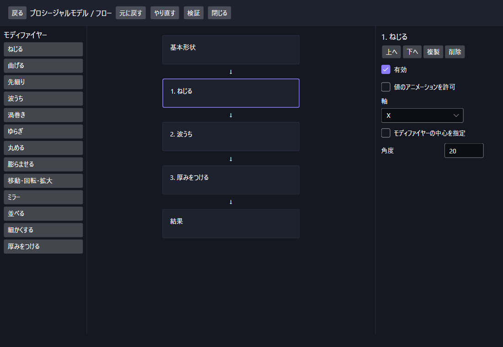

# プロシージャルモデル・テクスチャ・マテリアル

エフェクトグラフからモデル形状、GPU 生成テクスチャ、マテリアルを作れます。
[2026.11.42 Preview](https://github.com/Libra-Works/LibraFX/releases/tag/v2026.11.42)
に含まれます。対応するエディターとエンジン SDK を組み合わせてください。
それ以前のアーカイブは変更されません。

エディターで実際に撮影した制作画面です。エンジン上の描画結果ではありません。

## リソースを作成して接続する

1. **Node List → プロシージャル**から**プロシージャルモデル**、
   **プロシージャルテクスチャ**または**プロシージャルマテリアル**を追加します。
   生成ノードをダブルクリックすると、メイン画面内で Flow を編集できます。
2. **プロシージャルモデル**では基本形状を選び、モディファイヤーを追加・配置します。
   上から順に適用されます。ステップを選ぶとインスペクターで編集でき、
   並べ替え・複製・削除・Undo/Redo に対応します。
3. モデルの出力を **Model Draw** の `proceduralModel` へ接続します。
4. テクスチャー出力をマテリアルの `texture0`～`texture3` へ接続し、
   **テクスチャ参照**の処理で利用します。マテリアルの出力は
   **Model Draw** の `proceduralMaterial` へ接続します。

生成したモデルや画像をエンジンへインポートする必要はありません。
連続的に変化する数値はグラフから接続できます。

## 上限とリソースの動作

モデルのモディファイヤーは最大 16 個です。静的モデルは最大 65,536 頂点 /
131,072 三角形、アニメーションするモデルは最大 16,384 頂点 /
32,768 三角形です。ピボットは変形前の基本形状を基準に決まり、
モディファイヤーをアニメーションしても勝手に移動しません。

プロシージャルテクスチャは 256×256 で作成され、最大 1024×1024、
処理 32 個、ノイズ 8 オクターブまでです。マテリアルから参照できる
テクスチャーは最大 4 つです。初期マテリアルは Unlit で、Alpha / Additive、
片面 / 両面を選べます。上限を超える設定は明示的にエラーとなり、
形状の切り捨てやアニメーションの停止で回避しません。

同じ設定の静的リソースはエフェクト間で生成結果を共有できます。
アニメーションや外部入力があるリソースはインスタンスごとの状態を保ちます。
通常のテクスチャー再生で、生成ピクセルを CPU へ読み戻しません。

同梱の `ProceduralSlash.lfxproj`、`ProceduralShockwave.lfxproj`、
`ProceduralBeam.lfxproj` は外部のモデル・画像を必要としません。
最終的な見た目は対象エンジンのプレビューで確認してください。

## 検証範囲

Windows 上のローカルエンジン確認では Unity 7000.0.0a16 / D3D11、
Godot 4.7.2 / Vulkan、Unreal 5.7 / D3D11 を使用し、生成モデル、アニメーション、
Stop 後の解放を確認しました。Unity では静的出力の共有、変更がない場合の
再ディスパッチ抑制、独立したアニメーション、依存リソースの寿命も確認しています。
これらはエディターとエンジンの連携確認であり、配布 Player や Unreal の
Cook を保証するものではありません。UE 5.8 / 5.9 と他の描画バックエンドは
別途検証が必要です。
