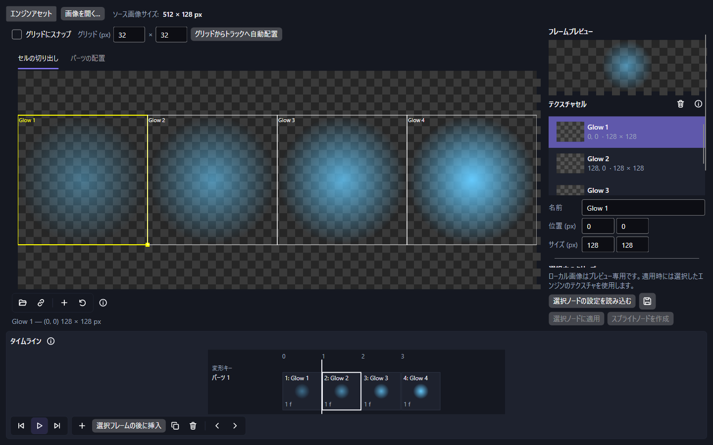

# パーティクルのテクスチャをアニメーションさせる

**Sprite Animation** で画像からセルを切り出し、コマを並べて、**CPU Particle** または **GPU Particle** に適用します。各粒子は自分が生まれてからの時間で再生するので、コマ送りの計算をノードで組む必要はありません。

先にパーティクルのコンテナーと、ゲームエンジンから参照できるテクスチャを用意します。最初のエフェクトには [噴水のチュートリアル](first-fountain.md)を使えます。

## 1. パーティクルを選び、Sprite Animation を開く

1. メイングラフで **CPU Particle** または **GPU Particle** を選びます。
2. **Window → Sprite Animation** を開きます。
3. 既存のアニメーションを直す場合は、先に **選択ノードの設定を読み込む** を押します。

**確認：** 目的のドキュメントとパーティクルを選んでいることを確認します。「読み込む」は設定を読む操作、「適用」はノードへ書き戻す操作です。

## 2. 元の画像を読み込む

接続先がテクスチャの一覧取得に対応している場合は、エンジンアセットから選べます。ローカル画像を開いて、セルの編集とプレビューを行うこともできます。

**ローカル画像はプレビュー用**です。適用時には選択したエンジンのテクスチャを使います。同じ画像・ピクセル寸法のアトラスをエンジン側へ取り込み、割り当ててください。ローカルの PNG が自動的にエフェクトへ埋め込まれるわけではありません。

## 3. セルを切り出し、トラックに並べる

1. **セルの切り出し** で画像を囲み、右側で位置とサイズをピクセル単位で調整します。
2. 等間隔のアトラスなら **グリッド (px)** にセルの寸法を入力します。必要なら **グリッドにスナップ** を使い、**グリッドからトラックへ自動配置** を押します。
3. 下部の **タイムライン** でコマを選びます。挿入・並べ替え・削除で再生順を決めます。
4. FPS、再生範囲、ループを設定します。コマの長さはフレーム単位です。8 FPS で長さを2にすると、そのコマを0.25秒表示します。

**2026.11.72 / LibraDark / 日本語 UI** の実画面です。説明用の4セル画像をローカルに読み込んでいます。中央でセルを編集し、右側で1コマを確認し、下部で再生順を決めます。粒子の描画結果ではありません。この例は未接続のローカル画像なので「適用」は無効です。

## 4. 確認して、選択したノードに適用する

1. トラックを再生し、**フレームプレビュー** で確認します。コマを選ぶと切り出し範囲を確認できます。
2. エンジンのテクスチャと画像寸法が一致していることを確認し、**選択ノードに適用** を押します。
3. 接続したエンジンでエフェクトを再生します。先に生まれた粒子と後から生まれた粒子が、それぞれ生成時からアニメーションを始めることを確認します。

**確認：** **選択ノードの設定を読み込む** で開き直し、セル・コマ順・長さ・再生範囲が戻ることを確かめます。

適用できない場合は、対象の対応ノードを選び直し、テクスチャの割り当てを確認してください。フレームプレビューの再生だけでは、エンジンのリソース割り当ては完了しません。

## 複数のパーツを重ねる

光の中心と外側の輪のように、複数のセルを重ねたい場合は **パーツの配置** を使います。パーツを追加し、位置などの変形とキーを調整してから、合成結果を確認して適用します。等間隔のセルを1枚ずつ選ぶ単純なグリッド式フリップブックとは別の機能です。

対応する同じリリースの SDK では、CPU・GPU の両方で Sprite エディターのアニメーションとパーツ合成を使えます。CPU は描画ステージ、GPU はビルボードの描画設定に反映します。描画と形式の制限は [CPU パーティクル](cpu-particles.md)・[GPU パーティクル](gpu-particles.md)を参照してください。

## 次に進む

- [エンジンに接続してエフェクトを再生する](production-workflow.md)。
- [表示されない・思った動きにならないときの確認](troubleshooting.md)。
