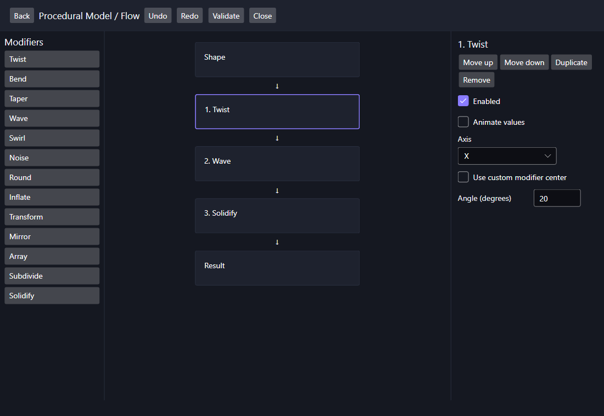

# Procedural models, textures and materials

Create reusable model geometry, GPU-generated textures and materials in the
effect graph. These features are included in the
[2026.11.42 Preview](https://github.com/Libra-Works/LibraFX/releases/tag/v2026.11.42);
use its matching editor and engine SDK. Earlier archives remain unchanged.

This is an editor capture of the authoring workspace, not an engine-rendered
result.

## Create and connect resources

1. In **Node List → Procedural**, add **Procedural Model**, **Procedural
   Texture** or **Procedural Material**. Double-click a producer to open its
   Flow workspace in the main window.
2. In **Procedural Model**, choose a base shape, then add and arrange modifiers.
   They run from top to bottom. Select a step to edit it in the inspector;
   reorder, duplicate, remove and Undo/Redo are supported.
3. Connect the model output to **Model Draw** at `proceduralModel`.
4. Connect texture outputs to a material's `texture0`–`texture3` inputs and use
   **Texture Sample** operations in the material. Connect the material output
   to **Model Draw** at `proceduralMaterial`.

No imported engine mesh or image is required for these generated resources.
Continuous numeric values can also be driven by graph connections.

## Limits and resource behavior

The model flow supports up to 16 modifiers. Static model output is bounded at
65,536 vertices / 131,072 triangles; animated output is bounded at 16,384
vertices / 32,768 triangles. The model pivot resolves against the undeformed
source shape and remains stable while modifiers animate.

Procedural Texture defaults to 256×256 and is bounded at 1024×1024, 32
operations and 8 noise octaves. A material can sample up to four textures.
Initial materials support unlit Alpha or Additive blending and single- or
double-sided geometry. Over-budget recipes report errors instead of silently
truncating geometry or freezing animation.

Identical static resources can share retained outputs across effects. Animated
or externally driven resources keep per-instance state. Normal texture playback
does not read generated pixels back to the CPU.

The bundled `ProceduralSlash.lfxproj`, `ProceduralShockwave.lfxproj` and
`ProceduralBeam.lfxproj` samples require no external mesh or image assets. Use
the target engine preview to inspect their final appearance.

## Verification boundaries

Local engine checks on Windows cover Unity 7000.0.0a16 / D3D11, Godot 4.7.2 /
Vulkan and Unreal 5.7 / D3D11. They exercised generated models, animated frames and
resource cleanup after Stop. Unity also checked shared static output,
suppressed redispatch for unchanged output, independent animation and
dependency lifetime. These editor-host checks do not certify exported players
or Unreal cooking. UE 5.8 / 5.9 and other graphics backends need separate
acceptance.
