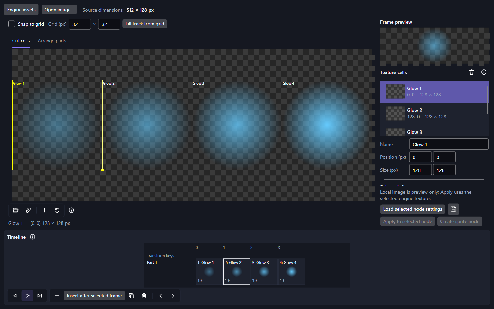

# Animate particle textures

Use **Sprite Animation** to cut an image into cells, arrange frames and apply the animation to **CPU Particle** or **GPU Particle**. Each particle plays the animation using its own age; you do not need to build the frame calculation from nodes.

Before you start, add a particle container and provide a texture that your target engine can resolve. For an initial effect, use [Make a fountain](first-fountain.md).

## 1. Select the particle and open Sprite Animation

1. Select **CPU Particle** or **GPU Particle** in the main graph.
2. Open **Window → Sprite Animation**.
3. To change an existing animation, choose **Load selected node settings** first.

**Check:** you are editing the intended document and particle container. Loading settings reads the animation; applying settings writes it back.

## 2. Load the source image

Use the engine-asset picker when the connected editor supplies a texture catalog. You can also open a local image to edit and preview cells.

A **local image is a preview source**. Applying the animation uses the selected engine texture. Import or bind the same atlas in the engine, with the same pixel dimensions; the local PNG is not automatically embedded in the effect package.

## 3. Cut cells and arrange the track

1. In **Cut cells**, draw a rectangle around each image, then refine its pixel position and size on the right.
2. For an evenly spaced atlas, enter the cell size in **Grid (px)**. Use **Snap to grid** if helpful, then **Fill track from grid**.
3. Select a frame on the bottom **Timeline**. Insert, reorder or remove frames to set the playback order.
4. Set FPS, the playback range and looping. A frame's duration is measured in frames: at 8 FPS, a duration of 2 holds it for 0.25 seconds.

This is the actual **2026.11.72 / LibraDark / English** editor, with an original four-cell example atlas loaded locally. The large area edits cells, the right side previews a frame, and the bottom controls frame order. It shows an editor preview, not particle rendering. Apply is disabled in this disconnected local-image example.

## 4. Preview and apply

1. Play the track and check **Frame preview**. Select a frame to inspect its crop.
2. Check that the engine texture and source dimensions match, then choose **Apply to selected node**.
3. Preview the effect in the connected engine. Check both the first particle and later particles: each should begin its own animation when born.

**Check:** reopen the particle's settings with **Load selected node settings**. The cells, frame order, durations and playback range should be restored.

If applying is unavailable, select the intended compatible node again and check the texture binding. A running frame preview alone does not establish an engine resource binding.

## Layer several parts

Use **Arrange parts** when a frame needs multiple cells, such as a core and a halo. Add parts, arrange their transforms and keys, then preview the composition before applying it. This is different from a simple grid flipbook, which selects one regularly spaced atlas cell at a time.

Both CPU and GPU particles support Sprite editor animations and compositions in the matching release SDK. CPU particles use the drawing-stage settings; GPU particles use the billboard renderer. See [CPU particles](cpu-particles.md) or [GPU particles](gpu-particles.md) for rendering and format limits.

## Next steps

- [Connect to an engine and play the effect](production-workflow.md).
- [Check a missing preview or unexpected result](troubleshooting.md).
